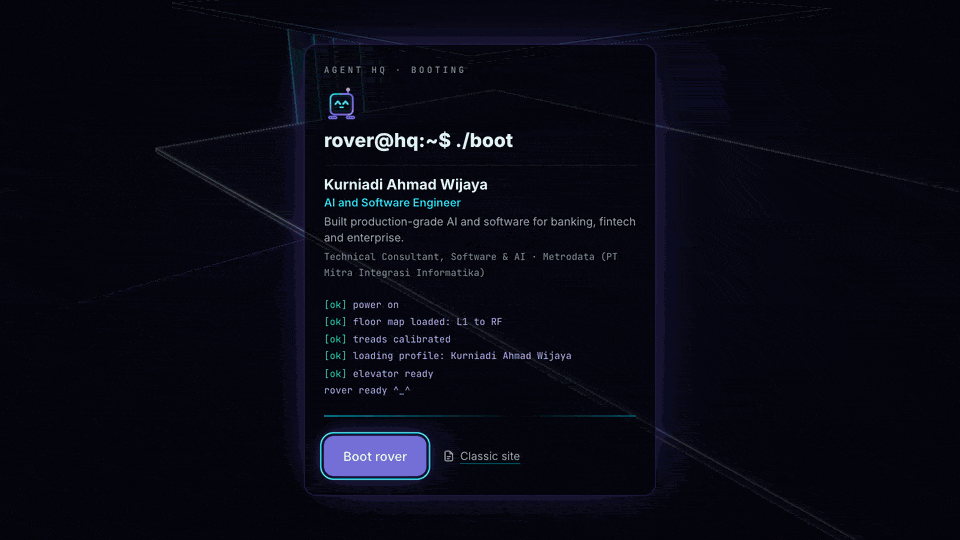
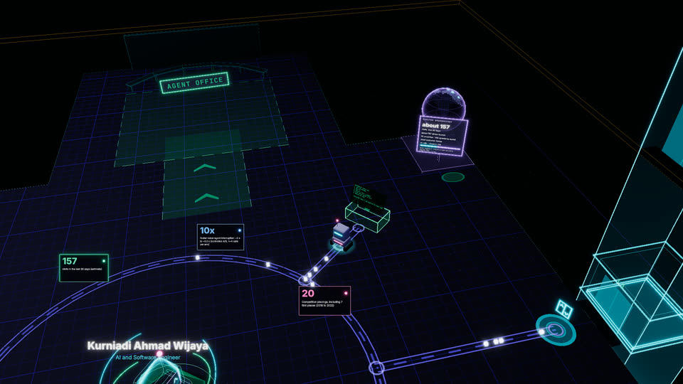
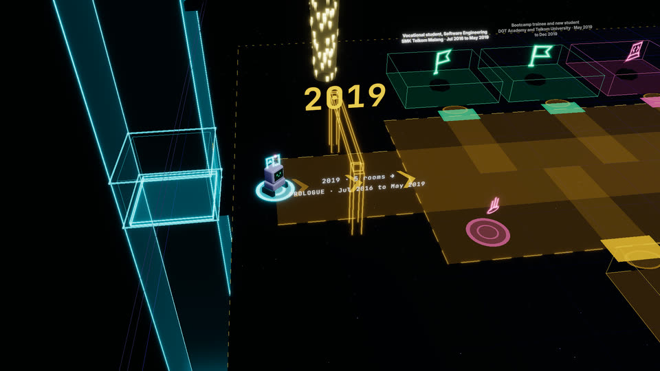
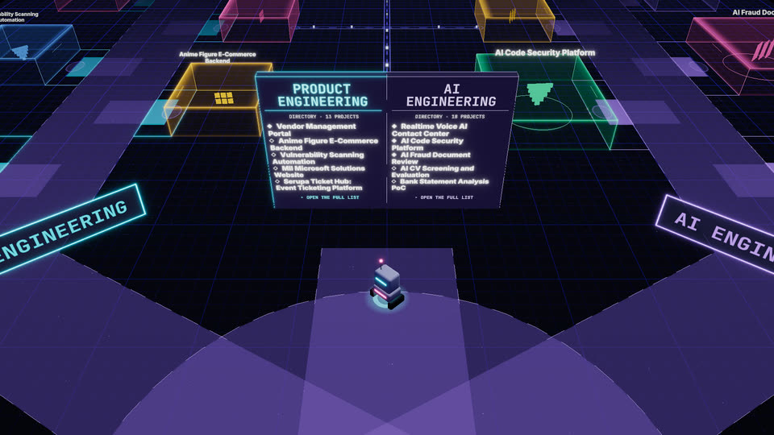
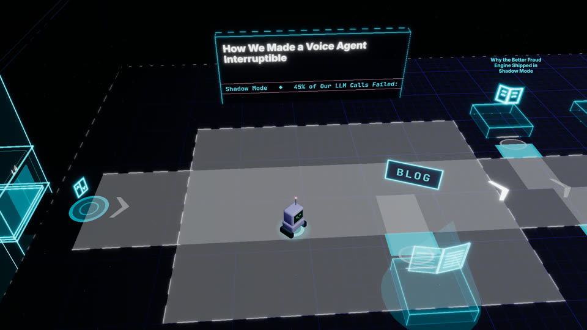
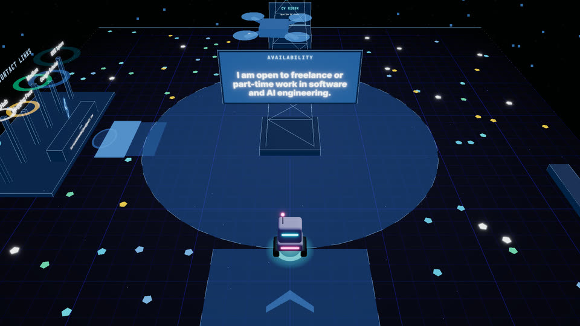
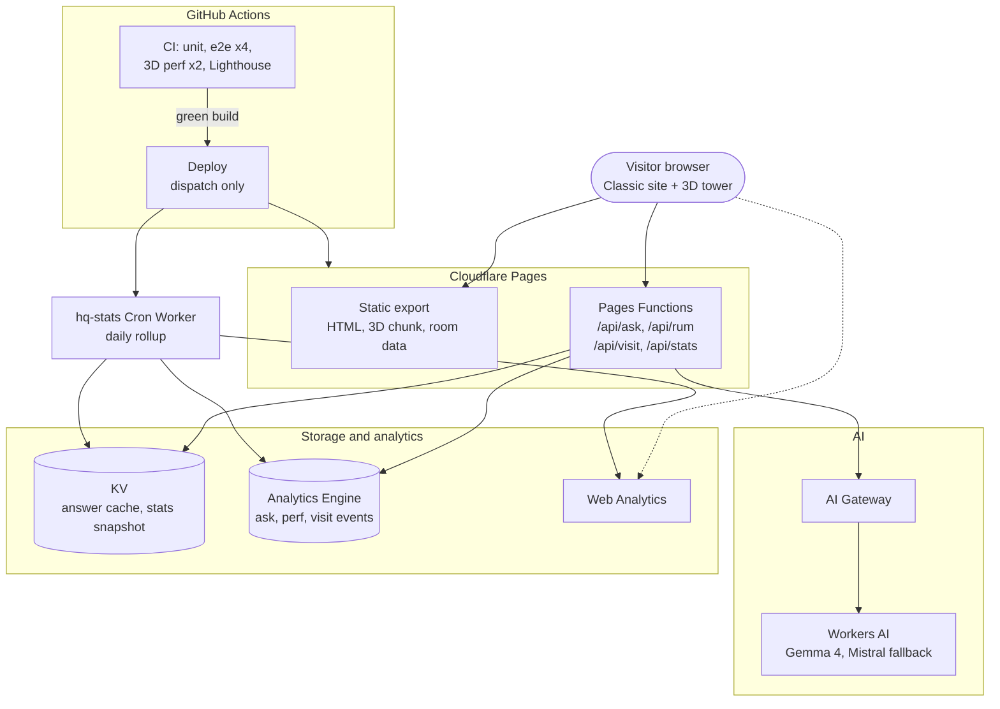

<div align="center">

<a href="https://kurniadi.pages.dev"></a>

# ShinyQ HQ

**The portfolio of Kurniadi Ahmad Wijaya, AI and Software Engineer, built as an explorable 3D neon tower.**

Pilot a small Screen Rover through five floors of projects, career, writing and contact details, or read it all as a fast, accessible website.

[](https://github.com/ShinyQ/ShinyQ-HQ/actions/workflows/ci.yml)
[](https://github.com/ShinyQ/ShinyQ-HQ/actions/workflows/deploy.yml)
[](https://kurniadi.pages.dev)
<br>
[](https://nextjs.org)
[](https://react.dev)
[](https://threejs.org)
[](https://www.typescriptlang.org)
[](https://tailwindcss.com)
[](https://pages.cloudflare.com)
[](https://bun.sh)

**[Live site](https://kurniadi.pages.dev)** · **[Classic site](https://kurniadi.pages.dev/en?view=page)** · **[Ask the HQ](docs/features.md#ask-the-hq-ai-qa)** · **[Features](docs/features.md)** · **[Docs](#docs)**

<br>

<a href="https://kurniadi.pages.dev">
  <picture>
    <source media="(prefers-reduced-motion: reduce)" srcset="docs/readme/hero.jpg">
    
  </picture>
</a>

<sub>Boot, intro, a boosted drive through the Lobby and an elevator ride to L3. Captured from the production build with <code>bun scripts/readme-hero.ts</code>.</sub>

</div>

## Contents

[What is this](#what-is-this) · [Highlights](#highlights) · [The tower](#the-tower) · [Architecture](#architecture) · [Tech stack](#tech-stack) · [Quick start](#quick-start)
· [Routes](#routes) · [Project structure](#project-structure) · [Testing and CI](#testing-and-ci) · [Deploy](#deploy) · [Docs](#docs)

## What is this

ShinyQ HQ ("Agent HQ") is a portfolio you drive through. A small Screen Rover rides a glass elevator between five floors: a Lobby, a 2019 to 2026 Career Road, Project Roads with case-study pods, a Newsroom of writing and research, and a roof deck for contact.

Every piece of content is also a normal, accessible, bilingual (EN / ID) HTML page. That Classic site is the permanent no-WebGL fallback and what crawlers see, so nothing depends on 3D.

## Highlights

- **Walkable 3D tower** in React Three Fiber: roads, plazas, teleporters, a glass elevator and five themed floors.
- **Point-and-go**: hover or tap any glowing object to see its name and drive there; WASD, joystick and Shift boost too.
- **Guided walks** on every floor (Walk my journey, Tour my projects, Read my writing, Meet me, Quick tour).
- **Rover's onboarding**: a handheld-RPG text box tour, "!" hint bubbles and first-visit floor lines.
- **Ask the HQ**: grounded AI Q&A about the work, the career and how this site was built, on Workers AI (Gemma 4, Mistral fallback) with Turnstile, rate limits and output checks.
- **Glass Drawer**: one shared room panel with tabs, galleries, architecture holograms and a README terminal view.
- **Public visit stats**: a daily rollup by a Cron Worker, shown as a hologram globe in the Lobby.
- **Classic site**: static export, Lighthouse-gated (LCP under 2 s), fully bilingual, works without JavaScript.
- **Performance gates in CI**: draw calls, triangles, shader programs, GPU memory and JS bytes on every PR.

## The tower

| | Floor | Route | What is there |
|---|---|---|---|
|  | **L1 Lobby** | [`/en`](https://kurniadi.pages.dev/en) | Profile hologram, stats ring, skills and certification walls, the Ask Rover kiosk and the Visitor Observatory. Behind it, the Highlights Hall. |
|  | **L2 Career Road** | [`/en/journey`](https://kurniadi.pages.dev/en/journey) | One road forward in time: a plaza per year, rooms on both edges, teleporters, and the Workshop with a repo skyline. |
|  | **L3 Project Roads** | [`/en/labs`](https://kurniadi.pages.dev/en/labs) | Product Engineering, AI Engineering and Data and ML wings, the Tech Reactor and the Ops Control Room. |
|  | **L4 Newsroom** | [`/en/library`](https://kurniadi.pages.dev/en/library) | Headline wall, a timeline lane of posts, research, models and talks desks, and the Topic Constellation. |
|  | **RF Roof deck** | [`/en/contact`](https://kurniadi.pages.dev/en/contact) | Comms mast with the availability sign, contact station, CV kiosk and a courier drone. |

Controls, floor-by-floor details and the full status log: **[docs/features.md](docs/features.md)**.

## Architecture



- **Content is data**: `content/site-content.json` (zod-validated, every string `{ en, id }`) generates pages, rooms, pods and missions.
- **Static first**: `output: "export"`, no server runtime. The 3D tower is a lazy client chunk portaled over the HTML page, which stays the SEO and no-WebGL tier.
- **One store, one intent bus**: input sources emit intents, a Director drives the elevator, rover and store each frame; the HUD talks to the scene only through the store.
- **AI behind a pipeline**: kill switch, Turnstile, rate limits, PII scrub, retrieval from a build-time knowledge pack, model call, output checks, KV cache.
- **Anonymous stats**: beacons write to Analytics Engine; a Cron Worker rolls up finalized UTC days into one KV snapshot.

## Tech stack

| Layer | Technology |
|---|---|
| Framework | Next.js 16 (App Router, static export), React 19, TypeScript strict |
| 3D | three.js, React Three Fiber, drei, postprocessing, troika text |
| State and i18n | zustand, next-intl, zod, MDX (next-mdx-remote) |
| Styling | Tailwind CSS 4, Neon Grid design tokens, self-hosted subset fonts |
| Edge and AI | Cloudflare Pages, Pages Functions, Workers AI, AI Gateway, KV, Analytics Engine, Turnstile, Cron Worker |
| Testing | Vitest, Testing Library, Playwright (WebGL on SwiftShader), Lighthouse CI |
| Tooling | Bun 1.4.1, ESLint, wrangler, GitHub Actions, gitleaks, Dependabot |

## Quick start

Prerequisites: [Bun](https://bun.sh) 1.4.1 (`packageManager` in `package.json`) and Chromium for the e2e tests.

```bash
bun install
bunx playwright install chromium   # needed for the e2e tests
bun run dev                        # http://localhost:3000/en
```

Build and serve the static export like Cloudflare Pages does:

```bash
bun run build                      # static export to out/
bun run serve                      # http://127.0.0.1:4173/en
```

### Scripts

| Script | What it does |
|---|---|
| `bun run dev` | Next.js dev server |
| `bun run build` | Static export to `out/`, plus the Ask knowledge pack and post-build checks |
| `bun run serve` | Serve `out/` with Cloudflare Pages style resolution |
| `bun run typecheck` | Generate route types and run `tsc` |
| `bun run lint` | ESLint |
| `bun run test` | Vitest unit, content and safety tests |
| `bun run verify:quick` | Typecheck, lint, unit tests, build and social-card check: the pre-push check |
| `bun run e2e:changed` | Playwright specs that cover your changed paths (`--dry` prints the plan) |

<details>
<summary><b>All scripts</b></summary>

| Script | What it does |
|---|---|
| `bun run build:web` | Same as `build`, kept as an alias |
| `bun run test:watch` | Vitest in watch mode |
| `bun run bench` | Vitest benches (`tests/bench/`): `findPath` on the real floor layouts and palette typing against the pre-round-5 code; numbers for PR bodies, never a CI gate |
| `bun run e2e` / `e2e:full` | Playwright against `out/` (run a build first): static routes plus the 3D experience on SwiftShader WebGL (tests force `?tier=`) |
| `bun run e2e:smoke` | Fast subset: static routes, SEO, deploy rules, game-first load, Page View |
| `bun run e2e:shard i/N` | One duration-balanced CI shard (`--dry` prints the plan) |
| `bun run e2e:perf` | 3D perf lane: bytes, floors, peaks, full-tier memory (`e2e/perf/`) |
| `bun run e2e:perf:shard i/N` | One perf lane CI shard |
| `bun run e2e:durations` | Refresh `e2e/durations.json` from recent green CI runs (needs `gh`) |
| `bun run e2e:timeline` | Nightly game-first timeline trend |
| `bun run e2e:look` | Local look check of the canvas against a main build |
| `bun run screenshots` | HTML pages and 3D captures at 1440x900, 1024x1366 and 390x844 into `screenshots/` |
| `bun run screenshots:pages` | Page View captures plus the landing at 1440x900, 834x1112 and 390x844 |
| `bun run validate:content` | Schema and safety check for `content/site-content.json` |
| `bun run build:knowledge` | Build the Ask knowledge pack only |
| `bun run cv:pages` | Render the CV PDF to page images (needs poppler and webp) |
| `bun run paper:pages` | Check and render the paper PDFs to page images (see [docs/content.md](docs/content.md#paper-pdfs)) |
| `bun run floor:thumbs` | Elevator picker thumbnails `public/floors/*.webp` from every floor's start spot (after a build, needs `cwebp`) |
| `bun run og:stills` | Share card backgrounds `public/og-assets/floor-*.jpg` at 1200x630; `--photo <png>` refreshes the owner's photo |
| `bun run og:check` | Social-card check over `out/`: titles, 140 to 160 character descriptions, canonical, hreflang, Open Graph, Twitter, share images |
| `bun run ask:eval` | Golden and red-team runs against the real models |
| `bun scripts/readme-hero.ts` | Re-capture this README's hero GIF and floor stills from `out/` (needs ffmpeg and gifsicle) |

</details>

## Routes

All routes are locale-prefixed (`/en/...`, `/id/...`). `/` redirects by the remembered or browser language.

| Route | Classic site | In 3D |
|---|---|---|
| `/{locale}` | Hero, stats ticker, featured projects, intro, journey, writing, skills, certifications | L1 Lobby and the Highlights Hall (`#highlights-<station>`) |
| `/{locale}/quick` | Quick view: everything on one page | |
| `/{locale}/journey`, `/journey/{slug}` | Career Archive 2019 to 2026 and the Workshop | L2 Career Road; a slug opens that room |
| `/{locale}/labs`, `/labs/{slug}` | Case studies, `?wing=software\|ai\|data` filter | L3 Project Roads; a slug opens that pod |
| `/{locale}/library`, `/blog/{slug}` | Blog, publications, models, talks, `?topic=` filter | L4 Newsroom with the "Read my writing" walk |
| `/{locale}/contact` | About, contact, "How I run AI in production", visit stats, CV, certifications | RF roof deck with the "Meet me" walk |
| `/{locale}/cv` | CV viewer with zoom, download and open in new tab | Opens as a modal from every CV button |
| `/api/ask` | Ask the HQ: `GET` status, `POST` question, SSE answer | |
| `/api/stats` | Daily public visit stats snapshot (200 or 204) | |

Section anchors, filters and deep links per route: [docs/features.md](docs/features.md#routes).

## Project structure

```text
content/         dataset, blog MDX, Ask suggestions, perspectives, blocklists, generated facts
messages/        UI strings (en, id)
functions/       Cloudflare Pages Functions: /api/ask, /api/rum, /api/visit, /api/stats
workers/stats/   hq-stats Cron Worker: daily public visit stats rollup into KV
src/
  app/           routes ([locale] pages, "/" redirect, OG cards, 404)
  components/    Classic site UI, modals, CV and paper viewers
  content/       schema, accessors, selectors, room views, safety lint
  experience/    3D tower: scene, floors, rover, camera, input, nav, missions, walks
  hud/           HTML HUD over the canvas: drawer, dialog, Ask dock, pickers
  ask/           Ask client, protocol, knowledge pack
  lib/ store/ i18n/
scripts/         build steps, static server, e2e planning, renderers, evals, provisioning
tests/           Vitest unit, content, HUD and Ask tests
e2e/             Playwright suites, budgets and the perf lane
docs/            features, content guide, design specs, plans, deploy, runbooks
```

The full annotated layout is in [`AGENTS.md`](AGENTS.md#folder-layout).

## Testing and CI

- **Locally**: `bun run verify:quick` then `bun run e2e:changed` before every push (about 5 minutes). Add `bun run e2e:perf` when touching the render path.
- **CI** (`ci.yml`): check and build in parallel, Playwright in 4 shards and the 3D perf gates in 2 shards against one build, plus a blocking Lighthouse CI job. `main` accepts changes only through PRs with green checks.
- **Nightly**: Ask evals against the real models, the game-first timeline trend and screenshots; weekly live facts and content-gap reports.

| Gate | Budget |
|---|---|
| Scene draw calls per floor | under 150 (L1 at most 125) |
| Post-processing passes | at most 20 |
| Triangles per floor | under 30k |
| JS after the 3D gate | under 450 KB gzip per tier |
| Shader programs | committed baseline + 2 |
| GPU memory | round trips return to baseline |
| Lighthouse (Classic site) | LCP under 2 s, CLS under 0.01, TBT under 200 ms |
| Page weight (Classic site) | fonts 60 KB, HTML 80 KB, CSS 20 KB, JS 240 KB |

Details: [docs/features.md](docs/features.md#performance) and [`AGENTS.md`](AGENTS.md#fast-verification).

## Deploy

Production is the Cloudflare Pages project `kurniadi` at [kurniadi.pages.dev](https://kurniadi.pages.dev).
`deploy.yml` runs on dispatch (or after the weekly live-facts merge), reuses CI's green result for the commit, deploys `out/` plus `functions/`, smoke-checks production and deploys the `hq-stats` Worker. A push to `main` never deploys on its own.

Secrets, variables, Cloudflare resources and budgets: [docs/deploy.md](docs/deploy.md).

## Docs

| Doc | What it covers |
|---|---|
| [`docs/features.md`](docs/features.md) | Every feature floor by floor, controls, Ask the HQ, CI, performance, status log |
| [`docs/content.md`](docs/content.md) | Dataset, posts, galleries, certifications, CV and paper PDFs, public-safety lint |
| [`AGENTS.md`](AGENTS.md) | Repo conventions for contributors and agents: hard rules, folder layout, content style, fast verification |
| [Design spec](docs/superpowers/specs/2026-10-09-agent-hq-design.md) | Agent HQ design and appendices `agent-hq/01..08` |
| [Ask the HQ design](docs/superpowers/specs/2026-10-11-ask-hq-design.md) | Models, security threat model, data freshness |
| [`docs/superpowers/plans/`](docs/superpowers/plans/) | Implementation plans, one per feature PR |
| [`docs/deploy.md`](docs/deploy.md) | Deploys, secrets and variables, analytics, Cloudflare resources, Lighthouse budgets, headers |
| [`docs/ask-runbook.md`](docs/ask-runbook.md) | Ask the HQ operations: provisioning, kill switch, cache purge, secret rotation, evals |
| [`workers/stats/README.md`](workers/stats/README.md) | hq-stats Cron Worker runbook |
| [`docs/perf/r5-gpu.md`](docs/perf/r5-gpu.md) | GPU timing measurements on real hardware |

---

<div align="center">

**Kurniadi Ahmad Wijaya** · AI and Software Engineer

[Website](https://kurniadi.pages.dev) · [LinkedIn](https://www.linkedin.com/in/kurniadiwijaya) · [GitHub](https://github.com/ShinyQ) · [Hugging Face](https://huggingface.co/ShinyQ)
· [Medium](https://kurniadiahmadwijaya.medium.com/) · [Google Scholar](https://scholar.google.com/citations?user=u8OY1foAAAAJ)

</div>
