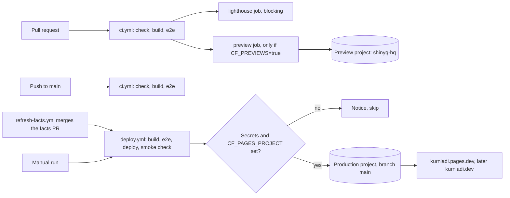

# Deploying ShinyQ HQ

The site is a Next.js static export (`out/`) plus the Ask the HQ Pages Function (`functions/`), hosted on Cloudflare Pages and uploaded with `wrangler pages deploy` (Direct Upload). Since 2026-10-11 production deploys run from GitHub Actions (`deploy.yml`) in exactly two cases: automatically after the weekly live-facts PR merges (`refresh-facts.yml` dispatches it), and when someone runs the workflow by hand. A push to `main` never deploys by itself. The manual local deploy below still works.

## Current state (production cutover, 2026-10-09)

| Item | Value |
| --- | --- |
| Production project | `kurniadi`, Direct Upload, production branch `main` |
| Production URL | https://kurniadi.pages.dev |
| Preview project | `shinyq-hq`, Direct Upload, production branch `production-cutover-phase-6` (never pushed, so every deploy is a preview) |
| Repository variable | `CF_PAGES_PROJECT=kurniadi` (set) |
| Repository secrets | `CLOUDFLARE_API_TOKEN` (account-owned token "shinyq-hq Pages deploy", Cloudflare Pages Edit only, expires 2027-01-09) and `CLOUDFLARE_ACCOUNT_ID`, set on 2026-10-11 |
| Repository variables | `CF_BEACON_TOKEN` (Web Analytics site `kurniadi.pages.dev`, manual snippet, site tag `4134db56168b4eb58d19fc1ead78b131`); `AUTO_DEPLOY_FACTS` unset (on); `CF_PREVIEWS` unset (PR previews off) |

The old Git-connected `kurniadi` project (old site repository, `npm run build` to `dist`) was deleted and recreated as a Direct Upload project with the same name (Option A below). Its source is still in the old site repository if it is ever needed again.

Notes:

- Per-deployment URLs such as `https://<hash>.kurniadi.pages.dev` are behind an existing Cloudflare Access application (account level, not part of the Pages project). Only `kurniadi.pages.dev` itself is public.
- Web Analytics: the manual-snippet site for `kurniadi.pages.dev` (created 2026-10-11) feeds `CF_BEACON_TOKEN`, which only production builds use (`deploy.yml`, or the manual command below). CI, screenshot and e2e builds never render the beacon, so test runs are not counted and the e2e cross-origin guard stays strict. Do not also turn on automatic Web Analytics for the Pages project, or every visit counts twice. The other Web Analytics site (`kurniadi.dev`, automatic) covers the custom domain zone.

## Deploy from GitHub Actions (preferred)

```sh
gh workflow run deploy.yml --ref main                       # tip of main
gh workflow run deploy.yml --ref main -f sha=<commit on main> -f reason="why"
gh run watch
```

Or Actions > Deploy > Run workflow. `deploy.yml` checks that the commit is on `main`, then `Reuse the CI result` (`scripts/ci-status.ts`) looks for CI's `Build, CV and e2e` check on that commit: green means no e2e rerun; still running means it waits (up to 40 minutes, for as long as a CI run on the commit is unfinished); red fails the deploy. A commit without its own CI run (the weekly facts merge, made with `GITHUB_TOKEN`) reuses a green CI run on a commit with the same tree (the facts PR CI tested). With no CI result at all (no CI run registered on the commit after a 3-minute grace), or with `-f rerun_e2e=true`, it builds without the beacon and runs the 4 e2e shards first, as before. It builds with `CF_BEACON_TOKEN` for production, rebuilds the Ask knowledge pack in the deploy job, runs `wrangler pages deploy out --branch=main`, then `scripts/deploy-smoke.ts`: `GET /api/ask` must be enabled with the pack date of that commit, `GET /api/rum` must answer 405 (the beacon Function only accepts POST), and `/en` must return 200 with the commit's live contributions number and the beacon. It retries for up to 5 minutes while the production alias switches. Any failure opens (or comments on) the `deploy-failed` issue; production keeps serving the previous deployment.

## Automatic deploy after the weekly facts refresh

`refresh-facts.yml` (Mondays 02:00 WIB) merges the live-facts PR only after CI passed on it, then dispatches `deploy.yml` for the merge commit, so the stats ring, Page View and Ask show the new numbers without anyone deploying by hand. Nothing else deploys automatically: ordinary pushes and merges to `main` do not, and PR previews stay off unless the variable `CF_PREVIEWS=true` is set.

- Turn the automatic deploy off: `gh variable set AUTO_DEPLOY_FACTS --body false` (the facts PR still merges; deploy by hand later). Turn it back on: `gh variable delete AUTO_DEPLOY_FACTS`.
- Turn every Actions deploy off: `gh secret delete CLOUDFLARE_API_TOKEN` (the deploy job then skips with a notice; the manual local deploy keeps working).
- Token rotation: "shinyq-hq Pages deploy" expires on 2027-01-09. Before then, create a new account-owned token with Cloudflare Pages Edit only (section 2, or the `cf accounts tokens create` command in `docs/ask-runbook.md` section 8 with the Pages Write permission group `8d28297797f24fb8a0c332fe0866ec89`), pipe it into `gh secret set CLOUDFLARE_API_TOKEN`, run one deploy, then delete the old token.

## Manual local deploy

From a clean checkout of `main`, with `wrangler` logged in to the account that owns the project (`bunx wrangler@4 login`, once). Run it from the repo root so `functions/` and `wrangler.toml` are included:

```sh
git switch main && git pull
bun install --frozen-lockfile
bun run typecheck && bun run lint && bun run test
CF_BEACON_TOKEN=$(gh variable get CF_BEACON_TOKEN)
NEXT_PUBLIC_SITE_URL=https://kurniadi.pages.dev NEXT_PUBLIC_CF_BEACON_TOKEN="$CF_BEACON_TOKEN" bun run build
bunx wrangler@4 pages deploy out --project-name=kurniadi --branch=main \
  --commit-hash="$(git rev-parse HEAD)" --commit-message="$(git log -1 --format=%s)" --commit-dirty=true
NEXT_PUBLIC_CF_BEACON_TOKEN="$CF_BEACON_TOKEN" bun scripts/deploy-smoke.ts
```

Run `bun run e2e` on a build without the beacon if you want the e2e suite: its cross-origin guard flags the analytics requests by design. `--branch=main` matches the production branch, so the upload goes live on `kurniadi.pages.dev` at once (previews get no Ask secrets, so Ask stays off there). Then run the checks in section 5, step 3.

## Overview

| Trigger | Workflow | Cloudflare project | Result |
| --- | --- | --- | --- |
| Pull request from this repo, only with `CF_PREVIEWS=true` | `ci.yml` job `preview` | `CF_PREVIEW_PROJECT` (default `shinyq-hq`) | Preview URL `pr-<n>.<project>.pages.dev` |
| Weekly facts PR merged (`refresh-facts.yml`), or manual run | `deploy.yml` (`workflow_dispatch` only) | `CF_PAGES_PROJECT` (`kurniadi`) | Production at `SITE_URL` (default `https://kurniadi.pages.dev`), smoke-checked |
| Push to `main` | `ci.yml` only | none | Checks; no deploy |
| Every CI run | `ci.yml` job `lighthouse` (`Lighthouse CI`) | none | Lighthouse budgets (blocking) and reports as an artifact |



`ci.yml` still runs typecheck, lint and unit tests on every push to `main`. `deploy.yml` runs its own build, the e2e suite and a post-deploy smoke check, and opens a `deploy-failed` issue when anything fails.

## 1. Choose the Pages project

Done for production on 2026-10-09 (see "Current state"); kept for reference. The production URL `kurniadi.pages.dev` belongs to the Cloudflare Pages project named `kurniadi`. A `*.pages.dev` subdomain is tied to the project name and cannot be moved to another project. Deleting a project frees its name at once: the cutover deleted and recreated `kurniadi` within seconds.

### Option A: reuse `kurniadi` (keeps kurniadi.pages.dev)

1. In the Cloudflare dashboard open Workers & Pages, then the `kurniadi` project, then Settings.
2. Check how it is deployed:
   - **Direct Upload project** (no Git repository shown under Settings > Builds): wrangler can deploy to it as is. Go to step 3.
   - **Git-connected project** (connected to the old site repository): wrangler Direct Upload is not allowed into a Git-integrated project. Cloudflare does not let you convert it, so the clean path is:
     1. Back up the old site first: download the latest deployment (or keep the old repository and its build command) so you can recreate it.
     2. Delete the `kurniadi` project (Settings > Delete project). This frees the name and the `kurniadi.pages.dev` subdomain. The old site is offline from this point until the first deploy.
     3. Recreate it immediately as a Direct Upload project with the same name:
        ```sh
        bunx wrangler@4 pages project create kurniadi --production-branch=main
        ```
     4. Run the first deploy (section 5) right away to keep the downtime short.
3. Make sure the production branch is `main` (Settings > Builds and deployments > Production branch, or recreate with `--production-branch=main`). If it is anything else, deploys from `deploy.yml` are published as previews and the production URL does not change.

Rollback note: if the new site has a problem after the cut-over, use the dashboard rollback (section 6). If you need the old site back entirely, redeploy the backup to the same project with `bunx wrangler@3 pages deploy <backup-dir> --project-name=kurniadi --branch=main`.

### Option B: create a new project

Use this to try production deploys without touching the old site, then switch later.

```sh
bunx wrangler@3 login
bunx wrangler@3 pages project create <name> --production-branch=main
```

The site is then served at `https://<name>.pages.dev`. Set `SITE_URL` to that URL (section 4) so canonical links and the sitemap match.

## 2. Create an API token and find the Account ID

1. Cloudflare dashboard > My Profile > API Tokens > Create Token > Create Custom Token.
2. Permissions: **Account**, **Cloudflare Pages**, **Edit**.
3. Account Resources: Include, your account (account scope, no zone needed).
4. Create the token and copy it once.
5. Account ID: Workers & Pages overview page, right sidebar ("Account ID"), or the dashboard URL `dash.cloudflare.com/<account-id>/...`.

## 3. GitHub repository secrets

Settings > Secrets and variables > Actions > Secrets, or with `gh`:

```sh
gh secret set CLOUDFLARE_API_TOKEN      # paste the token from step 2
gh secret set CLOUDFLARE_ACCOUNT_ID     # paste the account id
gh secret set SAFETY_BLOCKLIST < content/.safety-blocklist.local.txt   # optional, existing
```

| Secret | Required | Purpose |
| --- | --- | --- |
| `CLOUDFLARE_API_TOKEN` | Yes, for any deploy | Pages Edit token used by wrangler |
| `CLOUDFLARE_ACCOUNT_ID` | Yes, for any deploy | Cloudflare account that owns the projects |
| `SAFETY_BLOCKLIST` | Optional | Private public-safety blocklist terms (private repo and cloud resource names) used by the content tests and the e2e scan of `out/`; product names in `content/safety-allowlist.txt` are dropped from it |

## 4. GitHub repository variables

Settings > Secrets and variables > Actions > Variables, or with `gh`:

```sh
gh variable set CF_PAGES_PROJECT --body kurniadi
gh variable set CF_PREVIEW_PROJECT --body shinyq-hq            # optional
gh variable set SITE_URL --body https://kurniadi.pages.dev     # optional
gh variable set CF_BEACON_TOKEN --body <web-analytics-token>   # set on 2026-10-11
gh variable set AUTO_DEPLOY_FACTS --body false                 # optional: stop the weekly auto-deploy
gh variable set CF_PREVIEWS --body true                        # optional: turn PR previews on
```

| Variable | Required | Purpose |
| --- | --- | --- |
| `CF_PAGES_PROJECT` | Yes, to enable production deploys | Production Pages project name. While unset, `deploy.yml` builds and tests but skips the upload. |
| `CF_PREVIEW_PROJECT` | Optional | Project for PR previews. Defaults to `shinyq-hq` (created automatically with a production branch that is never pushed, so every deploy stays a preview). |
| `SITE_URL` | Optional | Public origin baked into canonical URLs, `hreflang`, sitemap, robots and OG URLs (`NEXT_PUBLIC_SITE_URL`). Defaults to `https://kurniadi.pages.dev`. Set to `https://kurniadi.dev` after the domain move. |
| `CF_BEACON_TOKEN` | Optional | Cloudflare Web Analytics site token (`NEXT_PUBLIC_CF_BEACON_TOKEN`), read only by `deploy.yml` production builds. When empty, no beacon is rendered. |
| `AUTO_DEPLOY_FACTS` | Optional | `false` stops `refresh-facts.yml` from dispatching `deploy.yml` after it merges a facts PR. |
| `CF_PREVIEWS` | Optional | `true` turns on the PR preview job in `ci.yml` (off by default). |

Web Analytics token: `cf rum site-info create --host <host> --auto-install=false` (how the `kurniadi.pages.dev` site was created; the token is public, it ships in every page), or Cloudflare dashboard > Analytics & Logs > Web Analytics > Add a site, choose the manual JS snippet, and copy the `token` value from the snippet. Alternatively enable automatic Web Analytics on the Pages project (Pages project > Metrics) and leave `CF_BEACON_TOKEN` unset. Use one or the other, not both, or every visit is counted twice.

The Content-Security-Policy in `public/_headers` already allows `static.cloudflareinsights.com` (script) and `cloudflareinsights.com` (beacon reports).

## 5. First deploy

1. Run the workflow: Actions > Deploy > Run workflow (or `gh workflow run deploy.yml --ref main`). Merging to `main` does not deploy.
2. Follow the run: `gh run watch`. The `deploy` job shows the deployment URL in its summary and the `production` environment links to `SITE_URL`.
3. Verify (replace the host if you use another project):

```sh
HOST=https://kurniadi.pages.dev
curl -sI "$HOST/" | head -n1                         # 200, static language redirect page
curl -sI "$HOST/en" | head -n1                       # 200
curl -sI "$HOST/id" | head -n1                       # 200
curl -sI "$HOST/cv.pdf" | grep -iE '^(HTTP|location)' # 301 to /cv/kurniadi-ahmad-wijaya-cv.pdf
curl -sI "$HOST/cv/kurniadi-ahmad-wijaya-cv.pdf" | grep -iE '^(HTTP|content-type|x-frame-options)' # 200, application/pdf, SAMEORIGIN
curl -s "$HOST/sitemap.xml" | head -n5               # URLs use SITE_URL
curl -s "$HOST/robots.txt"
curl -sI "$HOST/og/en.png" | grep -i content-type    # image/png (share card)
curl -sI "$HOST/en" | grep -iE 'content-security-policy|strict-transport|x-frame-options'
```

Then open `/` in a browser (it redirects to `/en` or `/id`), switch languages, and check the browser console for CSP violations.

## 6. Rollback

- Fastest: Cloudflare dashboard > Workers & Pages > project > Deployments, pick an earlier production deployment, then Rollback to this deployment. No rebuild needed.
- From GitHub: `gh workflow run deploy.yml --ref main -f sha=<earlier commit on main> -f reason=rollback`. Or revert the commit on `main` and run the workflow (a revert alone does not deploy).

## 7. Custom domain kurniadi.dev (later)

Status (2026-10-11): the `kurniadi.dev` zone is active on Cloudflare, but the domain is on Indonesia's TrustPositif blocklist (likely from a previous owner): Indonesian ISPs answer its DNS with a block page and intercept plain DNS to outside resolvers, so no Cloudflare setting can fix it for Indonesian visitors. Before moving production to the domain, point it at the Pages project (step 1) so it shows the portfolio, then request delisting ("normalisasi") at https://trustpositif.komdigi.go.id/normalisasi (or normalisasi@aduankonten.id). Until it is delisted, keep `kurniadi.pages.dev` as the canonical origin and do not redirect to the domain.


1. Pages project > Custom domains > Set up a custom domain: add `kurniadi.dev`, and `www.kurniadi.dev` if wanted.
2. DNS: if the zone is on Cloudflare, Pages creates the records for you. Otherwise add `CNAME kurniadi.dev -> <project>.pages.dev` (the apex works through CNAME flattening when the zone is on Cloudflare; other DNS hosts need ALIAS/ANAME support) and `CNAME www -> <project>.pages.dev`.
3. `gh variable set SITE_URL --body https://kurniadi.dev`, then redeploy (`gh workflow run deploy.yml --ref main`) so canonical URLs, `hreflang`, the sitemap and OG URLs use the new origin.
4. Optional: send `kurniadi.pages.dev` to the custom domain with a Cloudflare Bulk Redirect (Rules > Redirect Rules > Bulk Redirects, source `kurniadi.pages.dev`, target `https://kurniadi.dev`, preserve path and query). `_redirects` cannot do this because it cannot match on host names.
5. Optional: redirect `www.kurniadi.dev` to the apex with a Redirect Rule in the zone.

## 8. Lighthouse CI

- Job `lighthouse` (check name `Lighthouse CI`) in `ci.yml` runs after the `site` build on every PR and push. It downloads the `site` artifact, serves it with `scripts/serve-static.ts` on port 4320 and runs `@lhci/cli` (pinned in the workflow) with `lighthouserc.json`.
- Pages: a warm-up run of `/en?lhci-warmup=1` (never asserted; it absorbs the cold first Chrome and server run that used to spike `/en` TBT), then `/en`, `/en/quick`, `/en/journey`, `/en/labs/voice-ai-contact-center`, 3 runs each, Lighthouse default mobile profile (simulated 4G, mid-range device). Assertions live in one `assertMatrix` entry for URLs without a query string.
- Budgets (tighter than appendix 08 since the October 2026 performance pass): LCP under 2000 ms, CLS under 0.01, TBT under 200 ms (error level, median run); transfer bytes per page at most 60 KB of fonts, 80 KB of HTML, 20 KB of CSS and 240 KB of JavaScript (error level); performance score at least 0.9, accessibility at least 0.9 and SEO at least 0.9 (warn level).
- Reports: the run summary lists the assertion results, and the HTML and JSON reports are in the `lighthouse-reports` artifact (Actions run > Artifacts). Reports are written to the filesystem only and are never uploaded to public temporary storage.
- Per-chunk diff: after the run, `scripts/perf-base.sh` downloads `lighthouse-reports` of the last green `main` push run and `bun scripts/perf-summary.ts lhci` writes "Page View JavaScript per chunk" to the job summary: total per page, share of the 240 KB budget (a warning at 90%), and the chunks added or removed against main (names are content hashes, so a changed chunk shows as one removed and one added row). The 3D side (3D JS after the gate, floors, peaks, memory) is in the `Build, CV and e2e` job summary, from the `3D perf gates` job (appendix 08 section 2).
- Local run after `bun run build:web`: `bunx @lhci/cli@0.15.1 autorun` (needs a local Chrome), then open `.lighthouseci/*.report.html`.
- Blocking: a failed error-level budget fails `Lighthouse CI`, and the aggregate `Build, CV and e2e` job (the required check) needs it, so a PR cannot merge over budget. Branch rules may also list `Lighthouse CI` directly.
- LCP is simulated (Lantern): the slow-4G model counts every request that finished before the observed paint, so the bytes of the HTML, the CSS and the preloaded fonts decide it (the text paints before any JavaScript runs). Keep these measures when changing fonts, the layout or the build:
  - The preloaded fonts are self-hosted cuts narrowed to the axes, characters and OpenType features the site uses (`src/assets/fonts/README.md`, `scripts/subset-fonts.sh`, about 55 KB for all three; `tests/content/fonts.test.ts` checks coverage and the budget).
  - `scripts/defer-scripts.ts` (run by `bun run build`) requests the Next.js chunks only after the first contentful paint.
  - Client props of the locale layout are inlined into every HTML file (RSC payload). Large client data goes into a static file under `/data/` instead: the Glass Drawer content (`/data/rooms/{locale}.json`) and the HUD index (`/data/hud/index.json`, fetched by `MissionHud` after hydration).
  - Always-loaded client islands import only small modules: the Ask status from `src/ask/status.ts` (not the Turnstile and SSE client), certification helpers from `src/content/certs.ts` (the tech logo registry stays in the server-only `cert-views.ts`).
  - The landing's motion is CSS only and compositor only (`src/app/landing.css`): the backdrop has no image or text, so the `h1` stays the LCP element; featured images load lazily below the first screen; "Enter the 3D HQ" is shown by `html[data-hq-3d]` from the head script, never by client state, so it cannot shift the layout.
  - Elements that appear after first paint on their own must not move content or cover the landing: the Rover Terminal never opens on its own over the Page View (the 3D Lobby opens it after the intro), and its greeting types into reserved space.
- Medians at the time of writing (round 5 P1, local `lhci collect` with the warm-up URL, 3 runs, 2026-10-13): LCP `/en` 1.81 s, `/en/quick` 1.81 s, `/en/journey` 1.67 s, the pod page 1.66 s; CLS 0; TBT 38 to 61 ms; script transfer 204 to 207 KB. Production adds the real TTFB of Cloudflare Pages (simulated at 50 to 500 ms).

## 9. Headers and redirects

Files in `public/` are copied to `out/` by `next build`, and Cloudflare Pages reads `out/_headers` and `out/_redirects`.

`public/_headers`:

- `/*`: security headers (`X-Content-Type-Options`, `Referrer-Policy`, `X-Frame-Options`, `Permissions-Policy`, `Strict-Transport-Security`, `Cross-Origin-Opener-Policy`) and a Content-Security-Policy. `script-src` needs `'unsafe-inline'` because the static export inlines Next.js hydration data, the root language redirect script and JSON-LD. `blob:` is allowed for workers and media used by WebGL and audio.
- `/_next/static/*`: one year, `immutable` (file names are content hashed; this also covers the self-hosted `next/font` files).
- `/cv/*`: the CV PDF and its page images (`/cv/pages/*.webp`, shown by the in-site CV viewer; nothing frames the PDF any more). The rule, kept from the former iframe preview, detaches the site-wide `Content-Security-Policy` and `X-Frame-Options` (`! Header`) and sets `frame-ancestors 'self'` and `SAMEORIGIN` instead: same-origin framing only. The site CSP allows it with `frame-src 'self'` and keeps `object-src 'none'`.
- Caching of unhashed files: `/brand/*` one week; `/fonts/*` one year `immutable` (troika cuts are content-hashed, Task 4 of round 5 P1); `/tech/*` one week plus `stale-while-revalidate` one day; `/media/*`, `/floors/*`, `/logos/*` one day plus `stale-while-revalidate` one week; `/cv/*` one hour and `/papers/*` one day, both `must-revalidate` so a replaced CV or paper never shows stale; `/og/*` one day. Two rules must never both set `Cache-Control` for one file (Cloudflare joins the values; `tests/unit/cache-headers.test.ts`). `scripts/deploy-smoke.ts` checks one file per prefix after each deploy. Splats only work at the end of a path, so per-route images such as `/en/opengraph-image` keep the default caching.
- `/`: `Link` hreflang alternates (en, id, x-default).
- HTML keeps the Cloudflare default (revalidated on every request), so a new deploy is visible at once.

`public/_redirects`:

- `/cv.pdf` (the old site's path), `/en/cv.pdf`, `/id/cv.pdf` and the former per-locale PDFs `/cv/kurniadi-ahmad-wijaya-cv-{en,id}.pdf` to `/cv/kurniadi-ahmad-wijaya-cv.pdf` (301).
- `/` is intentionally not redirected: it is a static page that picks the language on the client.

`scripts/serve-static.ts` honors simple static rules from `out/_redirects` so `e2e/deploy.spec.ts` can check the CV redirects locally. Headers are only applied by Cloudflare; the e2e test checks that `out/_headers` is exported.

## 10. Ask the HQ

The "Ask the HQ" assistant adds one Pages Function (`functions/api/ask.ts`) and its bindings in `wrangler.toml` (Workers AI, KV `shinyq-hq-ask`, Analytics Engine `ask_events`, vars). Because `wrangler.toml` sets `pages_build_output_dir`, `wrangler pages deploy out` bundles `functions/` and applies those bindings, so always deploy from the repo root after `bun run build` (which also builds the knowledge pack into `functions/_generated/`), and keep `--branch=main` so the Pages secrets apply. The dashboard can no longer edit the bindings or vars that the file owns.

`ASK_ENABLED = "false"` in `wrangler.toml` is the kill switch: the endpoint returns 503 and the UI hides. Provisioning, secrets, smoke test, rotation and incidents: [`docs/ask-runbook.md`](ask-runbook.md).

## 11. Cloudflare resource inventory

Account `6b396b5c1b91035048383cf4c3f3f437` (Workers Free plan), as of 2026-10-11 after removing the old site's unused Workers, KV, D1, R2 cache buckets and tokens.

| Kind | Name | Used by |
|---|---|---|
| Pages | `kurniadi` | Production, https://kurniadi.pages.dev |
| Pages | `shinyq-hq` | Optional PR previews (`CF_PREVIEWS=true`) |
| KV | `shinyq-hq-ask` | Ask answer cache and rate-limit counters |
| AI Gateway | `shinyq-hq` | Ask model calls (cache, logs, rate limit) |
| Turnstile | `shinyq-hq-ask` | Ask anti-bot check (`kurniadi.pages.dev`, `kurniadi.dev`) |
| Analytics Engine | `ask_events` | Anonymized Ask events (created on first write) |
| Analytics Engine | `perf_events` | Anonymous performance beacon, one point per sampled 3D session (created on first write) |
| Web Analytics | `kurniadi.pages.dev` (manual), `kurniadi.dev` (automatic) | Page views |
| R2 | `shinyq` | Archive of the previous site's images and logos (not used by this site) |
| Zone | `kurniadi.dev` | Custom domain (blocked in Indonesia, see section 7) and email routing |
| API tokens | `shinyq-hq Pages deploy` (`CLOUDFLARE_API_TOKEN`), `shinyq-hq CI read` (`CF_EVAL_TOKEN`), `shinyq-hq AI Gateway log purge` (`CF_LOGS_TOKEN`) | All expire 2027-01-09; rotate before then (`docs/ask-runbook.md`) |

## 12. Performance beacon (RUM)

`functions/api/rum.ts` (`POST /api/rum`) writes one point per sampled 3D session (25%, once per browser session) to the Analytics Engine dataset `perf_events` (binding `PERF_EVENTS` in `wrangler.toml`). Fields, buckets and the privacy note: appendix 06 section 4. Kill switch: set `RUM_ENABLED = "false"` in `wrangler.toml` and deploy; the Function then answers 204 and writes nothing.

Check a deploy by hand: open `https://kurniadi.pages.dev/en?rum=1` in a normal browser, enter the tower, wait for explore, switch tabs; a `POST /api/rum` with status 204 appears in DevTools > Network. Points show up in SQL within a few minutes:

```sh
curl -s "https://api.cloudflare.com/client/v4/accounts/$CF_ACCOUNT_ID/analytics_engine/sql" \
  -H "Authorization: Bearer $CF_EVAL_TOKEN" \
  --data "SELECT blob2 AS tier, blob4 AS fps50, SUM(_sample_interval) AS points FROM perf_events WHERE timestamp > NOW() - INTERVAL '7' DAY GROUP BY tier, fps50 ORDER BY tier, fps50 FORMAT JSON"
```

Multiply by 4 for an estimate of 3D sessions (25% sampling). Other useful groupings: `blob3` (load path), `blob6` (time to explore), `SUM(double1)` (context losses), `SUM(double2)` (boot timeouts). `CF_EVAL_TOKEN` needs Account Analytics Read, like the Ask content-gap report.
