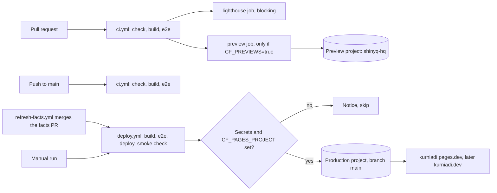

# Deploying ShinyQ HQ

The site is a Next.js static export (`out/`) plus the Ask the HQ Pages Function (`functions/`), hosted on Cloudflare Pages and uploaded with `wrangler pages deploy` (Direct Upload). Production deploys run from GitHub Actions (`deploy.yml`): on every merge to `main` (since 2026-10-18; the fast path deploys at once when the merged PR was green on the same tree, otherwise it waits for the complete `main` CI), after the weekly live-facts PR merges (`refresh-facts.yml` dispatches it), and when someone runs the workflow by hand. A red `main` CI rolls production back automatically (`rollback.yml`, section 6). The manual local deploy below still works.

## Current state (production cutover, 2026-10-09)

| Item | Value |
| --- | --- |
| Production project | `kurniadi`, Direct Upload, production branch `main` |
| Production URL | https://kurniadi.pages.dev |
| Preview project | `shinyq-hq`, Direct Upload, production branch `production-cutover-phase-6` (never pushed, so every deploy is a preview) |
| Repository variable | `CF_PAGES_PROJECT=kurniadi` (set) |
| Repository secrets | `CLOUDFLARE_API_TOKEN` (account-owned token "shinyq-hq Pages deploy", Cloudflare Pages Edit plus Workers KV Storage Edit for the Ask knowledge pack, expires 2027-01-09) and `CLOUDFLARE_ACCOUNT_ID`, set on 2026-10-11 |
| Repository variables | `CF_BEACON_TOKEN` (Web Analytics site `kurniadi.pages.dev`, manual snippet, site tag `4134db56168b4eb58d19fc1ead78b131`); `AUTO_DEPLOY_FACTS` unset (on); `CF_PREVIEWS` unset (PR previews off) |

The old Git-connected `kurniadi` project (old site repository, `npm run build` to `dist`) was deleted and recreated as a Direct Upload project with the same name (Option A below). Its source is still in the old site repository if it is ever needed again.

Notes:

- Per-deployment URLs such as `https://<hash>.kurniadi.pages.dev` are behind an existing Cloudflare Access application (account level, not part of the Pages project). Only `kurniadi.pages.dev` itself is public.
- Web Analytics: the manual-snippet site for `kurniadi.pages.dev` (created 2026-10-11) feeds `CF_BEACON_TOKEN`, which only production builds use (`deploy.yml`, or the manual command below). CI, screenshot and e2e builds never render the beacon, so test runs are not counted and the e2e cross-origin guard stays strict. Do not also turn on automatic Web Analytics for the Pages project, or every visit counts twice. The other Web Analytics site (`kurniadi.dev`, automatic) covers the custom domain zone.

## Deploy from GitHub Actions (preferred)

```sh
gh workflow run deploy.yml --ref main                       # tip of main
gh workflow run deploy.yml --ref main -f sha=<commit on main> -f reason="why"
gh run watch
```

Or Actions > Deploy > Run workflow. A merge to `main` starts the same workflow by itself: when the merged pull request came from this repository, its head had the same tree as the merge commit (merge an up-to-date branch) and every required check was green there, and no `deploy-rollback` issue is open, it skips the wait below and deploys in about 4 minutes (`scripts/merge-gate.ts`); otherwise it waits for the complete `main` CI as described here. `deploy.yml` checks that the commit is on `main`, then `Reuse the CI result` (`scripts/ci-status.ts`) looks for CI's `Build, CV and e2e` check on that commit: green in a complete run (one that carries the `ci-full` artifact; dispatches and the nightly always do, and a push to `main` does when it ran everything or the complement of its merged PR's green run, which together cover everything) means no e2e rerun; still running means it waits (up to 40 minutes, for as long as a CI run on the commit is unfinished); red fails the deploy. A commit without its own CI run may reuse a green complete CI run on a commit with the same tree, but only from a push to `main` or a pull request from this repository. The weekly facts merge (made with `GITHUB_TOKEN`, so it gets no push CI) finds no such run: the facts PR was tested by a `workflow_dispatch` run, which the deploy never reuses, so the facts deploy runs the 8 e2e shards itself (`refresh-facts.yml` already gated the merge on that full CI run). Selective smart CI runs of pull requests and older runs without the marker are never reused. With no complete CI result (none on the commit or its tree after a 3-minute grace), or with `-f rerun_e2e=true`, it builds without the beacon and runs the 8 e2e shards first, as before. It builds with `CF_BEACON_TOKEN` for production, rebuilds the Ask knowledge pack in the deploy job, runs `wrangler pages deploy out --branch=main`, then `scripts/deploy-smoke.ts`: `GET /api/ask` must be enabled with the pack date of that commit, `GET /api/rum` must answer 405 (the beacon Function only accepts POST), and `/en` must return 200 with the commit's live contributions number and the beacon. It retries for up to 5 minutes while the production alias switches. Any failure opens (or comments on) the `deploy-failed` issue; production keeps serving the previous deployment.

## Automatic deploy after the weekly facts refresh

`refresh-facts.yml` (Mondays 02:00 WIB) merges the live-facts PR only after CI passed on it, then dispatches `deploy.yml` for the merge commit, so the stats ring, Page View and Ask show the new numbers without anyone deploying by hand. Merges to `main` deploy through `deploy.yml` too (fast path or after `main` CI, section "Deploy from GitHub Actions"); PR previews stay off unless the variable `CF_PREVIEWS=true` is set.

- Turn the automatic deploy off: `gh variable set AUTO_DEPLOY_FACTS --body false` (the facts PR still merges; deploy by hand later). Turn it back on: `gh variable delete AUTO_DEPLOY_FACTS`.
- Turn every Actions deploy off: `gh secret delete CLOUDFLARE_API_TOKEN` (the deploy job then skips with a notice; the manual local deploy keeps working).
- Token rotation: "shinyq-hq Pages deploy" expires on 2027-01-09. Before then, create a new account-owned token with Cloudflare Pages Edit and Workers KV Storage Edit (section 2, or the `cf accounts tokens create` command in `docs/ask-runbook.md` section 8 with the Pages Write permission group `8d28297797f24fb8a0c332fe0866ec89`), pipe it into `gh secret set CLOUDFLARE_API_TOKEN`, run `gh workflow run ask-pack.yml --ref main -f mode=verify` and one deploy, then delete the old token.

## Manual local deploy

From a clean checkout of `main`, with `wrangler` logged in to the account that owns the project (`bunx wrangler login`, once). Run it from the repo root so `functions/` and `wrangler.toml` are included:

```sh
git switch main && git pull
bun install --frozen-lockfile
bun run typecheck && bun run lint && bun run test
CF_BEACON_TOKEN=$(gh variable get CF_BEACON_TOKEN)
NEXT_PUBLIC_SITE_URL=https://kurniadi.pages.dev NEXT_PUBLIC_CF_BEACON_TOKEN="$CF_BEACON_TOKEN" bun run build
bunx wrangler pages deploy out --project-name=kurniadi --branch=main \
  --commit-hash="$(git rev-parse HEAD)" --commit-message="$(git log -1 --format=%s)" --commit-dirty=true
NEXT_PUBLIC_CF_BEACON_TOKEN="$CF_BEACON_TOKEN" bun scripts/deploy-smoke.ts
```

Run `bun run e2e` on a build without the beacon if you want the e2e suite: its cross-origin guard flags the analytics requests by design. `--branch=main` matches the production branch, so the upload goes live on `kurniadi.pages.dev` at once (previews get no Ask secrets, so Ask stays off there). Then run the checks in section 5, step 3.

## Overview

| Trigger | Workflow | Cloudflare project | Result |
| --- | --- | --- | --- |
| Pull request from this repo, only with `CF_PREVIEWS=true` | `ci.yml` job `preview` | `CF_PREVIEW_PROJECT` (default `shinyq-hq`) | Preview URL `pr-<n>.<project>.pages.dev` |
| Weekly facts PR merged (`refresh-facts.yml`), or manual run | `deploy.yml` (`workflow_dispatch` only) | `CF_PAGES_PROJECT` (`kurniadi`) | Production at `SITE_URL` (default `https://kurniadi.pages.dev`), smoke-checked |
| Push to `main` | `ci.yml` only | none | Checks; no deploy |
| Every CI run | `ci.yml` job `lighthouse` (`Lighthouse CI`) | none | Lighthouse budgets (blocking) and reports as an artifact |



`ci.yml` still runs typecheck, lint and unit tests on every push to `main`. `deploy.yml` runs its own build, the e2e suite and a post-deploy smoke check, and opens a `deploy-failed` issue when anything fails.

## 1. Choose the Pages project

Done for production on 2026-10-09 (see "Current state"); kept for reference. The production URL `kurniadi.pages.dev` belongs to the Cloudflare Pages project named `kurniadi`. A `*.pages.dev` subdomain is tied to the project name and cannot be moved to another project. Deleting a project frees its name at once: the cutover deleted and recreated `kurniadi` within seconds.

### Option A: reuse `kurniadi` (keeps kurniadi.pages.dev)

1. In the Cloudflare dashboard open Workers & Pages, then the `kurniadi` project, then Settings.
2. Check how it is deployed:
   - **Direct Upload project** (no Git repository shown under Settings > Builds): wrangler can deploy to it as is. Go to step 3.
   - **Git-connected project** (connected to the old site repository): wrangler Direct Upload is not allowed into a Git-integrated project. Cloudflare does not let you convert it, so the clean path is:
     1. Back up the old site first: download the latest deployment (or keep the old repository and its build command) so you can recreate it.
     2. Delete the `kurniadi` project (Settings > Delete project). This frees the name and the `kurniadi.pages.dev` subdomain. The old site is offline from this point until the first deploy.
     3. Recreate it immediately as a Direct Upload project with the same name:
        ```sh
        bunx wrangler pages project create kurniadi --production-branch=main
        ```
     4. Run the first deploy (section 5) right away to keep the downtime short.
3. Make sure the production branch is `main` (Settings > Builds and deployments > Production branch, or recreate with `--production-branch=main`). If it is anything else, deploys from `deploy.yml` are published as previews and the production URL does not change.

Rollback note: if the new site has a problem after the cut-over, use the dashboard rollback (section 6). If you need the old site back entirely, redeploy the backup to the same project with `bunx wrangler pages deploy <backup-dir> --project-name=kurniadi --branch=main`.

### Option B: create a new project

Use this to try production deploys without touching the old site, then switch later.

```sh
bunx wrangler login
bunx wrangler pages project create <name> --production-branch=main
```

The site is then served at `https://<name>.pages.dev`. Set `SITE_URL` to that URL (section 4) so canonical links and the sitemap match.

## 2. Create an API token and find the Account ID

1. Cloudflare dashboard > My Profile > API Tokens > Create Token > Create Custom Token.
2. Permissions: **Account**, **Cloudflare Pages**, **Edit**.
3. Account Resources: Include, your account (account scope, no zone needed).
4. Create the token and copy it once.
5. Account ID: Workers & Pages overview page, right sidebar ("Account ID"), or the dashboard URL `dash.cloudflare.com/<account-id>/...`.

## 3. GitHub secrets

The Cloudflare secrets belong to the `production` environment (Settings > Environments > production), whose deployment branch policy allows `main` only (security S3, owner decision 4). Jobs that read them declare `environment: production` (`deploy.yml`, the eval, content-gap and token-check jobs; with `deployment: false` where nothing is deployed), so no pull request or other branch can read the deploy token. `SAFETY_BLOCKLIST` stays a repository secret because pull request and `main` CI runs read it. Secrets are passed only to the steps that read them (H1).

```sh
# Environment secrets (main only)
gh secret set CLOUDFLARE_API_TOKEN  --env production --repo ShinyQ/ShinyQ-HQ   # paste the token from step 2
gh secret set CLOUDFLARE_ACCOUNT_ID --env production --repo ShinyQ/ShinyQ-HQ   # paste the account id
gh secret set CF_EVAL_TOKEN         --env production --repo ShinyQ/ShinyQ-HQ   # docs/ask-runbook.md section 8
gh secret set CF_STATS_TOKEN        --env production --repo ShinyQ/ShinyQ-HQ   # section 13, Account Analytics Read only
gh secret set CF_LOGS_TOKEN         --env production --repo ShinyQ/ShinyQ-HQ   # optional, log purge
# Repository secret
gh secret set SAFETY_BLOCKLIST --repo ShinyQ/ShinyQ-HQ < content/.safety-blocklist.local.txt   # required on main and for deploys
```

Moving from repository secrets: set each one in the environment first (an environment secret wins over a repository secret of the same name for jobs in that environment), run `gh workflow run deploy.yml --ref main` and `gh workflow run stats-worker.yml --ref main`, then delete the repository copies (`gh secret delete CLOUDFLARE_API_TOKEN --repo ShinyQ/ShinyQ-HQ`, and the same for `CLOUDFLARE_ACCOUNT_ID`, `CF_EVAL_TOKEN`, `CF_LOGS_TOKEN`). Secret values cannot be read back, so paste them from the password manager or create new tokens.

| Secret | Required | Purpose |
| --- | --- | --- |
| `CLOUDFLARE_API_TOKEN` | Yes, for any deploy | Pages Edit token used by wrangler; also needs Workers KV Storage Edit for the Ask knowledge pack (`scripts/ask-pack.ts`, `docs/ask-runbook.md` section 17) and Workers Scripts Edit for the hq-stats Worker job (section 13; Workers KV Storage Read is checked as advisory only) and R2 access for the `GUIDES` binding (section 19) |
| `CF_EVAL_TOKEN` | Yes, for evals | Workers AI Read, AI Gateway Read, Account Analytics Read: Ask evals and the content-gap report; also the hq-stats Worker's `WA_TOKEN` until `CF_STATS_TOKEN` exists |
| `CF_STATS_TOKEN` | Recommended | Account Analytics Read only, 90-day expiry (owner decision 4): the hq-stats Worker's runtime secret `WA_TOKEN` and the analytics token check (section 13) |
| `CLOUDFLARE_ACCOUNT_ID` | Yes, for any deploy | Cloudflare account that owns the projects |
| `SAFETY_BLOCKLIST` | Yes, on main and for deploys | Private public-safety blocklist terms (private repo and cloud resource names) used by the content tests, `scripts/scan-export.ts` (CI build and production build) and the e2e scan of `out/`; product names in `content/safety-allowlist.txt` are dropped from it. Without it, the scan step fails on `main` and in `deploy.yml` (after `SAFETY_BLOCKLIST_GRACE_UNTIL`) and warns on pull requests. Output never prints a private term (`private term #n`). |

## 4. GitHub repository variables

Settings > Secrets and variables > Actions > Variables, or with `gh`:

```sh
gh variable set CF_PAGES_PROJECT --body kurniadi
gh variable set CF_PREVIEW_PROJECT --body shinyq-hq            # optional
gh variable set SITE_URL --body https://kurniadi.pages.dev     # optional
gh variable set CF_BEACON_TOKEN --body <web-analytics-token>   # set on 2026-10-11
gh variable set AUTO_DEPLOY_FACTS --body false                 # optional: stop the weekly auto-deploy
gh variable set CF_PREVIEWS --body true                        # optional: turn PR previews on
```

| Variable | Required | Purpose |
| --- | --- | --- |
| `CF_PAGES_PROJECT` | Yes, to enable production deploys | Production Pages project name. While unset, `deploy.yml` builds and tests but skips the upload. |
| `CF_PREVIEW_PROJECT` | Optional | Project for PR previews. Defaults to `shinyq-hq` (created automatically with a production branch that is never pushed, so every deploy stays a preview). |
| `SITE_URL` | Optional | Public origin baked into canonical URLs, `hreflang`, sitemap, robots and OG URLs (`NEXT_PUBLIC_SITE_URL`). Defaults to `https://kurniadi.pages.dev`. Set to `https://kurniadi.dev` after the domain move. |
| `CF_BEACON_TOKEN` | Optional | Cloudflare Web Analytics site token (`NEXT_PUBLIC_CF_BEACON_TOKEN`), read only by `deploy.yml` production builds. When empty, no beacon is rendered. |
| `AUTO_DEPLOY_FACTS` | Optional | `false` stops `refresh-facts.yml` from dispatching `deploy.yml` after it merges a facts PR. |
| `CF_PREVIEWS` | Optional | `true` turns on the PR preview job in `ci.yml` (off by default). |
| `SAFETY_BLOCKLIST_GRACE_UNTIL` | Temporary | `YYYY-MM-DD`: until this day (UTC) a missing `SAFETY_BLOCKLIST` only warns on `main` and in `deploy.yml`; afterwards it fails. Set on 2026-10-14 to `2026-10-21` while the owner adds the secret; delete it once the secret is set (`gh variable delete SAFETY_BLOCKLIST_GRACE_UNTIL`). |
| `GOOGLE_SITE_VERIFICATION` | Optional | Google Search Console HTML tag token (the `content` value of `google-site-verification`), rendered on `/`, `/en` and `/id` by production builds. Section 15. |
| `BING_SITE_VERIFICATION` | Optional | Bing Webmaster Tools `msvalidate.01` token, rendered the same way. Section 15. |
| `STATS_WORKER_DEPLOY` | Optional | `false` skips the hq-stats Worker job in `deploy.yml` (for example while the deploy token lacks Workers permissions and the Worker was deployed by hand). |

Web Analytics token: `cf rum site-info create --host <host> --auto-install=false` (how the `kurniadi.pages.dev` site was created; the token is public, it ships in every page), or Cloudflare dashboard > Analytics & Logs > Web Analytics > Add a site, choose the manual JS snippet, and copy the `token` value from the snippet. Alternatively enable automatic Web Analytics on the Pages project (Pages project > Metrics) and leave `CF_BEACON_TOKEN` unset. Use one or the other, not both, or every visit is counted twice.

The Content-Security-Policy in `public/_headers` already allows `static.cloudflareinsights.com` (script) and `cloudflareinsights.com` (beacon reports).

## 5. First deploy

1. Run the workflow: Actions > Deploy > Run workflow (or `gh workflow run deploy.yml --ref main`). Merging to `main` does not deploy.
2. Follow the run: `gh run watch`. The `deploy` job shows the deployment URL in its summary and the `production` environment links to `SITE_URL`.
3. Verify (replace the host if you use another project):

```sh
HOST=https://kurniadi.pages.dev
curl -sI "$HOST/" | head -n1                         # 200, static language redirect page
curl -sI "$HOST/en" | head -n1                       # 200
curl -sI "$HOST/id" | head -n1                       # 200
curl -sI "$HOST/cv.pdf" | grep -iE '^(HTTP|location)' # 301 to /cv/kurniadi-ahmad-wijaya-cv.pdf
curl -sI "$HOST/cv/kurniadi-ahmad-wijaya-cv.pdf" | grep -iE '^(HTTP|content-type|x-frame-options)' # 200, application/pdf, SAMEORIGIN
curl -s "$HOST/sitemap.xml" | head -n5               # URLs use SITE_URL
curl -s "$HOST/robots.txt"
curl -sI "$HOST/og/en.jpg" | grep -i content-type    # image/jpeg (share card)
curl -sI "$HOST/en" | grep -iE 'content-security-policy|strict-transport|x-frame-options'
```

Then open `/` in a browser (it redirects to `/en` or `/id`), switch languages, and check the browser console for CSP violations.

## 6. Rollback

Automatic: `rollback.yml` runs after every CI run from a push to `main`. When it is red, it first opens or updates the `deploy-rollback` issue with the failing run (closing the fast path), and when production serves the failing commit (or a later, not green, commit built on it), it rolls Cloudflare Pages back to the newest earlier production deployment that does not contain the failure and whose own CI was green (or that never had CI, like the facts merge), and redeploys the hq-stats Worker from that commit when `workers/stats/` changed (unless `STATS_WORKER_DEPLOY=false`). While the issue is open every merge waits for a green `main` CI before it deploys; a green `main` CI on the failing commit or a later one closes it and dispatches a deploy of the tip of `main`. Details: [`agents/ci-and-deploy.md`](agents/ci-and-deploy.md#production-deploy).

By hand:

- Fastest: Cloudflare dashboard > Workers & Pages > project > Deployments, pick an earlier production deployment, then Rollback to this deployment. No rebuild needed.
- API (what `rollback.yml` calls): list with `GET /accounts/$CLOUDFLARE_ACCOUNT_ID/pages/projects/kurniadi/deployments?env=production`, then `curl -X POST -H "Authorization: Bearer $CLOUDFLARE_API_TOKEN" https://api.cloudflare.com/client/v4/accounts/$CLOUDFLARE_ACCOUNT_ID/pages/projects/kurniadi/deployments/<deployment id>/rollback`.
- Same logic as the automation, locally: `GH_TOKEN=$(gh auth token) CLOUDFLARE_API_TOKEN=... CLOUDFLARE_ACCOUNT_ID=... bun scripts/rollback.ts pages --repo ShinyQ/ShinyQ-HQ --sha <bad commit> --project kurniadi --site https://kurniadi.pages.dev --dry-run true` (drop `--dry-run true` to roll back).
- Drill or rerun in Actions: `gh workflow run rollback.yml --ref main -f sha=<bad commit>` (dry run by default; `-f dry_run=false` rolls back for real).
- hq-stats Worker: `cd workers/stats && bunx wrangler deployments list` then `bunx wrangler rollback <version id>`, or redeploy it from a good commit.
- From GitHub: `gh workflow run deploy.yml --ref main -f sha=<earlier commit on main> -f reason=rollback`. Or revert the commit on `main` (the revert PR deploys on merge).
- After a manual rollback, close the `deploy-rollback` issue only once `main` is green (or leave it: the next green `main` CI closes it).

## 7. Custom domain kurniadi.dev (later)

Status (2026-10-11): the `kurniadi.dev` zone is active on Cloudflare, but the domain is on Indonesia's TrustPositif blocklist (likely from a previous owner): Indonesian ISPs answer its DNS with a block page and intercept plain DNS to outside resolvers, so no Cloudflare setting can fix it for Indonesian visitors. Before moving production to the domain, point it at the Pages project (step 1) so it shows the portfolio, then request delisting ("normalisasi") at https://trustpositif.komdigi.go.id/normalisasi (or normalisasi@aduankonten.id). Until it is delisted, keep `kurniadi.pages.dev` as the canonical origin and do not redirect to the domain.


1. Pages project > Custom domains > Set up a custom domain: add `kurniadi.dev`, and `www.kurniadi.dev` if wanted.
2. DNS: if the zone is on Cloudflare, Pages creates the records for you. Otherwise add `CNAME kurniadi.dev -> <project>.pages.dev` (the apex works through CNAME flattening when the zone is on Cloudflare; other DNS hosts need ALIAS/ANAME support) and `CNAME www -> <project>.pages.dev`.
3. `gh variable set SITE_URL --body https://kurniadi.dev`, then redeploy (`gh workflow run deploy.yml --ref main`) so canonical URLs, `hreflang`, the sitemap and OG URLs use the new origin.
4. Optional: send `kurniadi.pages.dev` to the custom domain with a Cloudflare Bulk Redirect (Rules > Redirect Rules > Bulk Redirects, source `kurniadi.pages.dev`, target `https://kurniadi.dev`, preserve path and query). `_redirects` cannot do this because it cannot match on host names.
5. Optional: redirect `www.kurniadi.dev` to the apex with a Redirect Rule in the zone.

## 8. Lighthouse CI

- Job `lighthouse` (check name `Lighthouse CI`) in `ci.yml` runs after the `site` build on every push to `main`, dispatch and nightly, and on pull requests whose smart CI plan needs it (page code, strings, assets, 3D code, or a full run; [`agents/ci-and-deploy.md`](agents/ci-and-deploy.md#what-a-pull-request-runs)); otherwise its steps skip and the check passes. It downloads the `site` artifact, serves it with `scripts/serve-static.ts` on port 4320 and runs `@lhci/cli` (pinned in the workflow) with `lighthouserc.json`.
- Pages: a warm-up run of `/en?lhci-warmup=1` (never asserted; it absorbs the cold first Chrome and server run that used to spike `/en` TBT), then `/en`, `/id`, `/en/quick`, `/en/journey`, `/en/labs/voice-ai-contact-center`, `/en/contact` and `/en/cv`, 3 runs each, Lighthouse default mobile profile (simulated 4G, mid-range device). Assertions live in two `assertMatrix` entries for URLs without a query string: the budgets below at error level for every page except `/en/cv`, and the same budgets at warn level for `/en/cv` (owner decision 15, 2026-10-14: warn-only until the CV image patch proves its LCP gain; its image-driven LCP is about 2.5 s in the lab).
- Budgets (tighter than appendix 08 since the October 2026 performance pass): LCP under 2000 ms, CLS under 0.01, TBT under 200 ms (error level, median run); transfer bytes per page at most 60 KB of fonts, 82 KB of HTML (raised from 80 KB on 2026-10-18 as an owner-approved stopgap), 20 KB of CSS and 240 KB of JavaScript (error level); performance score at least 0.9, accessibility at least 0.9 and SEO at least 0.9 (warn level).
- Reports: the run summary lists the assertion results, and the HTML and JSON reports are in the `lighthouse-reports` artifact (Actions run > Artifacts). Reports are written to the filesystem only and are never uploaded to public temporary storage.
- Per-chunk diff: after the run, `scripts/perf-base.sh` downloads `lighthouse-reports` of the last green `main` push run and `bun scripts/perf-summary.ts lhci` writes "Page View JavaScript per chunk" to the job summary: total per page, share of the 240 KB budget (a warning at 90%), and the chunks added or removed against main (names are content hashes, so a changed chunk shows as one removed and one added row). The 3D side (3D JS after the gate, the per-floor chunk sizes, floors, peaks, memory) is in the `Build, CV and e2e` job summary, from the `3D perf gates` job (appendix 08 section 2).
- 3D bytes (`e2e/perf/bytes-3d.spec.ts`, budgets in `e2e/budgets.ts` `BYTES_3D_BUDGET`): the main path before the first frame (measured with `?prefetch=off`) fails at 462.9 KB gzip per tier; each on-demand floor chunk has its own cap (L3 20 KB, L4 16 KB, RF 8 KB); the session total, main path plus every floor chunk that the idle prefetch downloads, is capped at 491.9 KB on full and 476.1 KB on lite (owner decisions 2026-10-19: each cap is the measured value plus about 0.6 KB, so creep is caught early); the Agent Office's lazy scene and drawer body chunks have their own caps outside it (14 KB and 6 KB). Raise a cap only with an owner note in the PR.
- Local run after `bun run build:web`: `bunx @lhci/cli@0.15.1 autorun` (needs a local Chrome), then open `.lighthouseci/*.report.html`.
- Blocking: a failed error-level budget fails `Lighthouse CI`, and the aggregate `Build, CV and e2e` job (the required check) needs it, so a PR cannot merge over budget. Branch rules may also list `Lighthouse CI` directly.
- LCP is simulated (Lantern): the slow-4G model counts every request that finished before the observed paint, so the bytes of the HTML, the CSS and the preloaded fonts decide it (the text paints before any JavaScript runs). Keep these measures when changing fonts, the layout or the build:
  - The preloaded fonts are self-hosted cuts narrowed to the axes, characters and OpenType features the site uses (`src/assets/fonts/README.md`, `scripts/subset-fonts.sh`, about 55 KB for all three; `tests/content/fonts.test.ts` checks coverage and the budget).
  - `scripts/defer-scripts.ts` (run by `bun run build`) requests the Next.js chunks only after the first contentful paint.
  - Client props of the locale layout are inlined into every HTML file (RSC payload). Large client data goes into a static file under `/data/` instead: the Glass Drawer content (`/data/rooms/{locale}.json`) and the HUD index (`/data/hud/index.json`, fetched by `MissionHud` after hydration).
  - Always-loaded client islands import only small modules: the Ask status from `src/ask/status.ts` (not the Turnstile and SSE client), certification helpers from `src/content/certs.ts` (the tech logo registry stays in the server-only `cert-views.ts`).
  - The landing's motion is CSS only and compositor only (`src/app/landing.css`): the backdrop has no image or text, so the `h1` stays the LCP element; featured images load lazily below the first screen; "Enter the 3D HQ" is shown by `html[data-hq-3d]` from the head script, never by client state, so it cannot shift the layout.
  - Elements that appear after first paint on their own must not move content or cover the landing: the Rover menu never opens on its own over the Page View, and its greeting types into reserved space.
- Medians at the time of writing (round 5 P1, local `lhci collect` with the warm-up URL, 3 runs, 2026-10-13): LCP `/en` 1.81 s, `/en/quick` 1.81 s, `/en/journey` 1.67 s, the pod page 1.66 s; CLS 0; TBT 38 to 61 ms; script transfer 204 to 207 KB. Production adds the real TTFB of Cloudflare Pages (simulated at 50 to 500 ms).

## 9. Headers and redirects

Files in `public/` are copied to `out/` by `next build`, and Cloudflare Pages reads `out/_headers` and `out/_redirects`.

`public/_headers`:

- `/*`: security headers (`X-Content-Type-Options`, `Referrer-Policy`, `X-Frame-Options`, `Permissions-Policy`, `Strict-Transport-Security`, `Cross-Origin-Opener-Policy`) and a Content-Security-Policy. A response header cannot list per-page hashes, so its `script-src` keeps `'unsafe-inline'` for the inline scripts of the static export (Next.js hydration data, the head script, the root language redirect, the analytics loader). Every HTML page also carries its own script policy (next bullet); the browser enforces both, a script runs only when both allow it, so the effective script policy has no `'unsafe-inline'`. `blob:` is allowed for workers and media used by WebGL and audio.
- Per-page script policy (security F1.9): `scripts/csp-hashes.ts`, the last step of `bun run build`, hashes every executable inline `<script>` of each `out/**/*.html` (sha256 of the body; JSON-LD and `src` scripts are skipped) and inserts `<meta http-equiv="Content-Security-Policy" ... data-hq-csp="">` right after the charset meta, before any script. It holds `script-src` from the `/*` header without `'unsafe-inline'` plus the page's hashes, and `worker-src 'self' blob:` again, because a meta policy without `worker-src` falls back to its own `script-src` and would block troika's `blob:` workers. Pure rules live in `scripts/csp-policy.ts`.
  - Guards: `csp-hashes` exits 1 on any problem (a missing hash, the policy after a script, the policy outside `<head>`, `'unsafe-inline'`, more than one policy, drift from `_headers`, an inline event handler attribute, a `javascript:` URL); `scripts/scan-export.ts` re-checks the export in CI and after the production build in `deploy.yml`; `e2e/deploy.spec.ts` checks `out/`; `scripts/deploy-smoke.ts` checks production `/en`; `e2e/csp.spec.ts` expects zero CSP violations on the Classic routes in both locales, the 404, client navigation, the `/` redirect, the CV viewer, the 3D boot, intro, an L3 ride and a floor deep link.
  - Rules: never add an inline event handler (`onclick=` and the like) or a `javascript:` URL, never inject an inline script at runtime (load a same-origin file instead), and a test that edits an inline script must rebuild the page policy with `addScriptPolicy` (as `patientBootCover` in `e2e/boot-first.spec.ts` does). Keep Cloudflare zone features that rewrite HTML off (Rocket Loader, HTML minification that changes scripts): a changed script no longer matches its hash and is blocked.
- `/_next/static/*`: one year, `immutable` (file names are content hashed; this also covers the self-hosted `next/font` files).
- `/cv/*`: the CV PDF and its page images (`/cv/pages/*.webp`, shown by the in-site CV viewer; nothing frames the PDF any more). The rule, kept from the former iframe preview, detaches the site-wide `Content-Security-Policy` and `X-Frame-Options` (`! Header`) and sets `frame-ancestors 'self'` and `SAMEORIGIN` instead: same-origin framing only. The site CSP allows it with `frame-src 'self'` and keeps `object-src 'none'`.
- Caching of unhashed files: `/brand/*` one week; `/fonts/*` one year `immutable` (troika cuts are content-hashed, Task 4 of round 5 P1); `/tech/*` one week plus `stale-while-revalidate` one day; `/media/*`, `/floors/*`, `/logos/*` one day plus `stale-while-revalidate` one week; `/cv/*` one hour and `/papers/*` one day, both `must-revalidate` so a replaced CV or paper never shows stale; `/og/*` one day. Two rules must never both set `Cache-Control` for one file (Cloudflare joins the values; `tests/unit/cache-headers.test.ts`). `scripts/deploy-smoke.ts` checks one file per prefix after each deploy. Splats only work at the end of a path, so per-route images such as `/en/opengraph-image` keep the default caching.
- `/`: `Link` hreflang alternates (en, id, x-default).
- HTML keeps the Cloudflare default (revalidated on every request), so a new deploy is visible at once.
- Pages Functions (`/api/*`): Cloudflare Pages never applies `_headers` to a Function's response, not even `/*`, so each Function sets its own headers. `/api/guides/<slug>` sets `Content-Security-Policy: frame-ancestors 'none'`, `X-Content-Type-Options: nosniff` and its `Cache-Control` in `functions/_lib/guides.ts` (`tests/unit/guides-function.test.ts`); `_headers` has no rule for it.

`public/_redirects`:

- `/cv.pdf` (the old site's path), `/en/cv.pdf`, `/id/cv.pdf` and the former per-locale PDFs `/cv/kurniadi-ahmad-wijaya-cv-{en,id}.pdf` to `/cv/kurniadi-ahmad-wijaya-cv.pdf` (301).
- `/` is intentionally not redirected: it is a static page that picks the language on the client.

`scripts/serve-static.ts` honors simple static rules from `out/_redirects` so `e2e/deploy.spec.ts` can check the CV redirects locally. Headers are only applied by Cloudflare; the e2e test checks that `out/_headers` is exported.

## 10. Ask the HQ

The "Ask the HQ" assistant adds one Pages Function (`functions/api/ask.ts`) and its bindings in `wrangler.toml` (Workers AI, KV `shinyq-hq-ask`, Analytics Engine `ask_events`, vars). Because `wrangler.toml` sets `pages_build_output_dir`, `wrangler pages deploy out` bundles `functions/` and applies those bindings, so always deploy from the repo root after `bun run build` (which also builds the knowledge pack into `functions/_generated/`), and keep `--branch=main` so the Pages secrets apply. The dashboard can no longer edit the bindings or vars that the file owns.

`ASK_ENABLED = "false"` in `wrangler.toml` is the kill switch: the endpoint returns 503 and the UI hides. Provisioning, secrets, smoke test, rotation and incidents: [`docs/ask-runbook.md`](ask-runbook.md).

## 11. Cloudflare resource inventory

Account `6b396b5c1b91035048383cf4c3f3f437` (Workers Free plan), as of 2026-10-11 after removing the old site's unused Workers, KV, D1, R2 cache buckets and tokens.

| Kind | Name | Used by |
|---|---|---|
| Pages | `kurniadi` | Production, https://kurniadi.pages.dev |
| Pages | `shinyq-hq` | Optional PR previews (`CF_PREVIEWS=true`) |
| KV | `shinyq-hq-ask` | Ask answer cache and rate-limit counters |
| AI Gateway | `shinyq-hq` | Ask model calls (cache, logs, rate limit) |
| Turnstile | `shinyq-hq-ask` | Ask anti-bot check (`kurniadi.pages.dev`, `kurniadi.dev`) |
| Analytics Engine | `ask_events` | Anonymized Ask events (created on first write) |
| Analytics Engine | `perf_events` | Anonymous performance beacon, one point per sampled 3D session (created on first write) |
| Analytics Engine | `visit_events` | Public visit stats beacon, one point per page lifetime (created on first write) |
| KV | `STATS_KV` | Public visit stats: ledger of finalized days `stats:days:v1` and snapshot `stats:v1` |
| Worker | `hq-stats` | Public visit stats Cron Worker (`17 */2 * * *` UTC, every 2 hours, no route), `workers/stats/` |
| Web Analytics | `kurniadi.pages.dev` (manual), `kurniadi.dev` (automatic) | Page views |
| R2 | `hq-study-guides` | Study guide PDFs (private, no `r2.dev` URL, no custom domain), binding `GUIDES`, served by `/api/guides/<slug>` (section 19) |
| R2 | `shinyq` | Archive of the previous site's images and logos (not used by this site) |
| Zone | `kurniadi.dev` | Custom domain (blocked in Indonesia, see section 7) and email routing |
| API tokens | `shinyq-hq Pages deploy` (`CLOUDFLARE_API_TOKEN`), `shinyq-hq CI read` (`CF_EVAL_TOKEN`), `shinyq-hq AI Gateway log purge` (`CF_LOGS_TOKEN`) | All expire 2027-01-09; rotate before then (`docs/ask-runbook.md`) |

## 12. Performance beacon (RUM)

`functions/api/rum.ts` (`POST /api/rum`) writes one point per sampled 3D session (25%, once per browser session) to the Analytics Engine dataset `perf_events` (binding `PERF_EVENTS` in `wrangler.toml`). Fields, buckets and the privacy note: appendix 06 section 4. Kill switch: set `RUM_ENABLED = "false"` in `wrangler.toml` and deploy; the Function then answers 204 and writes nothing.

Check a deploy by hand: open `https://kurniadi.pages.dev/en?rum=1` in a normal browser (with Do Not Track and Global Privacy Control off), enter the tower, wait for explore, switch tabs; a `POST /api/rum` with status 204 appears in DevTools > Network. Points show up in SQL within a few minutes:

```sh
curl -s "https://api.cloudflare.com/client/v4/accounts/$CF_ACCOUNT_ID/analytics_engine/sql" \
  -H "Authorization: Bearer $CF_EVAL_TOKEN" \
  --data "SELECT blob2 AS tier, blob4 AS fps50, SUM(_sample_interval) AS points FROM perf_events WHERE timestamp > NOW() - INTERVAL '7' DAY GROUP BY tier, fps50 ORDER BY tier, fps50 FORMAT JSON"
```

Multiply by 4 for an estimate of 3D sessions (25% sampling). Other useful groupings: `blob3` (load path), `blob6` (time to explore), `SUM(double1)` (context losses), `SUM(double2)` (boot timeouts). `CF_EVAL_TOKEN` needs Account Analytics Read, like the Ask content-gap report.

## 13. Public visit stats (hq-stats)

Pipeline and contract: appendix 06 section 4.1 and [`workers/stats/README.md`](../workers/stats/README.md). Pieces:

- `POST /api/visit` (`functions/api/visit.ts`) writes one point per page lifetime to Analytics Engine `visit_events` (binding `VISIT_EVENTS`).
- The Cron Worker `hq-stats` (`workers/stats/`, cron `17 */2 * * *` UTC: 17 minutes past every even hour, 00:17 to 22:17, off the top of the hour, when the Web Analytics API answered from a coarse sample) reads Web Analytics (GraphQL) and Analytics Engine (`ask_events`, `visit_events`, `perf_events`) and writes KV `STATS_KV`: the ledger `stats:days:v1` (a UTC day is appended once, an hour after it ended and only from an unsampled, consistent Web Analytics answer, and never recomputed) and the snapshot `stats:v1` (every run, over the ledger plus the provisional days after it, today so far, which are never stored). A routine run makes 1 GraphQL request, 3 SQL queries, 2 KV reads and at most 2 KV writes (24 a day at most, inside the free plan's 1,000 writes a day per account); see `workers/stats/README.md` for the limits.
- `GET /api/stats` (`functions/api/stats.ts`) serves the snapshot (204 until the first one exists).
- Kill switch: `STATS_ENABLED = "false"` in `wrangler.toml`, then deploy.
- **Pages Web Analytics must stay OFF** (Workers & Pages > kurniadi > Metrics > Web Analytics), and so must any zone automatic setup for the site's hosts. The site loads its own beacon (`src/components/Analytics.tsx`, token `vars.CF_BEACON_TOKEN`, site `WA_SITE_TAG`) behind the "Don't count my visits" guard. An injected beacon (`<!-- Cloudflare Pages Analytics -->`) wins over it, sends every page load to another Web Analytics site and ignores the opt-out; that happened from 2026-10-15 19:35 UTC to 2026-10-16 (public visits stuck at 36). `scripts/deploy-smoke.ts` and the hourly uptime check fail while production HTML carries one (`scripts/injected-analytics.ts`). To turn it off by API: `PATCH /accounts/<id>/pages/projects/kurniadi` with `{"build_config":{"web_analytics_tag":null,"web_analytics_token":null}}`, then deploy (the injection changes only with a new deployment); delete the extra Web Analytics site after copying its rows (`workers/stats/README.md`, "Extra rows").

Deploy: `deploy.yml` job "hq-stats Worker" (environment `production`, main only) runs after the Pages deploy. It proves the analytics token (`CF_STATS_TOKEN`, or `CF_EVAL_TOKEN` until that exists) can read Web Analytics and Analytics Engine (`bun scripts/stats-token-check.ts analytics`, fails loudly otherwise) and that `CLOUDFLARE_API_TOKEN` can see Workers scripts (`... deploy`; the KV namespace check only warns), then deploys with `cloudflare/wrangler-action` and sets the Worker secrets `WA_TOKEN` (from the same analytics token) and `WA_ACCOUNT_ID` (from `CLOUDFLARE_ACCOUNT_ID`). The deploy token keeps Workers Scripts Edit for this job (owner decision 4: accepted because it lives only in the main-only environment). Pull requests that touch the Worker only bundle it with `--dry-run` and receive no secret (`.github/workflows/stats-worker.yml`, security S3); the token checks run on `gh workflow run stats-worker.yml --ref main`.

`CF_STATS_TOKEN`: Cloudflare dashboard > My Profile > API Tokens > Create Custom Token, permission Account / Account Analytics / Read only, your account, TTL 90 days; then `gh secret set CF_STATS_TOKEN --env production --repo ShinyQ/ShinyQ-HQ` and run a deploy (it rewrites `WA_TOKEN`).

If the deploy token lacks Workers permissions: add **Account > Workers Scripts > Edit** to `shinyq-hq Pages deploy`, or deploy by hand once from `workers/stats/` with `bunx wrangler deploy` and set both secrets with `bunx wrangler secret put WA_TOKEN` and `bunx wrangler secret put WA_ACCOUNT_ID` (hidden prompts), then set `STATS_WORKER_DEPLOY=false` until the token is fixed.

Cadence: the Worker runs every 2 hours and uptime allows a snapshot at most 6 h old (3 missed runs, the same as the site's "delayed" threshold). A slower cadence must deploy the Worker first or raise the threshold first; a faster one is safe in either order. `GET /api/stats` is cached `public, max-age=600, stale-while-revalidate=3600`, so a returning visitor never sees a snapshot much older than the Worker's cadence (the stale window must stay well under the 6 h "delayed" threshold).

Deploys run in CI: the production `CLOUDFLARE_API_TOKEN` has Workers Scripts Edit and `STATS_WORKER_DEPLOY` is unset (since 2026-10-19), so `deploy.yml` job "hq-stats Worker" deploys the Worker and `rollback.yml` rolls it back. Manual deploy (fallback only, with `STATS_WORKER_DEPLOY=false`): after a merge that touches `workers/stats/`, `src/lib/stats/` or `content/ask/suggestions.json`, run `cd workers/stats && bunx wrangler deploy` with the owner's wrangler login (it also registers the cron schedule), check `bunx wrangler deployments list` shows the new version, then after the next 2-hour slot `curl -s https://kurniadi.pages.dev/api/stats | jq .updatedAt` must show that slot's time. Always `bunx wrangler` (the exact devDependency), never `bunx wrangler@<range>`.

Check a deploy: `curl -sI https://kurniadi.pages.dev/api/stats` (200 with an ETag once the Worker ran, 204 before), `curl -s -o /dev/null -w "%{http_code}" https://kurniadi.pages.dev/api/visit` (405). Preview the snapshot from production data without writing anything: `WA_TOKEN="$(bunx wrangler auth token)" WA_ACCOUNT_ID=<account id> bun scripts/stats-dry-run.ts`.

## 14. Repository protection (security S5, H2, H6; applied 2026-10-14)

Applied with `gh api` by the security workstream (owner decision 6); check them with the commands below.

- Ruleset "main protection" on the default branch: changes land only through a pull request (no approval count, so the owner and `refresh-facts.yml` can merge their own PRs); required status checks from GitHub Actions: `Typecheck, lint, unit tests`, `Build, CV and e2e`, `Lighthouse CI`, `3D perf gates 1/2`, `3D perf gates 2/2` (branches need not be up to date); force pushes and deletion blocked. The checks report on every pull request run, selective smart CI runs included: a heavy job the plan does not need still starts, skips its steps and passes, so the ruleset needs no change ([`agents/ci-and-deploy.md`](agents/ci-and-deploy.md#how-the-required-checks-stay-green)). Repository admins may bypass only through a pull request (emergency merge with `gh pr merge --admin`), so a direct push to `main` is rejected for everyone. Check: `gh api repos/ShinyQ/ShinyQ-HQ/rules/branches/main`.
- Environment `production`: deployment branch policy `main` only (custom policy), so only jobs running on `main` read its secrets (section 3). Check: `gh api repos/ShinyQ/ShinyQ-HQ/environments/production`.
- Dependabot alerts and Dependabot security updates on (version updates come from `.github/dependabot.yml`). Check: `gh api repos/ShinyQ/ShinyQ-HQ/vulnerability-alerts` (204) and `gh api repos/ShinyQ/ShinyQ-HQ/automated-security-fixes`.
- Workflow runs from forks need approval for all external contributors. Check: `gh api repos/ShinyQ/ShinyQ-HQ/actions/permissions/fork-pr-contributor-approval`.
- Every checkout sets `persist-credentials: false` except `refresh-facts.yml`, which pushes the facts branch.
- "Allow GitHub Actions to create and approve pull requests" stays on: `refresh-facts.yml` opens its PR with `GITHUB_TOKEN`, and the setting covers both.

Rollback: `gh api -X PUT repos/ShinyQ/ShinyQ-HQ/rulesets/<id> -f enforcement=disabled` (id from `gh api repos/ShinyQ/ShinyQ-HQ/rulesets`).

## 15. Search engines and link previews

What the build does is in [features.md](features.md#search-and-link-previews). The owner steps:

### Google Search Console

1. https://search.google.com/search-console > Add property > **URL prefix** `https://kurniadi.pages.dev/` (a Domain property needs a DNS TXT record, which a `pages.dev` subdomain cannot have).
2. Choose **HTML tag**, copy only the `content` value of `<meta name="google-site-verification" content="...">`.
3. `gh variable set GOOGLE_SITE_VERIFICATION --body <content value>`, then deploy (`gh workflow run deploy.yml --ref main`). Check: `curl -s https://kurniadi.pages.dev/ | grep google-site-verification`.
4. Click **Verify**. Keep the variable: Google re-checks the tag from time to time.
5. Sitemaps > add `sitemap.xml`. URL inspection > `https://kurniadi.pages.dev/en` > Request indexing (and `/id`).

Alternative without a deploy variable: download Google's HTML file (`google<token>.html`) into `public/`, commit it in a PR and deploy. Do not invent or reuse tokens.

### Bing Webmaster Tools

1. https://www.bing.com/webmasters > Import from Google Search Console (fastest once Google is verified; nothing else to do), or Add a site `https://kurniadi.pages.dev/` and choose **HTML Meta Tag**.
2. For the meta tag: `gh variable set BING_SITE_VERIFICATION --body <content of msvalidate.01>`, deploy, then Verify.
3. Sitemaps > Submit `https://kurniadi.pages.dev/sitemap.xml`. Bing also feeds DuckDuckGo and Yahoo.

### LinkedIn previews (Featured "Add link", posts)

LinkedIn caches a preview per URL, including a failed one, and does not run JavaScript. After a deploy that changes share tags or cards:

1. Open https://www.linkedin.com/post-inspector/ (signed in), paste the exact URL you will share (for example `https://kurniadi.pages.dev/en`), and Inspect. It shows the title, description, image and any error, and refreshes LinkedIn's cache for that URL.
2. If the Featured section still shows "We couldn't load a preview for this link", remove the link, wait a few minutes and add it again (the Featured section keeps its own copy).
3. Prefer the locale URL (`/en` or `/id`): `/` answers with the same card but declares `/en` as its canonical, so LinkedIn may show `/en` anyway.

Check what LinkedIn's fetcher gets, from any machine:

```sh
UA='LinkedInBot/1.0 (compatible; Mozilla/5.0; Apache-HttpClient +http://www.linkedin.com)'
curl -s -A "$UA" -o /dev/null -w '%{http_code} %{size_download}\n' https://kurniadi.pages.dev/en   # 200
curl -s -A "$UA" https://kurniadi.pages.dev/en | head -c 8192 | grep -o 'property="og:[a-z:_]*"' | sort -u
curl -sI -A "$UA" https://kurniadi.pages.dev/og/en.jpg | grep -iE '^(HTTP|content-type)'           # 200, image/jpeg
```

`deploy.yml` runs the same check after every deploy (`scripts/deploy-smoke.ts`, `UNFURL_PATHS`).

### Would a custom domain help?

Facts, not a recommendation to move now (section 7 explains the `kurniadi.dev` blocklist issue):

- `pages.dev` is on the Public Suffix List (https://publicsuffix.org/list/), so `kurniadi.pages.dev` is already its own registrable site, not a part of a shared one. The HTML, share tags and structured data are the same on either origin.
- A domain on a Cloudflare zone allows a Search Console Domain property (DNS TXT), zone-level security and bot settings (on `pages.dev` these are Cloudflare's, not ours), and request logs by user agent, which would show whether LinkedInBot reached the site and what it got.
- A domain change moves every URL, so LinkedIn and search engines treat it as a new site until redirects and re-crawls settle.

## 16. Uptime alerts (uptime.yml)

`.github/workflows/uptime.yml` runs `bun scripts/uptime.ts` every hour at minute 17 (owner decision: hourly) and on demand. It checks:

| Check | Passes when |
|---|---|
| Page `/` and `/en` | HTTP 200 (no redirect) with `og:title`, `og:image` and `og:url` |
| `GET /api/ask` | 200 with `enabled: true`. A 503 with `enabled: false` passes only while `wrangler.toml` sets `ASK_ENABLED` to `"false"` (the kill switch, switched off on purpose); otherwise a disabled Ask fails, which catches a lost AI binding or Turnstile secret (production's `enabled()` is false for those too). Status only: no model call, no AI quota |
| `GET /api/stats` | 200 with a valid snapshot whose `updatedAt` is at most 6 h old (the site's "delayed" threshold; the Worker writes every 2 hours, at minute 17 UTC). 204 fails |
| Latest `deploy.yml` run on main | the newest completed run that is not cancelled, skipped, neutral or stale succeeded (those runs are ignored) |

A failing check is retried once after 60 s. Then the script opens one issue labelled `uptime` ("Uptime: production checks failing") listing the failing checks, rewrites its body on later failing runs (a comment, and so an email, only when the set of failing checks changes) and closes it with a recovery comment once every check passes. GitHub emails the owner on the new issue, on comments and on the close. The run stays green when checks fail (the issue is the alert, so there are no hourly failure emails); it turns red only when the script cannot talk to GitHub.

Permissions: `actions: read`, `contents: read`, `issues: write`; no secrets. `vars.SITE_URL` overrides the site.

Prove the issue path: `gh workflow run uptime.yml -R ShinyQ/ShinyQ-HQ -f force_fail=true` adds a forced failing check, so the issue opens; the next scheduled (or a plain `gh workflow run uptime.yml`) run closes it. Locally: `bun scripts/uptime.ts --dry` (add `--force-fail` to see the failing path; `--dry` never touches issues).

Things to know:

- `updatedAt` is the time of the Worker's last run. If three 2-hour runs in a row are missed, the next hourly check finds a snapshot over 6 h old and fails, and the issue stays open until the next successful Worker run. That is two emails per outage, by design: the site shows "delayed" in that period too.
- GitHub disables scheduled workflows in public repositories after 60 days without repository activity. Re-enable it from Actions > Uptime.
- Removing the `uptime` label from an open issue hides it from the script, so the next failing run opens a new issue.

Pause it: Actions > Uptime > Disable workflow (or `gh workflow disable uptime.yml`).

## 17. Dependency upgrades and pinned majors

Policy (Round 7, owner decision 2026-10-15: tiered). Minor and patch updates land together (Dependabot group `minor-and-patch`, or one PR with `bun update` plus widened ranges). Each major gets its own PR and ships only with every gate green; 3D library majors (three, @types/three, @react-three/drei, @react-three/fiber, postprocessing) also need the strict visual gate (`bun scripts/visual-gate.ts --base main --profile strict`), the perf lane (`bun run e2e:perf`) and the memory gates. `next`, `eslint-config-next`, `react`, `react-dom`, `sharp` and `wrangler` stay exact pins; bump `wranglerVersion` in `deploy.yml` with `wrangler`.

A major that cannot pass is pinned: its Dependabot PR is closed with the reason, `.github/dependabot.yml` gets an `ignore` entry for `version-update:semver-major` with a `# revisit YYYY-MM-DD: reason` comment on the line above, and the table below gets a row (`tests/unit/dependabot.test.ts` keeps both in sync). On the revisit date, try the major again; extend the date with a new reason or remove the pin.

| Package | Pinned to | Latest | Reason | Revisit |
|---|---|---|---|---|
| `typescript` | 6.0.x (`~6.0.3`) | 7.0.2 | typescript-eslint 8.71 (via eslint-config-next) throws "does not support TS 7.0" and supports TypeScript below 6.1 (typescript-eslint#10940); TypeScript 7 also drops the classic compiler API that `tests/unit/three-disposal.test.ts` uses. 6.1 is held back by the tilde range for the same reason | 2027-01-15 |

## 18. Agent Office (hq-office)

- The Worker `hq-office` (`workers/office/`) holds the office state in a SQLite-backed Durable Object; the Pages
  Functions `/api/office`, `/api/office/beat` and `/api/office/github` reach it through the service binding `OFFICE`.
- `deploy.yml` deploys it inside the Pages job ("Cloudflare Pages production"), after the gates (fast path still
  open, complete green main CI) and before the upload, because Pages rejects a deploy whose service binding names a
  missing Worker. It sets `OFFICE_INGEST_KEY` and `GITHUB_WEBHOOK_SECRET` from the `production` environment secrets `OFFICE_INGEST_KEY` and `OFFICE_GITHUB_WEBHOOK_SECRET` (GitHub rejects secret names starting with `GITHUB_`); a missing secret
  leaves its route at 503. The Worker step has `continue-on-error`: a failure does not stop the upload while the
  Worker exists, and the step "hq-office Worker deploy failed" after the smoke check turns the job red (and opens the
  `deploy-failed` issue). A commit without `workers/office/` (a manual redeploy of an older one) or
  `OFFICE_WORKER_DEPLOY = "false"` skips the Worker steps with a notice.
- `rollback.yml` rolls it back with Pages: when the Worker's sources (`workers/office`, `src/lib/office`,
  `src/content/safety-match.ts`, `functions/_lib/security.ts`) differ between the rollback target and the live
  commit, it rebuilds the safety list and redeploys the Worker from the target (its secrets persist). A target
  without `workers/office` leaves the Worker at the live version; `OFFICE_WORKER_DEPLOY = "false"` skips it.
- `GET /api/office` answers with an ETag (304 on a matching `If-None-Match`) and
  `Cache-Control: public, max-age=5, stale-while-revalidate=30` (the disabled answer `public, max-age=60`).
- First setup, webhooks, key rotation and the kill switch (`OFFICE_ENABLED`): `workers/office/README.md`.

## 19. Study guides (R2)

The study guide reader reads PDFs from the private R2 bucket `hq-study-guides` through the Pages Function `functions/api/guides/[slug].ts`, bound as `GUIDES` in `wrangler.toml` beside the other bindings. Uploads, replacements and checks: [`study-guides-runbook.md`](study-guides-runbook.md).

- The bucket must exist before any deploy that carries the binding: Pages validates the bindings in `wrangler.toml` when `wrangler pages deploy` uploads, and a missing bucket fails the deploy. It exists (created 2026-10-19, with the four guides uploaded), so this matters only for a new account or project.
- The deploy token (`CLOUDFLARE_API_TOKEN`) needs R2 access in this account (Account, Workers R2 Storage; Read should be enough, since CI only binds the bucket and never writes to it: uploads are done by the owner's `wrangler login`). Owner action: none if the token already has it; otherwise add the permission in My Profile > API Tokens > edit "shinyq-hq Pages deploy" (the token value stays the same) and rerun `gh workflow run deploy.yml --ref main`.
- Keep the bucket private: never turn on its `r2.dev` URL or attach a custom domain. The Function is the only way in.
- Check after a deploy: `curl -sI "https://kurniadi.pages.dev/api/guides/gh-600?v=<version>"` answers 200 with `application/pdf` and `accept-ranges: bytes` (the version is in `content/study-guides.json`). A 404 for every guide with "GUIDES binding missing" in the Function log means the binding did not apply.
