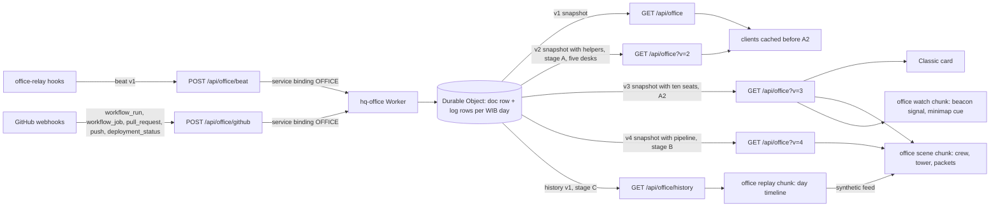

# Agent Office revamp (living crew, ship-it pipeline, day replay): design

Date: 2026-10-20. Status: implemented (A #274, A2 #276, B #279, C (this PR)). Approved by the owner on 2026-10-20
(direction D, staged all-in; section 2), relayed by the coordinator; the stage A look approved on 2026-10-20 from the
prototype renders (thought trail only, beacon 1.6 u, slim LED-lane tower, the done spin ending on the camera); A2 (the
always-live office and ten desks, sections 5.9 and 5.10) approved on 2026-10-21.

Owner request (verbatim): "I see thats good but current Agent Office just not feel so WOW i need you to think and do
revamp for it (or add featured)".

Builds on the Agent Office ([design](2026-10-18-agent-office-design.md), [decision](../../decisions/2026-10-18-agent-office.md),
[wing decision](../../decisions/2026-10-20-agent-office-wing.md)): the hq-office Worker and Durable Object (#233), the
relay hooks (#242, #251), the 3D office in the L1 south wing (#261) and the Classic card (#264). It assumes the
office enhancement of 2026-10-20 has merged (no privacy sentence on the Classic card and in the 3D drawer, a higher
screen wall, more space between the desk console and the wall); every number below that depends on the wall's height
or the console's depth is re-derived from `OFFICE` and `OFFICE_WING` after that merge, never copied.

Plans, one per PR (section 13):
[`2026-10-20-agent-office-crew.md`](../plans/2026-10-20-agent-office-crew.md) (A),
[`2026-10-21-agent-office-live-ten.md`](../plans/2026-10-21-agent-office-live-ten.md) (A2),
[`2026-10-20-agent-office-pipeline.md`](../plans/2026-10-20-agent-office-pipeline.md) (B),
[`2026-10-20-agent-office-replay.md`](../plans/2026-10-20-agent-office-replay.md) (C).

## 1. Goal

The office today is correct but quiet: Rovers bob at desks, a wall lists text, and most of the day every Rover is
asleep. The revamp makes it read at a glance, from across the Lobby, as a crew that works, waits, asks and ships:

- **A. Living crew.** Each Rover acts out its real state with a body, not only a face and a tone.
- **B. Ship-it pipeline.** Pushes, CI jobs, merges and production deploys become physical events in the wing.
- **C. Day replay.** Today (or any of the last 7 days) plays back as a 30 to 60 s time-lapse; an idle office loops the
  latest day, clearly labelled, so it never looks dead.

Success: a visitor at the office stop can tell within 3 s which Rovers work, wait or need Kurniadi; a visitor anywhere
in the Lobby sees when one needs him; the office moves (live or replay) whenever it is in view; every budget below holds.

## 2. Owner decisions (approved 2026-10-20)

| # | Decision |
|---|---|
| R1 | Direction D, staged all-in, three PRs in order: A living crew, B ship-it pipeline, C day replay (scope in sections 5 to 7). |
| R2 | Budget: the revamp gets its own office chunk budget of about 40 KB gzip (`officeTotal`, still the office chunks' own cap). L1 stays under 125 scene draw calls on both tiers and holds fps on lite; reuse instancing and the shared programs, no new shader program where avoidable. Its loading rule (only on the lead road, in the wing, or when an office mission, go-to or drawer starts, kept out of the 3D session totals like B1) is reversed by R5 ([decision 2026-10-21](../../decisions/2026-10-21-office-always-live.md)). |
| R3 | History: a privacy-safe event log in the Durable Object for today plus the last 7 days: agent, state, timestamp, and repo, branch and title only for public allowlisted repos (everything else "Client project"). No prompts, code, paths or client names, ever. Bounded storage (row caps, daily rollover, prune past 7 days) inside the Workers and Durable Object free limits; a public read endpoint for replay with ETag and caching. Security review before merge. |
| R4 | Optional "featured" touches (section 12) are proposals only: none is built without approval. |
| R5 | Always-live office (2026-10-21, A2; section 5.9, [decision](../../decisions/2026-10-21-office-always-live.md)): the office scene chunk (and the beacon chunk if merged into it) loads on every L1 visit at idle after the first frame and counts in the L1 session totals (caps raised by the measured bytes at measured plus 0.6 KB, first-frame cap unchanged); the drawer body, the beacon chunk (if separate) and the replay chunk keep their triggers; a far level of detail and near or far polls keep the runtime and request costs low. |
| R6 | Ten desks (2026-10-21, A2; section 5.10, [decision](../../decisions/2026-10-21-office-ten-desks.md)): up to ten session desks in two rows of five, served only in snapshot v3 (polled by the scene, the Classic card and the office watch); v1 and v2 keep five desks plus `extra`; stage B's pipeline moves to v4. |

Unchanged from the office design: the privacy rules D3 (and `docs/agents/office.md`), the v1 contract (five desks
plus `extra`; ten seats only in v3, section 5.10), the nine states, the time rules in `effective`, the wing's layout
outside the two new corner fixtures (section 6.1) and the second console row (section 5.10), every Classic route's budgets, and "every route works without WebGL".

## 3. Architecture



Client modules and chunks (all under `src/experience/floors/lobby/office/` unless noted):

| Piece | Where | Loaded | Stage |
|---|---|---|---|
| `officeWatch.ts`, `OfficeBeacon.tsx`, minimap cue | watch and beacon chunks (5.3) loaded by `OfficeMount`, `src/hud/minimap/` | the watch at idle on every L1 visit; the beacon on the first ask | A |
| `crew.ts` (pure choreography), `crewFx.ts` (sparks, thought trail, flag, dock writes) | scene chunk | every L1 visit, at idle after the first frame (5.9; an office mission, go-to or drawer still loads it at once) | A, A2 |
| `pipeline.ts` (pure: lanes, packets, ships from snapshot diffs), `pipelineFx.ts` | scene chunk | same | B |
| `replay.ts` (pure engine), `replayFeed.ts` (fetch, parse, playback clock) | new `office/replayChunk.ts` lazy chunk | the idle loop condition, or the drawer's replay control | C |
| Replay controls, crew summary | drawer body chunk (`OfficeBody`) | an office drawer opens | A (summary), C (controls) |

The crew renders whatever feed it is given: live snapshots (A, B) or the replay engine's synthetic snapshots (C).
Choreography, pipeline events and replay are pure modules over plain data, unit-tested in node; the three.js writers
stay thin.

## 4. Baseline facts the design relies on

- The office scene draws in 7 calls (2 shell on the main path, 5 in the scene chunk: Rover parts and treads instanced
  boxes, the face and desk-screen atlas quads, the instanced glow mesh in `HOLO_MODE.dot`, the wall quad). L1 settled:
  101 lite and 103 full at the spawn, 51 and 53 at the office stop (cap 125).
- The Highlights Hall's `HOLO_MODE.stage` program (per-instance kinds: stage lights, light curtain, pulse rings, tiles)
  is compiled and pinned on L1 already; a second mesh on the same material settings adds a draw call but no program.
- Per-frame office work runs only while the office is in view (`officeRuntime.inView`), writes are skipped when no
  pose, glow key or camera changed (`RoverWrites`, `glowKey`), and texture work runs through `whenDrawn`.
- Caps today: office scene chunk 14 KB (measured 14,290 B), drawer body 6 KB (5,996 B); first frame 462.2 KB, session
  full 491.1 KB and lite 475.4 KB (before the enhancement PR re-sets them).
- Polling: 10 s while a desk is awake, 30 s otherwise, only while the office is in view or a drawer is open, the tab
  visible and the visitor active in the last 10 min. `/api/office` is edge-cached 5 s per data center.

## 5. Stage A: living crew

### 5.1 Choreography model (`crew.ts`, pure)

One `CrewActor` per desk, advanced by `stepCrew(actor, input, dt, reduced)` every frame the office is in view:

- Input: the desk's effective state (from the feed), the camera's xz, the tower and dock anchors (section 6.1), the
  slot's phase.
- Output: an `OfficePose` (today's fields plus `x` and `z` offsets along the desk's local axes, a `yaw` offset, `flag`
  0 to 1, `spin`), and an `fx` record (sparks, thought trail, flag wave, charge level, flicker) read by `crewFx.ts`.
- **Transitions**: on a state change the actor snapshots the pose it is in and blends from it to the new state's live
  target pose with a smoothstep weight over `max(0.35 s, turn / 3 rad/s)`, so gestures (typing, pacing) keep their full
  amplitude once the blend ends and no turn is faster than 3 rad/s. A one-shot gesture (the victory spin) starts only
  after the blend ends. A change during a blend snapshots the current blended pose, so nothing snaps. Under reduced motion every transition cuts and the face and
  screen keep the existing 0.4 s crossfade.
- **Look targets**: `camera` (the camera's xz, the yaw clamped to 70 degrees either side of the desk heading so a Rover
  never turns its back fully to its desk), `tower` (the CI tower's lanes), `desk` (rest). The camera target is re-read
  only when the camera moved (the existing camera key), so a still camera costs no writes.
- Determinism: all motion is a function of the actor's state clock and the slot phase (`slotPhase`), so a test can
  step a fixed dt and assert poses; no `Math.random` (sparks use a hashed sequence per slot).

### 5.2 State table

| State | Full motion | Reduced motion (held pose, still readable) | Desk |
|---|---|---|---|
| working | typing: arms alternate, head pitched 0.12 rad to the desk, a 0.04 u bob; **key sparks**: 3 to 5 cyan glow dots pop 0.2 to 0.6 u above the desk's front edge between the hands, each living 0.3 s | typing pose held, 3 sparks fixed above the keys | code screen (unchanged) |
| thinking | head tilt sway; **thought trail**: 3 amber dots rising from the antenna tip (sizes 0.08, 0.12, 0.18 u), bobbing gently (owner: the trail only, no swirl) | tilt held, trail fixed | dots screen |
| reviewing | side-to-side scan (unchanged) | unchanged | diff screen |
| testing | lean in, arms half raised, progress ring runs (unchanged) | unchanged | progress screen |
| ci (waiting on CI) | turns to the CI tower (`tower` look target) and **paces**: slides 0.4 u either way along the desk's tangent at 0.2 Hz, the turn following the tower; the progress dot ring stays | turned to the tower, standing at the middle of its pace | CI screen |
| input (Needs Kurniadi) | turns to the camera (`camera` target), raises the left arm with a **flag** (pole 1.2 u, plate 0.6 x 0.4 u in the input tone) that waves; the **beacon** rings over the wing (5.3) | turned to the camera, flag raised still, beacon steady (no rings moving) | question screen ("Waiting for Kurniadi", unchanged) |
| done | a **victory spin**: one full turn over 0.9 s with a 0.3 u hop and both arms up that ends facing the camera (the `camera` look target, so the happy face reads), then the happy bob; 6 green confetti dots burst from the head once | arms up, facing the camera, no spin, no confetti | check screen |
| failed | **slump**: pitch 0.3 rad, down 0.08 u, arms hanging; **red flicker**: the halo and antenna tip flicker in two short bursts every 3 s (never above 3 flashes per second, WCAG 2.3.1) | slump held, halo and tip steady red | cross screen |
| asleep | **docks and charges**: rolls back 0.35 u onto a charging pad (a flat glow disc), head down; the pad breathes at 0.2 Hz from 30% to 60% | docked, pad steady at 45% | screen off; the **desk light** (a new glow strip instance along the desk's front edge, lit in the state tone while awake) fades to 10% |

Every motion amplitude is small enough that a Rover stays inside its row obstacle box (the pace and the dock offsets
are asserted against `officeObstacles` in `tests/unit/office-crew.test.ts`). The flag's top stays below the wall's
top edge, so it never meets a chip; it may cover part of the wall's lower text row while raised (accepted: the drawer
and the chip carry the same information).

### 5.3 Beacon and minimap cue (main path)

- **Chunks (owner budget decision 2026-10-20)**: the main path carries only a small loader in `OfficeMount`. After the
  first frame goes idle on L1 it loads the **office watch chunk** (`office/watchChunk.ts`: the signal, the watch and the
  minimap cue component), which loads on every L1 session and counts in the 3D session totals (its own cap,
  `BYTES_3D_BUDGET.officeWatch`, measured plus 0.6 KB). The **beacon chunk** (`office/beaconChunk.ts`: the beacon mesh
  and its effects, and stage B's deploy beam) loads only the first time the watch sees a Needs Kurniadi desk (or, in
  stage B, a fresh production deploy) and stays loaded for the session; most sessions never download it. It has its own
  cap (`BYTES_3D_BUDGET.officeBeacon`) outside the session total (merging it into the scene chunk is allowed now that
  the scene chunk loads on every L1 visit, 5.9). The office scene chunk, which also loads on every L1 visit at idle and
  counts in the session totals (5.9), feeds the same signal through the watch chunk's module (a shared lazy chunk,
  never the main path).
- **Office watch** (in the watch chunk): while the visitor is on L1 (not riding), the tab is
  visible, the visitor was active in the last 10 min and the office scene's own poller is not running, it fetches
  `GET /api/office?v=3` (`cache: "no-store"`; from A2, 5.10, so an asking Rover on the back row, slots 5 to 9, lights
  the beacon too; the same one request per 30 s as the v1 watch) every 30 s and keeps two values: the asking desks
  (`needsKurniadi`) and, from stage B, `deployAt` (a deploy success at most 30 s old). It reads only those fields with
  tiny guards (`signalFromBody` accepts v1 to v3 bodies with up to ten desks and slots 0 to 9; it never renders text
  from the body). The signal expires on its own 60 s after the last good answer (a module timer), so a
  beacon never outlives its data, also after leaving L1. Once the scene chunk's poller runs, the scene feeds the signal
  instead (one request stream, not two).
- **Beacon** (`OfficeBeacon.tsx` in the beacon chunk, mounted by `OfficeMount` inside the wing's `IntroReveal` once loaded): one instanced mesh on the hall's stage material
  (`createStageMaterial`, `HOLO_MODE.stage`, no new program) over the unit open cylinder, all instances of the `beam`
  stage kind: a column 1.6 u wide (owner) rising 26 u from the floor 1.25 u behind an asking front-row Rover (1.8 u
  behind a back-row Rover, just past the riser's back edge, so its base stands on the floor),
  between it and the wall (in front of the desk it hid the Rover and its flag in the prototype renders; from the wing
  plaza centre when more than one asks), plus three flat rings (0.4 u tall bands, 2.2 to 3.8 times the column's radius)
  that pulse up its lowest 8 u (the part a desktop sees from the spawn) every 1.6 s, fading in and out, in the input
  tone (look pass, [decision 2026-10-21](../../decisions/2026-10-21-office-look-pass.md)). Drawn only while `needsKurniadi` (out of the draw otherwise), so the spawn's
  settled calls rise by 1 only while a Rover asks. The wing stands outside the tower's footprint, so the column rises
  into open sky and reads over the Lobby's landmarks from the spawn on every landscape size (34 to 77% of the column
  in frame, asserted by a projection test on the six sizes like `office-chip-placement`); the views that face away from
  the wing (the hall road, the elevator arrival, portrait screens at the spawn) rely on the minimap cue (owner decision:
  no HUD edge arrow). Reduced motion: the column holds
  at full height, rings fixed. While the rover is at the office stop the column hides and only faint bands stay (30%,
  climbing no higher than the asking Rover's head; decision 2026-10-21, replacing the 25% fade): in the prototype the
  column crossed the wall's GitHub half, and the asking Rover's flag carries the signal there.
- **Minimap cue**: the office room marker in the minimap and the overview pulses in the input tone while
  `needsKurniadi` (CSS, written as `@variant motion-reduce` with a static ring under reduced motion), with an
  `aria-label` "Agent Office: a Rover is waiting for Kurniadi" / "Kantor Agen: sebuah Rover menunggu Kurniadi". No new
  draw call (the minimap is HTML/SVG).
- The watch, the cue and the beacon never load the office scene chunk themselves: `officeLoadWanted` loads it on every
  L1 visit at idle (5.9). The watch polls only while the scene's poller is not feeding (the office out of view), so
  one request stream runs at a time.

### 5.4 The CI tower and the dock (stage A shells)

The `ci` pose needs something to watch, so stage A adds the two corner fixtures of section 6.1 as furniture shell (the
main path's merged boxes, so the navgrid and the minimap fixtures hold them before the chunk loads): a slim LED-lane
column 1.2 u square and 9 u tall (look pass, decision 2026-10-21, replacing 2 u) and a low dock pad. In the scene
chunk it lights the tower from v1 data: the newest running public run in the feed shows its `progress` as lit lanes
(done of total, anonymous). Stage B replaces that with named per-job lanes.

### 5.5 Rendering and budget (A)

The counts below are for five desks; every per-desk count (glow instances, parts, atlas quads) scales with the seat
count, so ten seats double them (5.10).

- Sparks, the thought trail, confetti, flicker, charge pads and desk lights are extra instances of the existing glow mesh
  (`GLOW_PER_ROVER` grows from 18 to 34: 5 sparks, 3 trail, 6 confetti, the charge pad and the desk light; 170
  instances): 0 new calls, 0 new programs. Writes
  stay keyed: a still office (all asleep, reduced motion, camera still) writes nothing per frame.
- Flags: the pole is one more part per Rover (`PARTS_PER_ROVER` 5 to 6, scaled to 0 when lowered) and the plate a quad
  on a new flag cell of the face atlas (the atlas mesh grows from 10 to 15 quads), so the parts mesh needs no instance
  colour (which would compile a new program variant).
- Tower lanes in A: glow-mesh instances (an LED matrix, section 6.3). Tower and dock bodies: main-path shell boxes.
- Measured so far: scene chunk 13.2 KB gzip with the crew; main path: the loader and the shells only (the watch chunk and the
  beacon chunk carry the rest, owner decision), L1 calls at
  the office stop +0 (the beacon is already counted when asking: +1), at the spawn +1 only while a Rover asks.

### 5.6 Accessibility (A)

- The summary drawer gains a **crew summary**: one sentence per desk ("Desk 2: Claude is waiting for Kurniadi, since
  14:02"), in a `role="status"` region (`aria-live="polite"`) that announces only state changes (not activity or
  keepalive refreshes), coalesced to at most one announcement per 10 s. Strings in `office.3d.crew.*`, both locales.
- Chips keep their labels; the input chip adds "needs Kurniadi" to its accessible name.
- Every motion has a reduced-motion pose (5.2); nothing flashes more than 3 times per second.

### 5.7 Tests (A)

- `tests/unit/office-crew.test.ts`: every state's target pose and fx; transitions settle within 0.5 s and never jump
  more than a spring step per frame; retargeting mid-transition; reduced motion cuts and holds; the camera clamp; pace
  and dock offsets inside the obstacle boxes; determinism (same inputs, same poses).
- `tests/unit/office-watch.test.ts`: cadence, the visibility and idle gates, the hand-over to the scene poller, guards
  on hostile bodies (never throws, never true on malformed input).
- `tests/unit/office-beacon-view.test.ts`: the beacon column projects on screen from the spawn, the elevator arrival
  and the hall road on the six sizes (or the minimap cue is visible where it does not).
- `tests/unit/lobby-office.test.ts`: the tower and dock fixtures meet `SPACE_RULES` (touching or 6 u), no pocket, the
  stop still reachable; `office-chip-placement`: chips clear the tower and dock.
- jsdom: `OfficeBody` crew summary (live region, coalescing, both locales).
- E2E `e2e/office.spec.ts`: each state from fixtures reaches its pose (probe `__hq.probes.office.crew`), the beacon
  shows from the spawn when a desk asks and hides when none does, the minimap cue toggles, reduced motion holds still
  (`bob` 0, no spark motion).
- Perf lane: L1 calls at the spawn (asking and not) and at the office stop on both tiers; programs at the baseline;
  memory gates.

### 5.7b Office stop view and chip row (owner decision 2026-10-20)

From the office stop the office fills the frame: the wall top about 12 to 15% from the top edge, the console and Rovers
in the lower middle, the CI tower and dock corners in frame on desktop, the visitor's Rover visible; other view zones
unchanged. To free the sky band the chips move from over the wall into one compact row pinned under the HUD top bar,
each x-aligned with its Rover (a state dot and the agent name; the activity on the near pose; dot-only on phones),
nudged along x in desk order so they never overlap each other or the HUD (top bar, the desktop floor menu, the profile
card, the minimap), with a thin leader line or colour cue to its Rover; the full text stays in the aria-label. With
ten desks (A2, 5.10) the desktop row holds ten compact chips, and phones show dot-only chips in up to two rows. Chip
order: the row sorts the chips by each Rover's projected head x, so the front and back rows interleave and no leader
lines cross; within one console row that follows desk order. Every leader line stops at the wall-top level with a
tick, on the wall's top edge or, beside the wall toward an end Rover, at that level above the Rover's head (clear of the
HUD boxes); it fades to the head only where the chip sits over the screens. The chip's colour and the Rover's antenna
carry the mapping; a line that would still cross the HUD or a chip hides.

### 5.8 Sub-agent helpers (owner addition, 2026-10-20)

Each session is one Rover; the sub-agents a session starts become small **helper drones** around it.

- **Relay** (`tools/office-relay`): hooks the sub-agent start and stop events each tool offers (Copilot CLI
  `subagentStart` / `subagentStop`, Claude Code `SubagentStart` / `SubagentStop`, Codex `SubagentStart` /
  `SubagentStop`; each verified against the tool's hooks reference and a captured payload before it is installed). It
  keeps the active helper ids of each parent session locally (`~/.office-relay/sessions/<hash>.helpers.json`, each id
  hashed with the local salt, dropped after 30 min without a stop) and sends only their count: a beat gains an optional
  `helpers` (integer 0 to 9, 9 meaning 9 or more). No helper name, type, prompt or id ever leaves the machine. A start or
  stop that changes the count sends a beat with the session's last state and activity (the dedupe compares `helpers`
  too); the hook still exits 0 at once. A tool whose payload cannot name the parent session, or that has no such hook,
  is documented in the relay README and shows no helpers.
- **Worker and contract v2**: `SessionRecord.helpers` from the latest beat that carried it; read-time rule: 0 when the
  session is asleep or removed, or when no beat came for `TIMING.helpersTtl` (10 min). Old clients must never see the
  field (owner decision): `GET /api/office?v=2` serves snapshot v2, the v1 snapshot plus an optional desk `helpers` (1 to
  9, omitted at 0); `GET /api/office` (v1) stays byte for byte as before, asserted by a test that a v1 request never
  carries `helpers`. The 3D scene and the Classic card built after this change poll `?v=2` (`?v=3` from A2, 5.10, the watch too; stage B
  moves the scene to `?v=4`, 6.2); until A2 the watch keeps v1 (it needs no helpers). Deploy order: the Worker deploys before the Pages upload, so the new Function and the new clients always
  meet a Worker that serves v2; the old Function in the upload window still asks v1 and gets v1. After a rollback to a
  Worker without v2, a v2 request gets that Worker's v1 body, which the v2 parser accepts as a fallback (no helpers).
  The beat's optional `helpers` is accepted by the new Worker; an older Worker (after a rollback) rejects beats that
  carry it, so the relay omits it at 0 and the rollback runbook notes it (helpers show again after the roll forward).
- **History (stage C)**: a helper count change is a loggable change, and each log event carries the count.
- **3D**: one drone per active helper orbits the parent Rover's head (radius 1.15 u, y 2.5 u, 1.2 rad/s, evenly spaced,
  a gentle bob), at most 4 drawn; more show as a "+N" pill on the chip. Drone bodies are instances of the Rover parts
  mesh (`PARTS_PER_ROVER` grows by 4) and their glowing cores in the parent Rover's state tone instances of the glow mesh
  (`GLOW_PER_ROVER` grows by 4; dim on lite): no new draw call or program. Reduced motion parks them, hovering still at
  fixed angles beside the head. Asleep, off-duty or offline Rovers have no drones.
- **Text**: the chip and the desk drawer read "Copilot · Editing · 3 helpers" ("Copilot · Mengedit · 3 asisten"), ICU
  plurals in both locales; the compact phone chip keeps the dot only and adds the count to its accessible name; the
  crew summary says "with 3 helpers". The Classic card adds "· 3 helpers" after the activity on the same line inside
  the existing row (truncating, no height change, `OFFICE_RESERVE` unchanged).
- **Budget**: scene chunk about +1 KB, Classic card chunk about +0.1 KB, main path 0.
- **Tests**: relay fixtures with planted secrets for each tool's start and stop payloads (only a count leaves), the
  helper store (dedupe by id, TTL, cap 9), beat parse (0 to 9), Worker reducer and TTL, snapshot parse (1 to 9, absent
  at 0), the drone writer (count, cap 4, reduced motion parked, lite without glow), chips, drawer and Classic card in both
  locales, and an e2e drone state; the stage A captures and video include a desk with 3 helpers and one with 6.

### 5.9 Always-live office (owner decision 2026-10-21, A2)

The office's live layer (the Rovers, the crew animations, the helper drones, the wall screens' content and the beacon)
runs whenever the office is in view from anywhere in the Lobby, without driving there
([decision](../../decisions/2026-10-21-office-always-live.md); it reverses R2's loading rule).

- **Loading**: `officeLoadWanted` is true on L1 (or riding to L1) once the first frame went idle with speculative
  prefetch on, at any distance from the wing; the office chunks never load on the first-frame path. With
  `?prefetch=off` the scene chunk never loads on its own: only an office drawer loads it (an office mission or go-to
  ends in that drawer). Merging the beacon chunk into the scene chunk is allowed if simpler. The drawer body (an
  office drawer), the beacon chunk if separate (the first ask) and the replay chunk (the idle loop or the drawer
  control) keep their triggers.
- **Budgets**: the office scene chunk (and the beacon chunk if merged into it) counts in the L1 3D session totals,
  full and lite; the session caps rise by the measured office bytes at measured plus 0.6 KB (owner approved about
  +27 KB). The first-frame cap does not move. `BYTES_3D_BUDGET.officeTotal` 40 KB stays the office chunks' own cap.
- **Runtime**: out of view (`officeRuntime.inView` false) the office does no per-frame work, as before. In view, a far
  level of detail applies past `OFFICE_LOD.farDistance` (40 u from the office bounds, computed by `OfficeWatch` every
  0.5 s into `officeRuntime.far`): the crew, the drones, the sparks and other effects, the atlas faces and the tower
  step through the pure `lodStep` at about 4 fps (`OFFICE_LOD.farHz` 4; desk screens and faces at most 2 fps); inside
  it they step every frame. A still office still writes nothing per frame; reduced motion holds its poses as in 5.2.
- **Requests**: no per-visitor fast poll from afar. The scene's poller has three reasons: `near` (in view and inside
  `farDistance`: the fast cadence, 10 s while a desk is awake, else 30 s), `far` (in view and past it: 30 s) and
  `drawer` (an office drawer open: fast). Out of view the scene's poller stops and the office watch (5.3) polls v3 every
  30 s, so one request stream runs at a time. The back-off, the hidden-tab stop and the 10 min idle stop are kept. The
  Workers requests per day estimate is in the decision (about 7,000 visitor polls on a day of 500 L1 sessions, the same
  far rate as the part A watch).
- **Render budget**: L1 under 125 scene draw calls in every view on both tiers (the spawn with the wing in view, the
  spawn turned toward it and the lane ring's south point included), no new shader program, memory gates flat, lite fps
  healthy.
- **Verification**: captures of the ring-south and spawn-turned views show the live office; an e2e loads L1, waits for
  the idle frame and asserts the live layer mounts (`__hq.probes.office.loaded`) without moving the rover, and that
  Rovers animate at the far rate from the ring's south point.

### 5.10 Ten desks (owner decision 2026-10-21, A2)

Up to ten sessions get a desk, one Rover per session; helpers stay drones (5.8)
([decision](../../decisions/2026-10-21-office-ten-desks.md)).

- **Contract v3**: `OFFICE_SEATS = 10`. `GET /api/office?v=3` serves snapshot v3: the v2 snapshot with up to ten desks
  (slots 0 to 9) and `extra` counting sessions past ten. v1 and v2 stay byte for byte for documents with up to five
  sessions; beyond five they keep the same shape and rules: five desks (slots 0 to 4) plus `extra`, where sessions on
  seats 5 to 9 count in `extra`, never a slot above 4, so old clients never see more. The Worker's `assignSlots` works
  over ten seats and fills the front row (slots 0 to 4) first. The 3D scene, the Classic card and the office watch
  poll v3: the watch so an asking Rover on the back row lights the beacon (still one request per 30 s, the same count
  as the v1 watch), and the signal guard `signalFromBody` accepts v1 to v3 bodies with up to ten desks and slots 0 to 9.
  The Function honours `v` 2 and 3 (anything else is v1) with one edge cache entry per version; the v3 parser falls back to v2 and v1 bodies (a rolled-back Worker). Stage B's pipeline
  becomes v4 (6.2) and stage C's log slots run 0 to 9 (7.1).
- **3D**: a second, raised console row stands behind the first: a second arc on a riser, its angles, radius and
  height chosen so every back-row Rover's face and desk screen is at least 80% unoccluded from the office stop on the
  desktop and tablet camera classes, and on portrait every Rover is in frame with the back row at least 60% unoccluded
  (a projection test against the front row's boxes). The 6 u `SPACE_RULES` hold
  (touch or 6 u, no pocket, the stop reachable); the wing may grow deeper, derived from S through `OFFICE_WING`, and the
  tower and the dock still touch the end boxes. The front row stays in place. Rooms `L1:office-desk-6` to
  `L1:office-desk-10` join the desk rooms.
- **Rendering**: instance counts derive from the slot count (ten Rovers, drones at most 4 per Rover); the atlas holds
  ten faces, ten desk screens and the flag cell (grown to 1024 x 576 with full-size cells), still one
  upload and partial copies. No new draw call or shader program.
- **Chips**: on desktop one row of ten compact chips (a state dot and the agent; the activity only on the near pose),
  ordered by each Rover's projected head x (the two rows interleave; within a row, desk order; 5.7b); on phones
  dot-only chips in up to two rows. Chips never cover the HUD (the top bar, the floor menu, the profile card, the
  minimap) or each other. Empty desks show docked or dim; the "+N more" pill appears only past ten sessions. With ten
  sessions no screen size leaves a chip wide enough for the activity (107 px or narrower, under the 128 px near
  threshold), so near chips show names only and the activity stays in the aria-label and the desk drawer; pending owner
  review.
- **Stop view**: retuned to frame both rows and the wall (desktop wall top about 12 to 15% from the top edge; portrait
  keeps the accepted top-band fill); other view zones bit-identical.
- **Classic card**: keeps its fixed height with five desk rows. Active desks (any state but asleep, front row first)
  fill the rows; with more than five active, the fifth row becomes "+N more desks" ("+N meja lainnya";
  N counts every awake desk past the four shown, worded without "active" so it never contradicts the Active count);
  asleep and off-duty desks collapse into the existing summary line. Zero layout shift in every state (`OFFICE_RESERVE`
  re-measured only if a line changes height).
- **Budgets**: L1 under 125 scene draw calls in every view on both tiers, lite fps healthy, the office chunks inside
  40 KB.

## 6. Stage B: ship-it pipeline

### 6.1 Placement

Two corner fixtures in the wing, both touching the console's end row boxes and the wing's side and south edges (the
6 u `SPACE_RULES` allow touching), so they close the corners without making a pocket:

- **CI tower** (south-east, screen left from the stop): the plinth fills the corner east of the east row box; a column
  1.2 x 1.2 u (decision 2026-10-21), about 9 u tall, turned to face the stop, carries the lane matrix on its stop-facing side.
- **Ship dock** (south-west, screen right): a low pad with a launch ring, where merged packages land and deploy beams
  fire.

Exact rects come from `officeTower(w)` and `officeDock(w)` in `officeLayout.ts` (pure, from `OFFICE_WING` offsets), so
the L1 re-spacing moves them with the wing. From the stop both are in frame on desktop and tablet classes; on portrait
screens they may fall outside the frame, where the CI drawer and the chips carry the pipeline (asserted by projection).

### 6.2 Data: contract v4 (Worker, Function, scene in one PR)

The v1, v2 and v3 responses cannot carry per-job lanes, so the scene moves to `GET /api/office?v=4` (v3 is the ten-seat
snapshot, 5.10); v1, v2 and v3 stay byte for byte for the Classic card and the watch (v3) and clients cached across a
deploy.

```ts
interface OfficePipelineJob { name: string; status: "queued" | "running" | "done" | "failed" }
interface OfficePipelineRun {
  id: number; repo: string; title: string; url: string;
  status: "running" | "success" | "failure";
  slot?: number;              // the desk (0 to 9) whose public repo and branch match the run's head branch
  at: number;                 // first seen
  jobs: OfficePipelineJob[];  // at most 24, in first-seen order
}
interface OfficeShip { key: string; kind: "merge" | "deploy"; status: "running" | "success" | "failure" | "merged"; at: number; slot?: number }
interface OfficeSnapshotV4 extends Omit<OfficeSnapshotV3, "v"> {
  v: 4;
  pipeline: { runs: OfficePipelineRun[] /* newest first, at most 3 */; ships: OfficeShip[] /* newest first, at most 10 */ };
}
```

- Worker: `RunRecord` gains `order` (the laned job ids in first-seen order, at most 24 per run; later jobs fold into
  the last lane), `names: Record<jobId, string>` (job names already pass `cleanTitle`; cut to 40 chars) and `started`
  (the attempt's first sighting, the run's `at`); `PrRecord` and the deploy feed keep what they have; `ships` derive
  from the feed's `merged` PRs and production `deploy` items (`pipelineOf`, served by `viewV4`). Runs and merges link
  to a desk through the session's effective seat (`seatOf`). Older stored documents read with the three absent.
- Public repositories only, the same rules as today (allowlist, known-public set, fork and actor checks, blocked
  branches ignored, `privatized` strips runs and ships).
- `parseOfficeResponseV4` (the scene's poller and the Function; in `protocolV4.ts`, so the Classic card and the
  watch never carry it) is strict on a v4 body (keys like v1) and reads a v3, v2 or v1 body as v4 with an empty
  pipeline, so the scene reads one type, `OfficeResponseV4`; the Classic card and the watch stay on v3.
- `functions/_lib/office.ts`: the `v` query (only `2`, `3` and `4` are honoured; anything else is v1) is part of the
  edge cache key; the same ETag and cache headers.

### 6.3 Visuals

All on existing meshes unless noted; tones from `STATUS_COLOR` and `STATE_TONE`.

- **Lane matrix**: one lane per job of the newest run (up to 24 rows; a second running run gets the top rows, at most
  3 runs). A lane is a row of 8 glow dots: queued dim, running a chasing dot, done green full, failed red full. E2E
  shards appear lane by lane as their `workflow_job` events arrive (the poll brings them within 10 s).
- **Packets**: when a new run appears with a `slot`, 4 cyan dots travel from that desk to the tower on a 1.5 s arc; a
  run without a desk (a push to main) launches from the wall's centre.
- **Bursts**: a job turning `done` or `failed` fires a ring of 8 dots from its lane (green or red), staggered at least
  0.15 s apart; a whole run finishing flashes the tower's crown (top dots) once.
- **Package**: a merged PR sends a small box from its desk (or the tower) to the dock on a 2.5 s parabola, with a 6-dot
  violet glow trail; it stays on the dock pad until the WIB day ends (at most 12 stacked, the dock's pile is today's
  merged count). The box is a plain parts-mesh instance (the parts mesh has no instance colour; one would compile a
  new program variant), so its violet comes from a glow core at its centre and the trail.
- **Ceiling**: every arc (packets and packages) stays under the wall's top (6.6 u, `FX_CEILING`, `arcLift`), so from
  the office stop nothing rises into the chip row (5.7b); the beam stops at that height at the stop too.
- **Deploy beam**: a production `deploy` ship with `success` fires a green column up from the dock for 8 s (`running`:
  a slow violet shimmer at the pad; `failure`: one red pulse, both in the scene chunk). The beam is the beacon mesh's
  instance 4 in the beacon chunk (5.3), fired from the office signal's `deployAt` (the newest production deploy success
  at most 30 s old, from the scene's feed or the watch's), so it reads from the Lobby too, with the office out of view;
  the first fresh deploy loads the beacon chunk like the first ask.
- **CI drawer**: a new room `L1:office-ci` (point-and-go target `L1:station:office-ci` at the tower, driving to the
  stop like the other office rooms, URL stays `/{locale}`): the latest runs with their lanes as text (job name and
  status), the latest merges and deploys. This is the text alternative of the tower.

### 6.4 Events from snapshots (`pipeline.ts`, pure)

Polling brings snapshots, not events, so `diffPipeline(prev, next, now)` derives events (packet, burst, crown, package,
beam) by comparing run ids, job statuses and ship keys. Rules: the first snapshot after a load sets the baseline
silently (no backlog replays; the deploy beam does not come from the diff: it follows the signal's `deployAt`, any
production deploy success under 30 s old, 6.3); events older than 60 s on the server's clock (the skew read from
`updatedAt`) are dropped; a queue plays them staggered (at most 1 burst per 0.15 s, 1 package per 2.6 s, over the
2.5 s flight). Reduced motion: no packets or flights; the
end state shows at once (lanes lit, package on the dock, a static beam glow for 8 s).

### 6.5 Budget and tests (B)

- Expected: scene chunk +6 to 8 KB, main path +0.1 KB (the beam kind in the beacon mesh, the watch's deploy flag); calls
  at the office stop +0 (all instances) beyond the beacon mesh while lit.
- Measured (owner decision 2026-10-21, `docs/decisions/2026-10-21-office-pipeline-budgets.md`): the scene chunk 26,586 B
  (+3,663 B over A2's 22,923 B), the drawer body 6,483 B (the drawer reads the scene chunk's poller, so it shrank), the
  watch chunk 1,555 B, the beacon chunk 2,043 B; the first frame full 476,592 B and lite 460,458 B (under the unchanged
  `failAt`); L1 under 125 scene calls in every view with a burst playing and the beam running, programs at the
  baseline, no new draw call.
- Unit: `office/state` (job names, caps, ships, privatized), `office/protocol` (v4 parse, hostile inputs),
  `office-endpoint` (v4 query, cache key, v1 to v3 unchanged), `office-pipeline` (diff rules, baseline, staleness, queue),
  `office-rooms` (the CI room), `lobby-office` (fixture rects). E2E: a run's lanes fill from fixture snapshots, a burst,
  a package, a beam; the CI drawer lists the jobs. Security review of the v4 surface before merge.

## 7. Stage C: day replay

Shipped as stage C ([plan](../plans/2026-10-20-agent-office-replay.md), budgets
[decision](../../decisions/2026-10-22-office-replay-budgets.md)). Current rules: [office.md](../../agents/office.md)
(backend) and [floor-l1-lobby.md](../../agents/floor-l1-lobby.md#day-replay) (experience).

### 7.1 Storage (Durable Object)

Beside the `doc` row, one row per WIB day, `log:YYYY-MM-DD`, written in the same `storage.put` as the doc (one
transaction) only when something loggable changed. The Durable Object diffs the doc before and after every accepted
beat or webhook over every session (`logDoc` in `workers/office/src/history.ts`), so a seat that moves because another
session left is logged too (a per-session beat log would miss it).

```ts
interface DayLog {
  v: 1; day: string;
  keys: string[];                    // private: session hash per ordinal; never served
  agents: OfficeAgent[];             // per ordinal
  tasks: Record<string, { repo: string; title?: string }>; // allowlisted public repos only; no branches
  events: [t, n, seat, state, activity, until | null, helpers][];
  prs: [t, seat, repo, number, title][];            // repo and title "" when not public
  runs: [start, end, seat, ok, lanes][];            // finished runs: lanes 0 to 24
  deploys: [t, ok][];                               // production deploy results
  truncated: boolean;
}
```

- `t`, `start`, `end` and `until` are seconds since the WIB midnight; `seat` 0 to 9 (the v3 seats, 5.10) through
  `seatOf`, -1 past the ten; states and activities are indexes into `OFFICE_STATES` and `OFFICE_ACTIVITIES`. An event's
  `until` is null while it is open (its session has not changed); the served day closes it from the session's
  `lastBeat`.
- Logged: a change of a session's state, activity, seat or helper count (keepalives are not), a session back from a
  quiet gap (removed, asleep or helpers decayed: `quietGap`; thinking after 20 s is not logged, the replay derives it
  after `until`), a merge, a run that finished (a new finished attempt included) and a production deploy result.
- Caps: 200 sessions, 3,000 events, 200 merges, 500 runs, 50 deploys and 120 KB serialized per day (less a 4 KB
  headroom so the closes always fit); past a cap the row is marked `truncated`, what the change added is dropped and the
  merge, run and deploy counts keep growing to their own caps.
- Rollover: the first write of a new WIB day starts its row with one carry-in event at t 0 for each session still live
  at the midnight (its `until` closes from its last beat, down to -1800), closes the latest earlier row from the doc and
  deletes rows older than the 8-day window (`storage.list({ prefix: "log:" })`), so at most 8 log rows exist.
- `privatized` scrubs that repository from every stored row in the same write: its tasks go and its merges keep only
  time, desk and number.
- Free limits: a busy day with all ten seats in use (10 sessions, about 2,800 state changes, 60 PRs, 200 runs, 10
  deploys) logs about 95 KB (inside the 3,000 events and 120 KB caps; a busier day is marked `truncated`), writes under
  about 10,000 rows (limit 100,000 a day), stores under 1 MB in total (limit 5 GB), and adds no Durable Object request
  beyond the history reads (office.md has the table).

### 7.2 Endpoint

- `GET /api/office/history`: the index, `{ v: 1, days: [{ day, events, prs, runs, deploys }] }` for the 8 days (empty
  days included), newest first.
- `GET /api/office/history?day=YYYY-MM-DD`: `OfficeHistoryV1`: `{ v: 1, day, start (epoch ms of the WIB midnight),
  agents, tasks, events, prs, runs, deploys, truncated }`; `keys` is never serialized. The Durable Object serves the
  day (open events closed; tasks and merge titles only for repositories still in the known-public set) and the Worker
  cleans it again at read time (`cleanHistory`: the allowlist on every repository and `cleanTitle` with the current
  blocklist on every title, so a later blocklist update applies retroactively).
- A `day` outside the window, malformed, or any other query key: `404` with `{ v: 1, error: "day" }` from the Function
  (no echo of the input); the Worker answers such a query with a 404 that never reaches the Durable Object. The edge
  cache key is built from the validated values, so junk queries cannot fill the cache.
- Caching: the index and today `Cache-Control: public, max-age=30, stale-while-revalidate=60`; past days `public,
  max-age=3600, stale-while-revalidate=300` (not immutable: a privatize can scrub them). ETag and 304 like
  `/api/office`, GET and HEAD. The kill switch `OFFICE_ENABLED` answers `{ v: 1, enabled: false }`. Any other failure
  (no binding, a Worker error or invalid body, a Worker rolled back to before C) is a 503 with `no-store`, which the
  client shows as "Replay unavailable".
- The Function and the replay chunk validate with `parseOfficeHistory` and `parseOfficeHistoryIndex`
  (`src/lib/office/protocolHistory.ts`: strict keys, tuple shapes, bounds, sorted lists) and drop the whole body on any
  mismatch. The parsers stay out of `protocol.ts`, so the Classic card, the watch, the scene chunk and the drawer body
  never carry them.

### 7.3 Replay engine (`replay.ts`, pure, in the replay chunk)

- Rebuilds each desk's state over the day from the events with the same rules as `effective` (`RULES`, mirrored from
  the Worker's `TIMING` and pinned equal by a test: thinking after an event's `until` plus 20 s, asleep after 3 or 15
  min, done for 20 s, removed after 30 min, helpers for 10 min), so a replayed desk matches what the live office showed.
- **Time compression** (`planReplay`): active stretches (an awake event until its session would sleep, a merge or
  deploy plus 30 s, a run from its start to its end plus 30 s) play at 600 day seconds per playback second; a quiet gap
  over 600 s plays in 1.5 s (less when there are many); the total is clamped to 30 to 60 s. A day with nothing to play
  has no plan.
- **Output** (`snapshotAt`): a synthetic v4-shaped `OfficeFeedSnapshot` per playback second (desks, the merges so far
  as the GitHub feed, `today` counts so far, a pipeline view of the day's runs and ships), never parsed, cached or
  served, fed to the same scene as a live feed through `useOfficeSource`, so A's crew and B's pipeline render a replay
  with no extra render code. Tasks show the day's public titles or "Client project".
- **Clock and feed** (`replayFeed.ts`): the playback clock steps only from the scene's frame (after the in-view gate and
  the level-of-detail step), with no timer or rAF loop; the snapshot is published when its content changed, at most once
  per 0.25 s of playback. A `seq` bumps on every play, seek and loop restart, and the scene's pipeline queue resets on it.
- **Live is separate**: the beacon's signal, the minimap cue, the deploy beam and the point-and-go targets read the live
  feed, so a replay never lights them; replayed deploys show only on the dock ring. A live event ends a replay at once
  (owner decision Q4): a desk waking or asking, or a newer production deploy; an awake desk ends an idle-loop replay
  (a day the visitor picked stays until "Back to live").

### 7.4 Experience

- **Floor tiles** (`tiles.ts`): a 6 x 4 grid of 1.6 u tiles with 0.4 u gaps on the wing's lead plaza (3 u past the slab
  edge, on the road's axis) lights one tile per merged PR in the order merged (merges 25 to 48 brighten the grid in a
  second pass). Live, the tiles show today's merges; in a replay the merges so far. One instanced mesh on the holo
  program's stage mode (+1 call, no new program), through `holoFx` and a literal tile kind so the hall modules stay
  out of the office chunk's graph. Tiles carry no text (the floor text rule). They are visible on the approach and in
  the portrait stop views; at the desktop stop they are behind the camera, where the wall's GitHub half and the dock's
  stack carry the merges.
- **Idle loop**: when the live office has no awake desk for 30 s (semi-live, or all asleep) and is in view, and motion
  is not reduced, the replay chunk loads and plays the latest day with events (today, else the newest of the window) on
  a loop with a 6 s rest between loops. A failed or empty attempt is not retried for 300 s.
- **Labels** (owner decision Q3), always visible: one "Replay" pill leads the chip row ("Replay · 14:05", the clock
  alone on a phone), every chip's dot is a ring and its accessible name reads "Replay of <day>: ...", the wall shows a
  violet banner in place of its status line ("Replay · Mon 19 Oct · 14:05" / the Indonesian day), and the drawer's
  panels carry a "Replay" badge with the day and "Back to live", with a polite status region. The pill is aria-hidden;
  the chips and the drawer carry the label for assistive technology.
- **Controls** (summary drawer, their own lazy chunk loaded by the "Show day replay" press with the index): the 8 days as
  buttons (empty days disabled), play and pause, and a native range (`aria-valuetext` "14:05 WIB"), "Partial day" for a
  truncated day and "Replay unavailable" when the history is missing. Reduced motion: no idle loop; a picked day starts
  paused and "Next hour" steps through it in 1-hour jumps, and the tiles jump to their level.

### 7.5 Budget and tests (C)

- Measured (decision [2026-10-22](../../decisions/2026-10-22-office-replay-budgets.md)): replay chunk 5,240 B (cap 5,854
  B), controls chunk 826 B (cap 1,440 B), scene chunk +1,631 B (28,217 B), drawer body 7,018 B, office total 40,475 B of
  40 KB; the session totals grew by 7,428 B each; calls in the wing +1 at most (tiles); no new program.
- Unit: `office/history` storage (logging rules, `until`, caps, truncation, rollover, prune at 8 rows, privatize
  scrub, keys never served), `history-endpoint` (index, day, window, junk queries, cache headers, ETag, canonical cache
  key, disabled, 404 and 503), `protocol-history` (both parsers with hostile inputs), `office-replay` (reconstruction
  equals `effective`, compression bounds 30 to 60 s, empty day, truncated day), `office-replay-feed`,
  `office-replay-link`, `office-replay-chunk`, `office-tiles`, and the HUD tests for the pill, ring dots, badge and
  controls.
- E2E (`e2e/office.spec.ts`): the idle loop starts on an all-asleep fixture with a history fixture, shows the label and
  the tiles, stops on a live event; drawer controls; reduced motion stepping; an unavailable history; the replay and
  controls chunks load lazily. Perf: the replay chunk, the controls chunk and the replay looping at the office stops.
- Security review of the storage, the endpoint and the replay parsing before merge (findings in the PR).

## 8. Budgets

| Budget | Today | Target after C | Gate |
|---|---|---|---|
| Office chunks total (scene + drawer body + replay), gzip | 19.8 KB (14,290 + 5,996 B) | at most 40 KB, also after A2's ten desks (the office chunks' own cap); after B 33,069 B; after C 40,475 B (39.5 KB; owner Q1: the replay chunk is in it, the watch, beacon and controls chunks keep their own caps outside it) | `BYTES_3D_BUDGET.officeTotal` 40 KB |
| Office scene chunk | 14 KB cap | measured plus 0.6 KB per stage (after C: 28,217 B, cap 28,831 B) | `BYTES_3D_BUDGET.office` |
| Office replay chunk (C) | none | measured plus 0.6 KB: 5,240 B, cap 5,854 B (the engine, the feed, the label formatting and the replay view; in the session totals, measured with the idle loop triggered: owner Q2) | `BYTES_3D_BUDGET.officeReplay` |
| Replay controls chunk (C, the drawer's press) | none | measured plus 0.6 KB: 826 B, cap 1,440 B, outside the 40 KB office gate and the session totals, like the beacon (owner decision) | `BYTES_3D_BUDGET.officeControls` |
| Drawer body | 6 KB cap | measured plus 0.6 KB (after C: 7,018 B, cap 7,097 B) | `BYTES_3D_BUDGET.officeBody` |
| Main path (first frame and session caps) | 462.2 / 491.1 / 475.4 KB | first frame grows only by the loader and the furniture shells (A2 does not move it); the session totals also count the watch chunk and, from A2, the office scene chunk (5.9: raised by the measured office bytes, about +27 KB approved); caps re-set to measured plus 0.6 KB per stage (after B: first frame 476,592 B full under `failAt` 477,594 B; after C: first frame 476,967 B full, 460,833 B lite, session totals full 541,786 B and lite 525,652 B, caps 542,400 B and 526,266 B) | `BYTES_3D_BUDGET` |
| Office watch chunk (A, every L1 session) | none | measured plus 0.6 KB, inside the session total (after C: 1,737 B, cap 2,075 B) | `BYTES_3D_BUDGET.officeWatch` |
| Beacon chunk (A, on the first ask; B, or the first fresh production deploy) | none | measured plus 0.6 KB, outside the session total (after B with the deploy beam: 2,043 B, cap 2,657 B) | `BYTES_3D_BUDGET.officeBeacon` |
| L1 scene calls | 101 / 103 spawn, 51 / 53 stop | under 125 in every view, the live office in view from the spawn and the lane ring's south point included (A2); spawn +1 only while asking or a beam fires; stop +2 at most (beacon mesh, tiles). After B, with a burst playing and the beam running: spawn toward the wing 100 / 102, ring south 65 / 67, stop 44 / 45; after C, with the replay looping: spawn 101 / 103, spawn toward the wing 106 / 103, ring south 65 / 67, stop 44 / 45 (the tiles add at most 1) | under 125 both tiers |
| Shader programs per floor | baseline | baseline (stage-mode and dot-mode meshes reuse compiled programs; the replay adds none, checked against the same page's count before it started) | `e2e/perf/baseline.json` plus 0 for the office |
| Memory | zero growth | zero growth in geometries, textures and programs across a replay loop and live switches | perf memory gate |
| Lite fps | holds | the crew's per-frame writes stay keyed; far LOD at about 4 fps (5.9); replay drives the same writers | perf lane, office stop and ring-south spots |

From A2 the office scene chunk loads on every L1 visit at idle after the first frame and counts in the 3D session
totals (R5, 5.9); the drawer body loads on an office drawer, the beacon chunk on the first ask or fresh deploy, the
replay chunk on the idle-loop condition or the drawer control (it counts in the session totals, since a quiet L1 visit
loads it), and the replay controls chunk (loaded from the replay chunk) only on the drawer's "Show day replay" press.

## 9. Privacy and security

- The only new data leaving the relay is the helper count (0 to 9) per session (5.8); otherwise stages A to C use
  the v1 beat unchanged. The history stores what the doc already
  holds, minus the session hash and any branch in served output (per-day ordinals that do not link across days).
- Titles, job names and branch-derived text pass `cleanTitle` at ingest and again at history read time (the Worker's
  `cleanHistory`); repositories must be allowlisted and in the known-public set at read time.
- Every new text reaches the page through React text nodes or canvas `fillText` (never HTML), URLs through
  `safeGithubUrl`.
- Endpoints: strict query validation, canonical cache keys, bounded response sizes (history under about 150 KB raw),
  no reflected input, `nosniff`, same CSP (no inline scripts).
- Storage: hard caps per row and per day, prune on rollover, scrub on `privatized`.
- Security review (the `security-review` agent, then fixes) before merging B and C; findings go into the PR.

## 10. Failure modes

| Case | Behaviour |
|---|---|
| Offline or errors | Unchanged rules: last snapshot kept 60 s, then every Rover docks asleep and the chips say offline; the watch clears `needsKurniadi` after 60 s without a good answer (no stale beacon); the idle loop may still play a cached history day, labelled (the controller keeps days fetched in the last minute and plays a day it already has). |
| Stale data (paused poller, hidden tab) | Crew holds its last pose; on resume the first fresh snapshot retargets with normal transitions; pipeline events older than 60 s are dropped. |
| No events today | The idle loop picks the newest of the 8 days with events; with none at all, the office stays docked asleep (no replay label) and the next attempt waits 300 s. |
| Disabled office | Everything hides as today; the beacon, minimap cue, tiles and replay never show (the history endpoint answers `{ v: 1, enabled: false }`). |
| History endpoint down or invalid | No replay; the live office as before; the drawer's replay controls show "Replay unavailable" and the idle loop waits 300 s. A Worker rolled back to before C has no `/history`, so the Function answers 503; its stored rows wait untouched until a roll forward prunes them. |
| Live event during a replay | A desk waking or asking, or a newer production deploy, ends any replay at once; an awake desk ends an idle-loop replay (owner decision Q4). Riding off L1 ends it too. |
| Truncated day | Replays what it has (the counts of merges, runs and deploys kept growing); the drawer notes "Partial day". |
| Webhook gaps (missed job events) | Lanes show what arrived; a finished run fills its remaining lanes to its conclusion. |
| Old cached client after a deploy | Every version is served byte for byte as it was (v1 for old clients, v2 for stage A clients, v3 for A2 clients); a new field only ever appears in a new version that old clients never request. The Worker deploys before the Pages upload, so a new client always meets a Worker that knows its version; a client asking a version an older Worker (after a rollback) does not know gets that Worker's v1 body, which the client's parser accepts as a fallback with no helpers or pipeline. |
| Many asks at once | One beacon at the plaza centre; every asking Rover waves its flag. |
| WebGL off | The Classic site is unchanged (the Classic card polls v3, 5.10); no 3D work. |

## 11. Accessibility

- Reduced motion: every state has a held pose (5.2); no packets, flights, spins, flickers or auto loops; a picked
  replay day starts paused and steps on demand ("Next hour"); the tiles jump; transitions cut.
- Screen readers: the crew summary live region (5.6); the CI drawer as the tower's text alternative (6.3); replay
  controls are real buttons and a labelled range (`aria-valuetext` "14:05 WIB"); the replay label is text in the drawer
  badge (with a polite status region, "Replaying Mon 19 Oct") and in every chip's accessible name ("Replay of ..."), not
  only on the wall's canvas; the pill is aria-hidden (the chips and the drawer carry the label) and the ringed dots are
  a shape cue besides the colour.
- Flashing: at most 3 flashes per second anywhere; the beacon pulses at 0.6 Hz.
- Colour is never the only cue: each state keeps its face, screen, pose and chip text.

## 12. Optional featured touches (proposals; not built without approval)

| # | Touch | Cost | Notes |
|---|---|---|---|
| F1 | Classic card "Today" mini timeline: ten thin rows (or five active rows) over the WIB day, coloured by state, plus PR ticks, from the history endpoint | about 1.5 KB in the card's lazy `OfficePanel` chunk, one more cached request when the card is near | Classic JS budget has room; the card height (`OFFICE_RESERVE`) grows by one row, re-measured. |
| F2 | Ask: "what did the agents do today?" answered from today's history counts (no titles) fetched by the Ask Function at question time | Ask Function code only | Changes the Ask rule "never put live office data in the pack" into "only counts at question time"; needs a prompt version bump and golden questions. |
| F3 | Visitor wave: the visitor's rover honks at the office stop and every awake Rover glances at it for 1 s | under 0.3 KB in the scene chunk | Client only, no data. |
| F4 | Beacon chime: a soft chime when the beacon starts, only with sound enabled (`@/lib/audio`) | under 0.2 KB main path | Respects the audio setting. |
| F5 | Shipped pile: the dock's package pile doubles as a counter on the wall ("12 shipped today") | wall canvas only | Mostly in B already. |

## 13. Delivery

| PR | Scope | Depends on |
|---|---|---|
| A | Crew choreography, crew fx, tower and dock shells with v1 lane light, office watch, beacon, minimap cue, crew summary, sub-agent helpers (relay hooks, optional beat and desk field, drones, chip, drawer and Classic text), docs, decision, relay reinstall steps | the enhancement PR merged; the owner's look approval of the prototype renders |
| A2 | Always-live office (idle load on every L1 visit, far LOD, near and far polls, session caps raised; 5.9) and ten desks (contract v3, a second raised console row, ten Rovers, chips and stop view for two rows, the Classic card for ten; 5.10), docs, decisions | A merged |
| B | Contract v4 (Worker, Function, scene), lanes, packets, bursts, packages, deploy beam, CI room and drawer, docs | A2 merged |
| C | Day log storage, history endpoint, replay chunk, tiles, idle loop, replay controls, docs | B merged |

For each PR: `bun run verify:quick`, `bun run e2e:changed`, the perf lane, captures at 1440x900, 820x1180 and 390x844
on the full and lite tiers plus a short video of the states (an extended `scripts/office-shots.ts`), sent to the
coordinator before merge; B and C also get the security review. Ready-for-review PRs; the CI in-flight rule applies.

Docs per PR: `docs/agents/office.md`, `docs/agents/floor-l1-lobby.md` (Agent Office), `docs/features.md`, budgets in
`docs/agents/performance.md` and `e2e/budgets.ts`, and a decision file for each re-set cap.

## 14. Out of scope

- Beat fields or relay changes beyond the helper count; any data from private repositories beyond the anonymous
  state.
- Per-visitor history, accounts or notifications outside the site.
- History beyond 7 days, or exports.
- Text painted on floors or in the tower; new floors or a second office.
