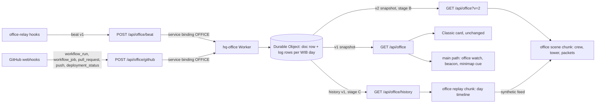

# Agent Office revamp (living crew, ship-it pipeline, day replay): design

Date: 2026-10-20. Status: approved by the owner on 2026-10-20 (direction D, staged all-in; section 2), relayed by the
coordinator; the stage A look approved on 2026-10-20 from the prototype renders (thought trail only, beacon 1.6 u,
slim LED-lane tower, the done spin ending on the camera).

Owner request (verbatim): "I see thats good but current Agent Office just not feel so WOW i need you to think and do
revamp for it (or add featured)".

Builds on the Agent Office ([design](2026-10-18-agent-office-design.md), [decision](../../decisions/2026-10-18-agent-office.md),
[wing decision](../../decisions/2026-10-20-agent-office-wing.md)): the hq-office Worker and Durable Object (#233), the
relay hooks (#242, #251), the 3D office in the L1 south wing (#261) and the Classic card (#264). It assumes the
office enhancement of 2026-10-20 has merged (no privacy sentence on the Classic card and in the 3D drawer, a higher
screen wall, more space between the desk console and the wall); every number below that depends on the wall's height
or the console's depth is re-derived from `OFFICE` and `OFFICE_WING` after that merge, never copied.

Plans, one per PR (section 13):
[`2026-10-20-agent-office-crew.md`](../plans/2026-10-20-agent-office-crew.md) (A),
[`2026-10-20-agent-office-pipeline.md`](../plans/2026-10-20-agent-office-pipeline.md) (B),
[`2026-10-20-agent-office-replay.md`](../plans/2026-10-20-agent-office-replay.md) (C).

## 1. Goal

The office today is correct but quiet: Rovers bob at desks, a wall lists text, and most of the day every Rover is
asleep. The revamp makes it read at a glance, from across the Lobby, as a crew that works, waits, asks and ships:

- **A. Living crew.** Each Rover acts out its real state with a body, not only a face and a tone.
- **B. Ship-it pipeline.** Pushes, CI jobs, merges and production deploys become physical events in the wing.
- **C. Day replay.** Today (or any of the last 7 days) plays back as a 30 to 60 s time-lapse; an idle office loops the
  latest day, clearly labelled, so it never looks dead.

Success: a visitor at the office stop can tell within 3 s which Rovers work, wait or need Kurniadi; a visitor anywhere
in the Lobby sees when one needs him; the office moves (live or replay) whenever it is in view; every budget below holds.

## 2. Owner decisions (approved 2026-10-20)

| # | Decision |
|---|---|
| R1 | Direction D, staged all-in, three PRs in order: A living crew, B ship-it pipeline, C day replay (scope in sections 5 to 7). |
| R2 | Budget: the revamp gets its own office chunk budget of about 40 KB gzip, loaded only on the lead road, in the wing, or when an office mission, go-to or drawer starts, kept out of the 3D session totals like B1. The session caps grow only by the small main-path loader (measured plus 0.6 KB rule). L1 stays under 125 scene draw calls on both tiers and holds fps on lite; reuse instancing and the shared programs, no new shader program where avoidable. |
| R3 | History: a privacy-safe event log in the Durable Object for today plus the last 7 days: agent, state, timestamp, and repo, branch and title only for public allowlisted repos (everything else "Client project"). No prompts, code, paths or client names, ever. Bounded storage (row caps, daily rollover, prune past 7 days) inside the Workers and Durable Object free limits; a public read endpoint for replay with ETag and caching. Security review before merge. |
| R4 | Optional "featured" touches (section 12) are proposals only: none is built without approval. |

Unchanged from the office design: the privacy rules D3 (and `docs/agents/office.md`), the v1 contract for the Classic
card, the five desks, the nine states, the time rules in `effective`, the wing's layout outside the two new corner
fixtures (section 6.1), every Classic route's budgets, and "every route works without WebGL".

## 3. Architecture



Client modules and chunks (all under `src/experience/floors/lobby/office/` unless noted):

| Piece | Where | Loaded | Stage |
|---|---|---|---|
| `officeWatch.ts`, `OfficeBeacon.tsx`, minimap cue | main path (beside `OfficeMount`), `src/hud/minimap/` | with L1 | A |
| `crew.ts` (pure choreography), `crewFx.ts` (sparks, thought trail, flag, dock writes) | scene chunk | lead road, wing, office mission, go-to or drawer (unchanged trigger) | A |
| `pipeline.ts` (pure: lanes, packets, ships from snapshot diffs), `pipelineFx.ts` | scene chunk | same | B |
| `replay.ts` (pure engine), `replayFeed.ts` (fetch, parse, playback clock) | new `office/replayChunk.ts` lazy chunk | the idle loop condition, or the drawer's replay control | C |
| Replay controls, crew summary | drawer body chunk (`OfficeBody`) | an office drawer opens | A (summary), C (controls) |

The crew renders whatever feed it is given: live snapshots (A, B) or the replay engine's synthetic snapshots (C).
Choreography, pipeline events and replay are pure modules over plain data, unit-tested in node; the three.js writers
stay thin.

## 4. Baseline facts the design relies on

- The office scene draws in 7 calls (2 shell on the main path, 5 in the scene chunk: Rover parts and treads instanced
  boxes, the face and desk-screen atlas quads, the instanced glow mesh in `HOLO_MODE.dot`, the wall quad). L1 settled:
  101 lite and 103 full at the spawn, 51 and 53 at the office stop (cap 125).
- The Highlights Hall's `HOLO_MODE.stage` program (per-instance kinds: stage lights, light curtain, pulse rings, tiles)
  is compiled and pinned on L1 already; a second mesh on the same material settings adds a draw call but no program.
- Per-frame office work runs only while the office is in view (`officeRuntime.inView`), writes are skipped when no
  pose, glow key or camera changed (`RoverWrites`, `glowKey`), and texture work runs through `whenDrawn`.
- Caps today: office scene chunk 14 KB (measured 14,290 B), drawer body 6 KB (5,996 B); first frame 462.2 KB, session
  full 491.1 KB and lite 475.4 KB (before the enhancement PR re-sets them).
- Polling: 10 s while a desk is awake, 30 s otherwise, only while the office is in view or a drawer is open, the tab
  visible and the visitor active in the last 10 min. `/api/office` is edge-cached 5 s per data center.

## 5. Stage A: living crew

### 5.1 Choreography model (`crew.ts`, pure)

One `CrewActor` per desk, advanced by `stepCrew(actor, input, dt, reduced)` every frame the office is in view:

- Input: the desk's effective state (from the feed), the camera's xz, the tower and dock anchors (section 6.1), the
  slot's phase.
- Output: an `OfficePose` (today's fields plus `x` and `z` offsets along the desk's local axes, a `yaw` offset, `flag`
  0 to 1, `spin`), and an `fx` record (sparks, thought trail, flag wave, charge level, flicker) read by `crewFx.ts`.
- **Transitions**: on a state change the actor snapshots the pose it is in and blends from it to the new state's live
  target pose with a smoothstep weight over `max(0.35 s, turn / 3 rad/s)`, so gestures (typing, pacing) keep their full
  amplitude once the blend ends and no turn is faster than 3 rad/s. A one-shot gesture (the victory spin) starts only
  after the blend ends. A change during a blend snapshots the current blended pose, so nothing snaps. Under reduced motion every transition cuts and the face and
  screen keep the existing 0.4 s crossfade.
- **Look targets**: `camera` (the camera's xz, the yaw clamped to 70 degrees either side of the desk heading so a Rover
  never turns its back fully to its desk), `tower` (the CI tower's lanes), `desk` (rest). The camera target is re-read
  only when the camera moved (the existing camera key), so a still camera costs no writes.
- Determinism: all motion is a function of the actor's state clock and the slot phase (`slotPhase`), so a test can
  step a fixed dt and assert poses; no `Math.random` (sparks use a hashed sequence per slot).

### 5.2 State table

| State | Full motion | Reduced motion (held pose, still readable) | Desk |
|---|---|---|---|
| working | typing: arms alternate, head pitched 0.12 rad to the desk, a 0.04 u bob; **key sparks**: 3 to 5 cyan glow dots pop 0.2 to 0.6 u above the desk's front edge between the hands, each living 0.3 s | typing pose held, 3 sparks fixed above the keys | code screen (unchanged) |
| thinking | head tilt sway; **thought trail**: 3 amber dots rising from the antenna tip (sizes 0.08, 0.12, 0.18 u), bobbing gently (owner: the trail only, no swirl) | tilt held, trail fixed | dots screen |
| reviewing | side-to-side scan (unchanged) | unchanged | diff screen |
| testing | lean in, arms half raised, progress ring runs (unchanged) | unchanged | progress screen |
| ci (waiting on CI) | turns to the CI tower (`tower` look target) and **paces**: slides 0.4 u either way along the desk's tangent at 0.2 Hz, the turn following the tower; the progress dot ring stays | turned to the tower, standing at the middle of its pace | CI screen |
| input (Needs Kurniadi) | turns to the camera (`camera` target), raises the left arm with a **flag** (pole 1.2 u, plate 0.6 x 0.4 u in the input tone) that waves; the **beacon** rings over the wing (5.3) | turned to the camera, flag raised still, beacon steady (no rings moving) | question screen ("Waiting for Kurniadi", unchanged) |
| done | a **victory spin**: one full turn over 0.9 s with a 0.3 u hop and both arms up that ends facing the camera (the `camera` look target, so the happy face reads), then the happy bob; 6 green confetti dots burst from the head once | arms up, facing the camera, no spin, no confetti | check screen |
| failed | **slump**: pitch 0.3 rad, down 0.08 u, arms hanging; **red flicker**: the halo and antenna tip flicker in two short bursts every 3 s (never above 3 flashes per second, WCAG 2.3.1) | slump held, halo and tip steady red | cross screen |
| asleep | **docks and charges**: rolls back 0.35 u onto a charging pad (a flat glow disc), head down; the pad breathes at 0.2 Hz from 30% to 60% | docked, pad steady at 45% | screen off; the **desk light** (a new glow strip instance along the desk's front edge, lit in the state tone while awake) fades to 10% |

Every motion amplitude is small enough that a Rover stays inside its row obstacle box (the pace and the dock offsets
are asserted against `officeObstacles` in `tests/unit/office-crew.test.ts`). The flag's top stays below the wall's
top edge, so it never meets a chip; it may cover part of the wall's lower text row while raised (accepted: the drawer
and the chip carry the same information).

### 5.3 Beacon and minimap cue (main path)

- **Office watch** (`officeWatch.ts`, main path, about 0.4 KB gzip): while the visitor is on L1 (not riding), the tab is
  visible, the visitor was active in the last 10 min and the office scene's own poller is not running, it fetches
  `GET /api/office` every 30 s (the first fetch after the first frame went idle) and keeps two booleans:
  `needsKurniadi` (some desk's state is `input`) and, from stage B, `deployFlash` (a deploy success at most 30 s old).
  It reads only those fields with tiny guards (it never renders text from the body). Once the scene chunk's poller runs,
  the watch reads its feed instead of fetching (one request stream, not two).
- **Beacon** (`OfficeBeacon.tsx`, inside the wing's `IntroReveal`): one instanced mesh on the hall's stage material
  (`createStageMaterial`, `HOLO_MODE.stage`, no new program) over the unit open cylinder, all instances of the `beam`
  stage kind: a column 1.6 u wide (owner) rising 26 u from the floor 1.25 u behind the asking Rover,
  between it and the wall (in front of the desk it hid the Rover and its flag in the prototype renders; from the wing
  plaza centre when more than one asks), plus three short bands (0.3 u tall) that rise up it and widen every 1.6 s, in the
  input tone. Drawn only while `needsKurniadi` (out of the draw otherwise), so the spawn's
  settled calls rise by 1 only while a Rover asks. The wing stands outside the tower's footprint, so the column rises
  into open sky and reads over the Lobby's landmarks from the spawn, the elevator arrival and the hall road (asserted by
  a projection test from those points on the six sizes, like `office-chip-placement`). Reduced motion: the column holds
  at full height, rings fixed. While the rover is at the office stop the beacon fades to 25% (in the prototype the
  column crossed the wall's GitHub half, and the asking Rover's flag carries the signal there).
- **Minimap cue**: the office room marker in the minimap and the overview pulses in the input tone while
  `needsKurniadi` (CSS, written as `@variant motion-reduce` with a static ring under reduced motion), with an
  `aria-label` "Agent Office: a Rover is waiting for Kurniadi" / "Kantor Agen: sebuah Rover menunggu Kurniadi". No new
  draw call (the minimap is HTML/SVG).
- The beacon and the cue never load the office chunk: the trigger in `officeLoadWanted` is unchanged.

### 5.4 The CI tower and the dock (stage A shells)

The `ci` pose needs something to watch, so stage A adds the two corner fixtures of section 6.1 as furniture shell (the
main path's merged boxes, so the navgrid and the minimap fixtures hold them before the chunk loads) and, in the scene
chunk, lights the tower from v1 data: the newest running public run in the feed shows its `progress` as lit lanes
(done of total, anonymous). Stage B replaces that with named per-job lanes.

### 5.5 Rendering and budget (A)

- Sparks, the thought trail, confetti, flicker, charge pads and desk lights are extra instances of the existing glow mesh
  (`GLOW_PER_ROVER` grows from 18 to 34: 5 sparks, 3 trail, 6 confetti, the charge pad and the desk light; 170
  instances): 0 new calls, 0 new programs. Writes
  stay keyed: a still office (all asleep, reduced motion, camera still) writes nothing per frame.
- Flags: the pole is one more part per Rover (`PARTS_PER_ROVER` 5 to 6, scaled to 0 when lowered) and the plate a quad
  on a new flag cell of the face atlas (the atlas mesh grows from 10 to 15 quads), so the parts mesh needs no instance
  colour (which would compile a new program variant).
- Tower lanes in A: glow-mesh instances (an LED matrix, section 6.3). Tower and dock bodies: main-path shell boxes.
- Expected: scene chunk +4 to 6 KB gzip, main path +0.6 to 1.0 KB (watch, beacon, minimap cue, shells), L1 calls at
  the office stop +0 (the beacon is already counted when asking: +1), at the spawn +1 only while a Rover asks.

### 5.6 Accessibility (A)

- The summary drawer gains a **crew summary**: one sentence per desk ("Desk 2: Claude is waiting for Kurniadi, since
  14:02"), in a `role="status"` region (`aria-live="polite"`) that announces only state changes (not activity or
  keepalive refreshes), coalesced to at most one announcement per 10 s. Strings in `office.3d.crew.*`, both locales.
- Chips keep their labels; the input chip adds "needs Kurniadi" to its accessible name.
- Every motion has a reduced-motion pose (5.2); nothing flashes more than 3 times per second.

### 5.7 Tests (A)

- `tests/unit/office-crew.test.ts`: every state's target pose and fx; transitions settle within 0.5 s and never jump
  more than a spring step per frame; retargeting mid-transition; reduced motion cuts and holds; the camera clamp; pace
  and dock offsets inside the obstacle boxes; determinism (same inputs, same poses).
- `tests/unit/office-watch.test.ts`: cadence, the visibility and idle gates, the hand-over to the scene poller, guards
  on hostile bodies (never throws, never true on malformed input).
- `tests/unit/office-beacon-view.test.ts`: the beacon column projects on screen from the spawn, the elevator arrival
  and the hall road on the six sizes (or the minimap cue is visible where it does not).
- `tests/unit/lobby-office.test.ts`: the tower and dock fixtures meet `SPACE_RULES` (touching or 6 u), no pocket, the
  stop still reachable; `office-chip-placement`: chips clear the tower and dock.
- jsdom: `OfficeBody` crew summary (live region, coalescing, both locales).
- E2E `e2e/office.spec.ts`: each state from fixtures reaches its pose (probe `__hq.probes.office.crew`), the beacon
  shows from the spawn when a desk asks and hides when none does, the minimap cue toggles, reduced motion holds still
  (`bob` 0, no spark motion).
- Perf lane: L1 calls at the spawn (asking and not) and at the office stop on both tiers; programs at the baseline;
  memory gates.

### 5.8 Sub-agent helpers (owner addition, 2026-10-20)

Each session is one Rover; the sub-agents a session starts become small **helper drones** around it.

- **Relay** (`tools/office-relay`): hooks the sub-agent start and stop events each tool offers (Copilot CLI
  `subagentStart` / `subagentStop`, Claude Code `SubagentStart` / `SubagentStop`, Codex `SubagentStart` /
  `SubagentStop`; each verified against the tool's hooks reference and a captured payload before it is installed). It
  keeps the active helper ids of each parent session locally (`~/.office-relay/sessions/<hash>.helpers.json`, each id
  hashed with the local salt, dropped after 30 min without a stop) and sends only their count: a beat gains an optional
  `helpers` (integer 0 to 9, 9 meaning 9 or more). No helper name, type, prompt or id ever leaves the machine. A start or
  stop that changes the count sends a beat with the session's last state and activity (the dedupe compares `helpers`
  too); the hook still exits 0 at once. A tool whose payload cannot name the parent session, or that has no such hook,
  is documented in the relay README and shows no helpers.
- **Worker**: `SessionRecord.helpers` from the latest beat that carried it; read-time rule: 0 when the session is asleep
  or removed, or when no beat came for `TIMING.helpersTtl` (10 min). The snapshot's desk gains an optional `helpers`
  (1 to 9, omitted at 0), so v1 stays backward compatible for the Classic card and old relays (owner decision: an
  optional v1 field, not a new version). Known window: a browser tab or Pages Function still on the previous build
  rejects a snapshot whose desk carries `helpers` (strict keys) until it reloads or the Pages upload finishes, minutes
  after the Worker deploy; the office shows as offline there in that window.
- **History (stage C)**: a helper count change is a loggable change, and each log event carries the count.
- **3D**: one drone per active helper orbits the parent Rover's head (radius 1.15 u, y 2.5 u, 1.2 rad/s, evenly spaced,
  a gentle bob), at most 4 drawn; more show as a "+N" pill on the chip. Drone bodies are instances of the Rover parts
  mesh (`PARTS_PER_ROVER` grows by 4) and their eye lights instances of the glow mesh (`GLOW_PER_ROVER` grows by 4, full
  tier only; lite draws the bodies only): no new draw call or program. Reduced motion parks them, hovering still at
  fixed angles beside the head. Asleep, off-duty or offline Rovers have no drones.
- **Text**: the chip and the desk drawer read "Copilot · Editing · 3 helpers" ("Copilot · Mengedit · 3 asisten"), ICU
  plurals in both locales; the compact phone chip keeps the dot only and adds the count to its accessible name; the
  crew summary says "with 3 helpers". The Classic card adds "· 3 helpers" after the activity on the same line inside
  the existing row (truncating, no height change, `OFFICE_RESERVE` unchanged).
- **Budget**: scene chunk about +1 KB, Classic card chunk about +0.1 KB, main path 0.
- **Tests**: relay fixtures with planted secrets for each tool's start and stop payloads (only a count leaves), the
  helper store (dedupe by id, TTL, cap 9), beat parse (0 to 9), Worker reducer and TTL, snapshot parse (1 to 9, absent
  at 0), the drone writer (count, cap 4, reduced motion parked, lite without glow), chips, drawer and Classic card in both
  locales, and an e2e drone state; the stage A captures and video include a desk with 3 helpers and one with 6.

## 6. Stage B: ship-it pipeline

### 6.1 Placement

Two corner fixtures in the wing, both touching the console's end row boxes and the wing's side and south edges (the
6 u `SPACE_RULES` allow touching), so they close the corners without making a pocket:

- **CI tower** (south-east, screen left from the stop): the plinth fills the corner east of the east row box; a column
  about 2 x 2 u, about 9 u tall, turned to face the stop, carries the lane matrix on its stop-facing side.
- **Ship dock** (south-west, screen right): a low pad with a launch ring, where merged packages land and deploy beams
  fire.

Exact rects come from `officeTower(w)` and `officeDock(w)` in `officeLayout.ts` (pure, from `OFFICE_WING` offsets), so
the L1 re-spacing moves them with the wing. From the stop both are in frame on desktop and tablet classes; on portrait
screens they may fall outside the frame, where the CI drawer and the chips carry the pipeline (asserted by projection).

### 6.2 Data: contract v2 (Worker, Function, scene in one PR)

The v1 response cannot carry per-job lanes, so the scene moves to `GET /api/office?v=2`; v1 stays byte for byte for
the Classic card and for clients cached across a deploy.

```ts
interface OfficePipelineJob { name: string; status: "queued" | "running" | "done" | "failed" }
interface OfficePipelineRun {
  id: number; repo: string; title: string; url: string;
  status: "running" | "success" | "failure";
  slot?: number;              // the desk whose public repo and branch match the run's head branch
  at: number;                 // first seen
  jobs: OfficePipelineJob[];  // at most 24, in first-seen order
}
interface OfficeShip { key: string; kind: "merge" | "deploy"; status: "running" | "success" | "failure" | "merged"; at: number; slot?: number }
interface OfficeSnapshotV2 extends Omit<OfficeSnapshotV1, "v"> {
  v: 2;
  pipeline: { runs: OfficePipelineRun[] /* newest first, at most 3 */; ships: OfficeShip[] /* newest first, at most 10 */ };
}
```

- Worker: `RunRecord` gains `names: Record<jobId, string>` (job names already pass `cleanTitle`; cut to 40 chars) and
  a jobs cap of 24 per run (later jobs fold into the last lane); `PrRecord` and the deploy feed keep what they have;
  `ships` derive from the feed's `merged` PRs and `deploy` items. Older stored documents read with `names` absent.
- Public repositories only, the same rules as today (allowlist, known-public set, fork and actor checks, blocked
  branches ignored, `privatized` strips runs and ships).
- `parseOfficeResponse` accepts v1 and v2 (`parseOfficeResponseV2` for the scene), strict on keys like v1.
- `functions/_lib/office.ts`: the `v` query (only `2` is honoured; anything else is v1) is part of the edge cache key;
  the same ETag and cache headers.

### 6.3 Visuals

All on existing meshes unless noted; tones from `STATUS_COLOR` and `STATE_TONE`.

- **Lane matrix**: one lane per job of the newest run (up to 24 rows; a second running run gets the top rows, at most
  3 runs). A lane is a row of 8 glow dots: queued dim, running a chasing dot, done green full, failed red full. E2E
  shards appear lane by lane as their `workflow_job` events arrive (the poll brings them within 10 s).
- **Packets**: when a new run appears with a `slot`, 4 cyan dots travel from that desk to the tower on a 1.5 s arc; a
  run without a desk (a push to main) launches from the wall's centre.
- **Bursts**: a job turning `done` or `failed` fires a ring of 8 dots from its lane (green or red), staggered at least
  0.15 s apart; a whole run finishing flashes the tower's crown (top dots) once.
- **Package**: a merged PR sends a small box (a parts-mesh instance, violet) from its desk (or the tower) over the wall
  to the dock on a 2.5 s parabola, with a 6-dot glow trail; it stays on the dock pad until the WIB day ends (at most 12
  stacked, the dock's pile is today's merged count).
- **Deploy beam**: a `deploy` ship with `success` fires a green column up from the dock for 8 s (`running`: a slow
  violet shimmer at the pad; `failure`: one red pulse). The beam is an instance of the main-path beacon mesh (5.3), so
  it reads from the Lobby too (the watch's `deployFlash`).
- **CI drawer**: a new room `L1:office-ci` (point-and-go target `L1:station:office-ci` at the tower, driving to the
  stop like the other office rooms, URL stays `/{locale}`): the latest runs with their lanes as text (job name and
  status), the latest merges and deploys. This is the text alternative of the tower.

### 6.4 Events from snapshots (`pipeline.ts`, pure)

Polling brings snapshots, not events, so `diffPipeline(prev, next, now)` derives events (packet, burst, crown, package,
beam) by comparing run ids, job statuses and ship keys. Rules: the first snapshot after a load sets the baseline
silently (no backlog replays), except a deploy success under 30 s old; events older than 60 s are dropped; a queue
plays them staggered (at most 1 burst per 0.15 s, 1 package per 1 s). Reduced motion: no packets or flights; the
end state shows at once (lanes lit, package on the dock, a static beam glow for 8 s).

### 6.5 Budget and tests (B)

- Expected: scene chunk +6 to 8 KB, main path +0.1 KB (the beam kind in the beacon mesh, the watch's deploy flag); calls
  at the office stop +0 (all instances) beyond the beacon mesh while lit.
- Unit: `office/state` (job names, caps, ships, privatized), `office/protocol` (v2 parse, hostile inputs),
  `office-endpoint` (v2 query, cache key, v1 unchanged), `office-pipeline` (diff rules, baseline, staleness, queue),
  `office-rooms` (the CI room), `lobby-office` (fixture rects). E2E: a run's lanes fill from fixture snapshots, a burst,
  a package, a beam; the CI drawer lists the jobs. Security review of the v2 surface before merge.

## 7. Stage C: day replay

### 7.1 Storage (Durable Object)

Beside the existing `doc` row, one row per WIB day, `log:YYYY-MM-DD`, written in the same `storage.put` as the doc
(one transaction, two rows) only when something loggable changed:

```ts
interface DayLog {
  v: 1; day: string;
  keys: string[];                    // private: session hash per ordinal; never served
  agents: OfficeAgent[];             // per ordinal
  tasks: Record<number, { repo: string; branch?: string; title?: string }>; // public allowlisted repos only
  events: [t: number, n: number, slot: number, state: number, activity: number, until: number, helpers: number][];
  prs: [t: number, slot: number, repo: string, number: number, title: string][];
  runs: [t: number, ok: 0 | 1][];
  deploys: [t: number, ok: 0 | 1][];
  truncated: boolean;
}
```

- `t` and `until` are seconds since the WIB midnight; `slot` -1 for a session beyond the five desks; states and
  activities are indexes into `OFFICE_STATES` and `OFFICE_ACTIVITIES`.
- Logged: a beat that changes a session's state, activity or helper count (keepalives are not logged; the previous event's `until`
  is set from that session's `lastBeat` when its next event arrives, and the open event's `until` comes from the doc's
  `lastBeat` at read time), a slot change, a CI failure, a merged PR, a finished run, a deploy result.
- Caps: 3,000 events, 200 PRs, 500 runs, 50 deploys and 120 KB serialized per day; past a cap the day is marked
  `truncated` and only PR, run and deploy counts keep growing. Daily rollover at the WIB midnight; on the first write of
  a new day, rows older than 7 days are deleted (`storage.list({ prefix: "log:" })`), so at most 8 log rows exist.
- `privatized` also scrubs that repository's tasks and PR titles from every log row.
- Free limits: a busy day (5 sessions, about 2,000 state changes, 30 PRs, 100 runs) writes about 4,500 rows (limit
  100,000/day), stores under 1 MB in total (limit 5 GB), and adds no Durable Object request beyond the history reads.

### 7.2 Endpoint

- `GET /api/office/history`: the index, `{ v: 1, days: [{ day, events, prs, runs }] }` for the 8 days (empty days
  included).
- `GET /api/office/history?day=YYYY-MM-DD`: `OfficeHistoryV1`: `{ v: 1, day, start (epoch ms of the WIB midnight),
  agents, tasks, events, prs, runs, deploys, truncated }`, where `tasks` and PR titles go through the blocklist again at
  read time (a later blocklist update applies retroactively) and every repository must still be in the known-public
  set; `keys` is never serialized.
- A `day` outside the window, malformed, or any other query key: `404` with `{ v: 1, error: "day" }` (no echo of the
  input). The edge cache key is the canonical URL (only `day`), so junk queries cannot fill the cache.
- Caching: today `Cache-Control: public, max-age=30, stale-while-revalidate=60`, edge-cached 30 s; past days
  `public, max-age=3600, stale-while-revalidate=86400` (not immutable: a privatize can scrub them). ETag and 304 like
  `/api/office`. The kill switch `OFFICE_ENABLED` answers `{ v: 1, enabled: false }`.
- The client validates with `parseOfficeHistory` (strict keys, tuple shapes, bounds) and drops the whole body on any
  mismatch.

### 7.3 Replay engine (`replay.ts`, pure)

- Rebuilds each desk's state over the day from the events with the same rules as `effective` (thinking after 20 s
  quiet, asleep after 3 or 15 min, done for 20 s), driven by `until`, so a replayed desk matches what the live office
  showed.
- **Time compression**: active spans (any desk awake, or a PR, run or deploy) play at a constant rate; quiet gaps over
  10 min shrink to 1.5 s each; the total is clamped to 30 to 60 s. A day without events has nothing to play.
- **Output**: a synthetic `OfficeSnapshot` per frame time (desks, a pipeline view of the day's runs and ships), fed to
  the same scene as a live feed, so A's crew and B's pipeline render replay with no extra render code. Tasks show the
  day's public titles or "Client project".

### 7.4 Experience

- **Floor tiles**: a 6 x 4 grid of tiles (1.6 u, 0.4 u gaps) on the wing plaza floor lights one tile per merged PR in
  the order merged (more than 24 brighten the grid in a second pass). Live, the tiles show today's merges; in a replay
  they light as the PRs come. Instances of a second `HOLO_MODE.stage` mesh in the scene chunk (+1 call in the wing,
  no new program). Tiles carry no text (the floor text rule).
- **Idle loop**: when the live office has no awake desk for 30 s (semi-live, or all asleep) and is in view, and motion
  is not reduced, the replay chunk loads and plays the latest day with events (today, else the newest of the last 7)
  on a loop with a 6 s rest between loops. It is always labelled: the wall shows a "REPLAY" banner with the day
  ("Replay · Mon 19 Oct" / "Putar ulang · Sen 19 Okt") and the time of day, every chip gets a "Replay" tag, the drawer a
  badge and "Back to live". Any awake desk in a live snapshot ends the loop within one poll (crossfade 0.4 s).
- **Controls** (summary drawer): the 8 days as buttons (empty days disabled), play and pause, and a scrubber
  (`input type="range"`, `aria-valuetext` "14:05 WIB"). Reduced motion: no auto loop; play steps through the day in
  1-hour jumps on demand, and the tiles show their end state.

### 7.5 Budget and tests (C)

- Expected: replay chunk 5 to 7 KB gzip, drawer body +1 to 2 KB; calls in the wing +1 (tiles).
- Unit: `office/history` storage (logging rules, `until`, caps, truncation, rollover, prune at 8 rows, privatize
  scrub, keys never serialized), `office-history-endpoint` (index, day, window, junk queries, cache headers, ETag,
  canonical cache key, disabled), `office/protocol` (`parseOfficeHistory` with hostile inputs), `office-replay`
  (reconstruction equals `effective` on generated days, compression bounds 30 to 60 s, empty day, truncated day).
- E2E: the idle loop starts on an all-asleep fixture with a history fixture, shows the label, stops on a live awake
  snapshot; drawer controls; reduced motion stepping.
- Security review of the storage, the endpoint and the replay parsing before merge.

## 8. Budgets

| Budget | Today | Target after C | Gate |
|---|---|---|---|
| Office chunks total (scene + replay + drawer body), gzip | 19.8 KB (14,290 + 5,996 B) | at most 40 KB | new `BYTES_3D_BUDGET.officeTotal` 40 KB |
| Office scene chunk | 14 KB cap | measured plus 0.6 KB per stage (about 26 KB after B) | `BYTES_3D_BUDGET.office` |
| Office replay chunk (C) | none | about 7 KB | `BYTES_3D_BUDGET.officeReplay` |
| Drawer body | 6 KB cap | measured plus 0.6 KB (about 8 KB after C) | `BYTES_3D_BUDGET.officeBody` |
| Main path (first frame and session caps) | 462.2 / 491.1 / 475.4 KB | grows only by the watch, beacon and cue (target at most 1.2 KB over A to C), caps re-set to measured plus 0.6 KB per stage | `BYTES_3D_BUDGET` |
| L1 scene calls | 101 / 103 spawn, 51 / 53 stop | spawn +1 only while asking or a beam fires; stop +2 at most (beacon mesh, tiles) | under 125 both tiers |
| Shader programs per floor | baseline | baseline (stage-mode and dot-mode meshes reuse compiled programs) | `e2e/perf/baseline.json` plus 0 for the office |
| Memory | zero growth | zero growth in geometries, textures and programs across a replay loop and live switches | perf memory gate |
| Lite fps | holds | the crew's per-frame writes stay keyed; replay drives the same writers | perf lane, office stop spot |

The chunks stay outside the 3D session totals like B1 (R2) and load only on the existing office trigger (the replay
chunk only on the idle-loop condition or the drawer control).

## 9. Privacy and security

- The only new data leaving the relay is the helper count (0 to 9) per session (5.8); otherwise stages A to C use
  the v1 beat unchanged. The history stores what the doc already
  holds, minus the session hash in served output (per-day ordinals that do not link across days).
- Titles, job names and branch-derived text pass `cleanTitle` at ingest and again at history read time; repositories
  must be allowlisted and in the known-public set at read time.
- Every new text reaches the page through React text nodes or canvas `fillText` (never HTML), URLs through
  `safeGithubUrl`.
- Endpoints: strict query validation, canonical cache keys, bounded response sizes (history under about 150 KB raw),
  no reflected input, `nosniff`, same CSP (no inline scripts).
- Storage: hard caps per row and per day, prune on rollover, scrub on `privatized`.
- Security review (the `security-review` agent, then fixes) before merging B and C; findings go into the PR.

## 10. Failure modes

| Case | Behaviour |
|---|---|
| Offline or errors | Unchanged rules: last snapshot kept 60 s, then every Rover docks asleep and the chips say offline; the watch clears `needsKurniadi` after 60 s without a good answer (no stale beacon); the idle loop may still play a cached history day, labelled. |
| Stale data (paused poller, hidden tab) | Crew holds its last pose; on resume the first fresh snapshot retargets with normal transitions; pipeline events older than 60 s are dropped. |
| No events today | The idle loop picks the newest of the last 7 days with events; with none at all, the office stays docked asleep (no replay label). |
| Disabled office | Everything hides as today; the beacon, minimap cue, tiles and replay never show. |
| History endpoint down or invalid | No replay; the live office as before; the drawer's replay controls show "Replay unavailable". |
| Truncated day | Replays what it has; the drawer notes "Partial day". |
| Webhook gaps (missed job events) | Lanes show what arrived; a finished run fills its remaining lanes to its conclusion. |
| Old cached client after a deploy | v1 unchanged; a v2 client against an old Worker gets a v1 body, which `parseOfficeResponseV2` rejects: the scene falls back to v1 parsing with no pipeline. |
| Many asks at once | One beacon at the plaza centre; every asking Rover waves its flag. |
| WebGL off | The Classic site is unchanged (the Classic card stays v1); no 3D work. |

## 11. Accessibility

- Reduced motion: every state has a held pose (5.2); no packets, flights, spins, flickers or auto loops; the replay
  steps on demand; transitions cut.
- Screen readers: the crew summary live region (5.6); the CI drawer as the tower's text alternative (6.3); replay
  controls are real buttons and a labelled range; the replay label is text in the drawer and the chips, not only on the
  wall's canvas.
- Flashing: at most 3 flashes per second anywhere; the beacon pulses at 0.6 Hz.
- Colour is never the only cue: each state keeps its face, screen, pose and chip text.

## 12. Optional featured touches (proposals; not built without approval)

| # | Touch | Cost | Notes |
|---|---|---|---|
| F1 | Classic card "Today" mini timeline: five thin rows over the WIB day, coloured by state, plus PR ticks, from the history endpoint | about 1.5 KB in the card's lazy `OfficePanel` chunk, one more cached request when the card is near | Classic JS budget has room; the card height (`OFFICE_RESERVE`) grows by one row, re-measured. |
| F2 | Ask: "what did the agents do today?" answered from today's history counts (no titles) fetched by the Ask Function at question time | Ask Function code only | Changes the Ask rule "never put live office data in the pack" into "only counts at question time"; needs a prompt version bump and golden questions. |
| F3 | Visitor wave: the visitor's rover honks at the office stop and every awake Rover glances at it for 1 s | under 0.3 KB in the scene chunk | Client only, no data. |
| F4 | Beacon chime: a soft chime when the beacon starts, only with sound enabled (`@/lib/audio`) | under 0.2 KB main path | Respects the audio setting. |
| F5 | Shipped pile: the dock's package pile doubles as a counter on the wall ("12 shipped today") | wall canvas only | Mostly in B already. |

## 13. Delivery

| PR | Scope | Depends on |
|---|---|---|
| A | Crew choreography, crew fx, tower and dock shells with v1 lane light, office watch, beacon, minimap cue, crew summary, sub-agent helpers (relay hooks, optional beat and desk field, drones, chip, drawer and Classic text), docs, decision, relay reinstall steps | the enhancement PR merged; the owner's look approval of the prototype renders |
| B | Contract v2 (Worker, Function, scene), lanes, packets, bursts, packages, deploy beam, CI room and drawer, docs | A merged |
| C | Day log storage, history endpoint, replay chunk, tiles, idle loop, replay controls, docs | B merged |

For each PR: `bun run verify:quick`, `bun run e2e:changed`, the perf lane, captures at 1440x900, 820x1180 and 390x844
on the full and lite tiers plus a short video of the states (an extended `scripts/office-shots.ts`), sent to the
coordinator before merge; B and C also get the security review. Ready-for-review PRs; the CI in-flight rule applies.

Docs per PR: `docs/agents/office.md`, `docs/agents/floor-l1-lobby.md` (Agent Office), `docs/features.md`, budgets in
`docs/agents/performance.md` and `e2e/budgets.ts`, and a decision file for each re-set cap.

## 14. Out of scope

- Beat fields or relay changes beyond the helper count; any data from private repositories beyond the anonymous
  state.
- Per-visitor history, accounts or notifications outside the site.
- History beyond 7 days, or exports.
- Text painted on floors or in the tower; new floors or a second office.
