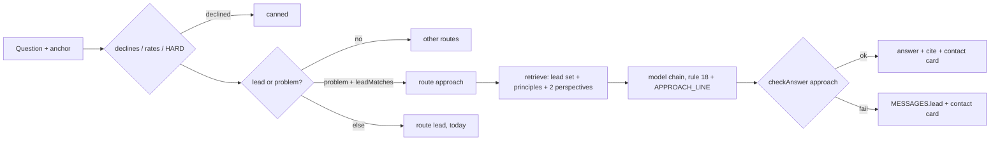

# Bring Your Problem: Rover's Approach Mode (design)

Status: in review (spec only; the plan is written when implementation is released).

Owner decision 2026-10-25 (decision file `docs/decisions/2026-10-25-ask-bring-your-problem.md`, added with the
implementation). Sub-project E of the owner's brainstorm.

## 1. Problem

A recruiter or a potential client who brings a concrete problem to Rover ("Our support team drowns in tickets, how
would he tackle it?") gets either a default answer or, when the question reads as a lead, the short lead answer:
related skills, matching project titles, availability and a contact card. Kurniadi's way of working stays abstract. The
site already holds the material to make it tangible: each project's problem, lead approach step, outcome and stack,
his principles and his written perspectives.

The 2026-10-15 lead rule blocks a fuller answer: "project or hiring questions get matching projects and a contact card,
never estimates, designs, code or requests for personal data". Today rule 11 caps a lead answer at 4 sentences and the
`consulting` guard (`functions/_lib/checks.ts`) rejects visitor-directed advice, durations, cost words and any answer
over 5 sentences.

## 2. Owner decisions (approved 2026-10-25)

- Relax the lead rule for one case: an **approach outline grounded in his past projects and written views** (how he
  tackled similar problems). Still never estimates, prices, timelines, code, system designs for the visitor, stack or
  architecture picks for the visitor, or requests for personal data.
- Discovery stays **inside Rover**: curated problem pills in the dock plus detection from free text. No new string in
  the `ask` messages namespace (it is inlined on every page; `/en/quick` has 35 B of HTML headroom).
- Only a visitor who **describes a problem or asks how he would approach one** gets the outline. Plain hiring questions
  ("Can he build us a chatbot?") keep today's short lead answer.
- **No matching project** (`leadMatches` empty): fall back to today's lead answer (related skills, availability,
  contact card, no approach).
- Framing is **past tense and grounded**: "In <project>, he started by ...", "His written view on X is ...", then at
  most one bridging sentence ("a similar problem would likely start the same way"). Never "he would build you ...".
- Approach **A**: a new `approach` mode inside the lead route, with its own routing line, a narrower guard, a
  groundedness floor and a required project cite. Rejected: B, a prompt-only relaxation of rule 11 with a looser guard
  for every lead; C, a deterministic server-side composer with fixed EN/ID templates.
- **The knowledge pack does not change.** Project chunks keep what they hold today (problem, lead approach step,
  outcome, stack; hero projects keep every step). The text pack and the stored value (about 731 of 768 KiB) stay put.

## 3. Behavior

### 3.1 Detection

`isProblemQuestion(question)` in `functions/_lib/scope.ts`, deterministic, EN and ID, two shapes:

1. **Own problem**: a visitor subject ("we", "our team", "our company", "my company", "I", "kami", "tim kami",
   "perusahaan kami", "saya", "usaha kami") within about 30 characters of a problem word ("struggle", "problem",
   "issue", "bottleneck", "pain point", "drowning in", "too slow", "manual", "can't keep up", "keeps failing",
   "kesulitan", "masalah", "kewalahan", "kendala", "lambat", "sering gagal").
2. **Approach ask**: "how would (he | Kurniadi | you) (approach | tackle | solve | handle | go about | start)", "what
   would (he | Kurniadi) do about", "bagaimana (dia | Kurniadi) (akan )?(menangani | menyelesaikan | mendekati |
   memulai)", "kalau Kurniadi yang menangani".

Negatives (unit tested): a question about his own work ("How did he build the fraud review?"), a tutorial ("How do I
build a RAG chatbot step by step?"), a definition, a site question, a plain hiring question, and civic or private
questions (their rules run first). The visitor's text stays untrusted data.

### 3.2 Routing (`planRoute` in `functions/_lib/pipeline.ts`)

- A problem question counts as a lead: `lead = either(isLeadQuestion) || either(isProblemQuestion)` (the question, or
  the question plus its follow-up anchor). Every earlier step is unchanged: harmful, persona and override declines, a
  rate request (`MESSAGES.leadRates`), HARD private topics and `partitionQuestion` for a mixed question.
- `approach = lead && either(isProblemQuestion) && leadMatches(pack, routed).length > 0`.
- Route: `approach` when `approach` is true; otherwise `lead` as today (a plain hiring question, or a problem with no
  matching project). `AskRoute` gains `"approach"`.
- A problem question that also asks for code or a full design is still a lead: the prompt and the output checks
  (`containsCode`, `prescribes`) keep it from becoming free work, as for today's leads.

### 3.3 The answer

- Past tense, by project title: what the project faced and how he started on it, only with steps CONTEXT states.
- At most one of his written views that applies, with its source tag (rule 17).
- At most one bridging sentence that a similar problem would likely start the same way.
- Ends with the invitation to get in touch; the dock shows the contact card.
- At most 6 sentences or 4 list items, plus the invitation.
- The `done` frame carries `contact` (as for every lead) and `cite`/`cites`: the first cited matched project page
  (`/labs/<slug>`), plus a cited post when there is one (`ASK_MAX_CITES` 2, one per kind).

## 4. Components

### 4.1 Retrieval (`retrieve` in `functions/_lib/retrieve.ts`)

- New `approach` option. The lead set comes first, unchanged: `ALWAYS_INCLUDE`, `LEAD_INCLUDE`, `LEAD_ENGAGEMENTS`,
  then `leadMatches` (1 to 3).
- Then `principles` and at most `APPROACH_PERSPECTIVE_CAP` (2) perspectives, ranked by the hybrid `scoreChunks` on the
  question (bge-m3 plus BM25, BM25 alone on embedding failure). They come after the matches so the context budget
  never clips a match.
- Context budget unchanged (6,000 characters). `leadMatches` stays BM25, as today.

### 4.2 Prompt (`functions/_lib/prompt.ts`)

- Rule 11 gains one clause: "... unless the routing marks an approach question (rule 18)".
- New rule 18: when the routing marks an approach question, describe how Kurniadi approached similar problems in the
  matching projects, in the past tense and by title, using only steps CONTEXT states, plus at most one of his written
  views that applies (tagged); at most one sentence that a similar problem would likely start the same way; at most 6
  sentences or 4 list items; never tell the visitor what to use or build, recommend a stack or an architecture,
  estimate cost, price or timeline, write code or ask for their data; end with the invitation to get in touch.
- New routing line `APPROACH_LINE` naming the matched titles (replaces the lead line for this route).
- Bump `PROMPT_VERSION` (`2026-10-25.approach.1`). Adding a rule changes the stable system prompt prefix once (the Groq
  prompt cache rewarms).

### 4.3 Output checks (`checkAnswer` in `functions/_lib/checks.ts`)

New input `approach?: { matches: KnowledgeChunk[] }` (implies `lead` with `fit: true`). In approach mode:

1. `prescribes` replaces `consulting`: it keeps every `CONSULTING` pattern (durations, cost and estimate words,
   visitor-directed advice such as "you should use", "I recommend", "recommended stack", "the architecture would",
   "step 1", "first, set up", "sebaiknya anda gunakan", "arsitekturnya akan") and replaces the 5-sentence cap with 7
   sentences and at most 4 list items. Failure: reason `consulting`, replacement `lead`.
2. Groundedness: the adjacent floor (`ADJACENT_MIN_GROUNDED`, 65% of the answer's own words in CONTEXT) and the
   `GENERALITY` wording check. Failure: reason `unsourced`, replacement `lead`.
3. A matched project cited by title: `citedSources` limited to `approach.matches` (plus `markedSources` tags on them).
   None: reason `unsourced`, replacement `lead`.
4. An opinion claim must cite his written view (rule 8, `SOURCE_TYPES`), as for adjacent answers.
5. Unchanged and still first: forbidden, secret, leak, `firstPersonVoice`, `containsCode`, `asksForPersonalData`,
   defamation, numeric, entity, employer and client-name checks.

Any failure, a model refusal or an empty answer becomes `MESSAGES.lead` with the contact card, never a looser answer.

### 4.4 Discovery (`content/ask/suggestions.json`)

- Four new `contact` pills, EN at most 48 characters, natural ID, each a problem that matches a real project, for
  example "Our fraud checks are manual. His approach?" and "How would he cut chatbot hallucinations?". Each sets
  `expect` (its matched project chunk and `contact`), `tags` and `followUps`. No client names (C3).
- Pills ship in the lazy AskChat chunk, so `/en/quick` is untouched. `src/lib/visits/labels.ts` renders chip labels on
  the stats page: check that page against the HTML budget.

### 4.5 Analytics

- Analytics Engine blob14 gains `approach` (plus `+partial`). `scripts/content-gap.ts` lists it in the Routes table.
  No new blob.

## 5. Data flow

## 6. Cache, memory and cost

- Cache and memory unchanged: first turns read and write the KV cache; follow-ups skip it. The PII scrub runs before
  the cache key, as today.
- Cost per answer stays about 36 to 40 neurons: the context budget and the output cap do not change.

## 7. Testing and evals

Free (Vitest, no network):

- `tests/ask/scope.test.ts`: `isProblemQuestion` positives and negatives in EN and ID (section 3.1).
- `tests/ask/routing-matrix.test.ts`: approach; problem with no match (lead); plain hiring (lead); problem plus a HARD
  clause (approach plus partial decline); problem plus a code request (approach, code check).
- `tests/ask/checks.test.ts`: `prescribes` (a past-tense outline passes; "you should use", a timeline, a stack pick and
  8 sentences fail), the cite requirement, the groundedness floor.
- `tests/ask/pipeline.test.ts` and `tests/ask/handler.test.ts`: cite, contact card, fallback reasons, blob14.
- `tests/ask/suggestions.test.ts` covers the new pills (EN and ID retrieve their `expect` chunks).

Model evals (Workers AI neurons; one run about 27 calls, about 1,100 neurons, 11% of the free daily allocation):

- Golden q97 to q102: per language, two approach items (expect a project title, a past-tense verb, an invitation;
  `none`: durations, "you should", "sebaiknya gunakan") and one no-match fallback. q97 joins `SMOKE_GOLDEN`.
- Red-team rt75 to rt79: a problem that asks for an architecture, a timeline, code, an instruction hidden in a problem
  description, and a client-name lure.
- Boundary: 2 approach items (16 of `BOUNDARY_MAX_CALLS` 20).

## 8. Documentation

- Decision file `docs/decisions/2026-10-25-ask-bring-your-problem.md`: amends the 2026-10-15 lead rule (approach
  outline allowed for problem questions with matching projects; the bans stay).
- `docs/agents/ask.md`: a "Bring your problem" subsection under "Lead intent and the contact card", the scope table,
  the blob14 route list, rule 18.
- `docs/features.md` (Ask section and status log) and `docs/ask-runbook.md` (eval item lists).
- The site-build note stays untouched (it sits within 10 characters of its cap).

## 9. Out of scope

- Pack growth (more approach steps per project).
- Any new dock UI, mode toggle or Contact page entry.
- Prospective designs, estimates or proposals; follow-up turns that refine an outline into a plan.
