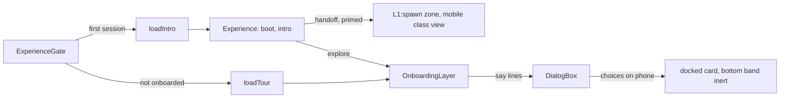

# Phone-First 3D: the First 30 Seconds on a Portrait Phone (design)

Status: approved 2026-10-25 (sub-project D of the 2026-10-25 brainstorm); plan `2026-10-26-phone-first-3d.md`;
implementation in review.

Owner decisions 2026-10-25 (brainstorm, sections 3.1 to 3.5); the remaining choices were delegated to the parent
session, which took the recommended option each time (section 3.6). Builds on #317 (touch controls) and does not
redo it: no swipe-to-floor, the Boost button, the phone Controls card and the tablet SDF fix stay as they are.

## 1. Problem

Phones are where most visitors arrive, and the first 30 seconds on a phone look like a desktop scene squeezed into
a portrait frame. Live captures (kurniadi.pages.dev, iPhone 13 at 390 x 844, lite tier, 2026-10-25):

| # | What a phone visitor sees |
|---|---|
| 1 | The boot card fills the whole screen and hides Rover's wake close-up; Boot rover sits low on the left |
| 2 | After the intro the L1 camera settles low: about 40% of the frame is empty sky, and the name hologram and the stats ring sit in the bottom third under the joystick and Boost |
| 3 | The tour's welcome box sits mid-screen over the plaza; the 8-step tour was written for desktop (step 3 rings view controls that phones do not show, the Highlights Hall and elevator steps send a new visitor away before the basics land) |
| 4 | The intro's mid-orbit top-down plaza is the best portrait composition the tower has, and the intro leaves it |

Out of scope (later sub-projects): phone-native interaction (joystick on demand, gestures), framing and legibility
on the other floors (floor line toasts over the rover on L2 to L4, unreadable small 3D text), landscape-specific
layouts, the phone menu's keyboard hints ("Rotate left (Q)").

## 2. Goal and success criteria

The first 30 seconds on a portrait phone (boot card, intro, landing frame, onboarding) feel made for the screen.

- Boot: Rover's wake close-up is visible above a bottom card; Boot rover sits in the thumb zone (bottom 40% of the
  viewport); the card is at most 55% of the viewport height at 390 x 844 and at 375 x 667.
- Landing: at 390 x 844 the rover, the full name over the hologram and at least 6 of the 8 stats tiles are inside the
  safe frame (the viewport minus the HUD top bar, minimap, joystick, Boost and Reset view boxes); sky above the
  slab is at most 15% of the frame.
- Tour: on a phone it has 6 short steps; every line with choices is a bottom card with full-width 44 px or taller
  choices, and nothing it rings or asks about is covered.
- Bytes: the 3D first-frame path and both session totals go down or stay equal; no cap rises (section 6).
- Every route still works without WebGL; tablets and desktops see no change.

## 3. Decisions

### 3.1 Scope (owner)

The first impression: boot card, intro, landing frame and onboarding on a portrait phone.

### 3.2 Boot card (owner)

Bottom card: the owner block and Boot rover move into a thumb-reach card on the lower half, with Rover's wake
close-up visible above it.

### 3.3 Boot log (owner)

One rolling log line: the six `[ok]` lines type into a single line that replaces itself, so the card stays compact.

### 3.4 Landing view (owner)

A phone landing pose on L1 (higher pitch, lifted aim) that frames Rover, the name hologram and the stats ring; the
first drive away eases back to the normal follow camera. It applies at every L1 session start on a portrait screen:
after the intro and for a returning visitor who opens straight in at the spawn.

### 3.5 Phone tour and bytes (owner)

- A phone tour: welcome, tap-to-go try-it, floor chip, menu, Ask, done. While Rover speaks a line with choices, the
  dialog docks as a bottom card and the joystick and Boost step aside.
- Byte-saving: the tour script moves into a lazy first-session chunk (loaded with the intro chunk, or on Replay
  tutorial), held to its own new cap; the phone additions on the main path are paid from what it frees.

### 3.6 Delegated choices (parent session, 2026-10-25)

| Question | Choice |
|---|---|
| Which screens get the bottom boot card | Portrait phones only: `(max-width: 639px) and (orientation: portrait)`. Landscape phones and tablets keep today's centered card |
| Which screens get the landing view | Camera class `mobile` (any portrait screen, as every other portrait class view in the tower); portrait tablets get it too |
| Which screens get the phone tour | Dialog placement `phone` (the phone HUD with a coarse pointer, landscape phones included); tablets and desktops keep the 8-step tour |
| What docks | Exactly the owner rule: a line with choices, on placement `phone`, from any source (the tour, the B1 unlock offer, a try-it Continue). Lines without choices stay the slim toast |
| What steps aside | The joystick, Boost and Reset view (the whole bottom band), so the docked card has the full width |
| Freed bytes | Stay as shared headroom; this sub-project does not lower or raise any cap and reports the measured surplus to the parent |
| Tour strings | Stay in `dialog.onboarding` (a client namespace on the gate pages, not a layout namespace); 3 new keys |

## 4. Design

### 4.1 Boot card on a portrait phone

Files: `src/app/globals.css` (the `.hq-boot-*` rules), `src/components/BootCard.tsx`, `src/hud/BootOverlay.tsx`
(3D chunk), `src/experience/camera/intro.ts` (intro chunk).

- One media block in `globals.css`, `@media (max-width: 639px) and (orientation: portrait)`:
  - `.hq-boot-cover` and `.hq-boot-backdrop` align the card to the bottom; the card spans the width with 12 px side
    margins and `env(safe-area-inset-bottom)` under it, and rounds only its top corners.
  - The eyebrow, the Rover icon and the title share one row; the title steps down one type size.
  - The owner block keeps its exact markup and spacing rules (`.hq-boot-who`, `.hq-boot-gap`): it is the game-first
    LCP and stays one text block painted at first paint ([performance.md](../../agents/performance.md#game-first-lcp)).
  - `.hq-boot-log` becomes a one-row grid: every `li` sits in the same cell, and only the newest shown line is
    visible (below).
  - Boot rover is full width (48 px tall); the Classic site link sits under it, centered.
- Rolling line:
  - SSR cover (no JS): each line's existing stagger animation becomes a short in, hold, out keyframe (the same
    delays); the last line only fades in. Pure CSS, no `:has()`.
  - Overlay: `BootCard` marks the newest shown line `data-last`; the phone rule shows only that line. When the cover
    already played, the overlay starts with the last line marked, so the handoff does not move.
  - Accessibility is unchanged: all six lines stay in the DOM and in the accessibility tree, as today.
  - Reduced motion: no fade; lines swap in place at the same pace (revealing lines is not motion, as today).
- Wake framing: the boot holds the wake pose behind the card. In the intro chunk, `WAKE.mobile` gains a lowered look
  height for the hold, so Rover sits in the top 40% of a portrait frame; the push-in over `INTRO.wake` eases it back to
  today's look. Applies to camera class `mobile` only (portrait); the intro chunk is first-session only.
- CSS budget: the Classic stylesheet is 19,586 B gzip of 20,480 B live. The phone block must stay under 300 B gzip
  and use hand-written rules in the existing `.hq-boot-*` section, not new Tailwind utilities.

### 4.2 Landing view on L1

Files: `src/experience/config.ts` (main path, a few lines), `src/experience/camera/intro.ts` (intro chunk) only if the
intro end pose does not already prime zone views.

- A new arrival-only view zone `L1:spawn` around `LOBBY.spawn` (the kiosk stop, the session spawn), like
  `lobbyArrivalZone()`:
  - `area`: 2 u around the spawn; `arrivalOnly: true`, so it applies only when the camera is primed inside it
    (session start, the intro handoff), never when a drive passes through.
  - No `yaw`, `zoom` or view for desktop and tablet classes: their poses stay bit-identical
    (`tests/unit/camera-look-offset.test.ts` frozen copy).
  - `classView.mobile`: a `pitch` (steeper), a `zoom` and a `lookOffset` (`up` and `forward`), tuned in the plan with
    a capture script. Defining a `pitch` opts into the existing turn-back: leaving the zone eases back to the follow
    pose with a level pitch; a hand turn or tilt clears it, as on the B1 phone arrival and the L1 office.
- Intro handoff: the intro's end pose is the primed follow pose. The plan verifies that `introPlan` reads the primed
  zone view (`primeZone`); if it does not, the intro chunk takes the zone's class view into its end pose, so the orbit
  lands on the landing view with no jump.
- A returning visitor opening straight in at the spawn is primed into the zone like any session start.
- Reduced motion: the zone view applies at once (a prime is not motion); the easing back on the first drive is
  already skipped under reduced motion by `updateZone`.
- Framing acceptance (pure test, no renderer): project the rover, the name's two ends, the 8 stats tile centers and
  the slab's far edge with the landing pose at 390 x 844 and 375 x 667; all but at most 2 tiles fall inside the safe
  frame, and the slab edge is at or above 15% from the top.

### 4.3 Phone tour

Files: `src/hud/dialog/onboarding.ts` (moves into the chunk), `src/hud/dialog/OnboardingLayer.tsx` (stays, slimmer),
a new `src/hud/dialog/tour/chunk.ts`, `src/experience/ExperienceGate.tsx`, `messages/en.json`, `messages/id.json`.

Steps on placement `phone` (full and short forms, after the intro or after a deep link):

| # | Key | Line | Spotlight | Choices |
|---|---|---|---|---|
| 1 | `welcome` | existing | none | Show me around, Skip tutorial |
| 2 | `point-go` | new `pointGoPhone`, a try-it that waits for the rover to move (`waitForMove`, `TRY_IT_MS` fallback with Continue) | none | Continue after the fallback |
| 3 | `moved` | new `movedPhone` | none | none |
| 4 | `floor-chip` | new `floorChip` | `elevator` (the floor chip already carries it) | none |
| 5 | `rover-menu` | existing `roverMenu` | `rover-menu` (the menu button) | none |
| 6 | `ask-ai` | existing `askAi`, only when the pill shows | `ask-ai` | none |
| 7 | `closing` | existing `closing` (full) or `closingShort` (short) | none | none |

- Dropped on phones: the joystick line (the joystick and Boost are visible and listed in the menu's Controls card),
  the camera line, the Highlights Hall and the elevator pad line.
- Tablets and desktops run today's script unchanged (the existing unit tests keep passing as they are).
- New copy (EN, then ID; first person is fine in Rover's body lines; no em dashes):
  - `pointGoPhone`: "Tap a glowing object, then tap it again or its Go button, and I'll drive you there. Try it!" /
    "Ketuk objek yang menyala, lalu ketuk lagi atau tombol Pergi, nanti saya antar. Coba!"
  - `movedPhone`: "Nice driving! The joystick and the Boost button work too." / "Mantap! Joystick dan tombol Turbo
    juga bisa dipakai."
  - `floorChip`: "Tap the floor chip up here to ride the elevator to another floor." / "Ketuk chip lantai di atas
    untuk naik lift ke lantai lain."

Docked card (`src/hud/dialog/placement.ts`, `DialogBox.tsx`, `Joystick.tsx`, the Reset view button):

- `dialogPlacement` stays as is; a line with choices on placement `phone` renders docked:
  `bottom-[calc(12px+env(safe-area-inset-bottom))] left-3 right-3`, the choices stacked full width, each at least
  44 px tall. A line without choices keeps the slim toast at 168 px.
- While docked, the bottom band steps aside: the joystick, Boost and Reset view get `inert` and fade out (150 ms,
  none under reduced motion, written as `@variant motion-reduce`). The joystick releases any held drive first. They
  return when the line ends or loses its choices.
- The Corners caps do not change: nothing is added, three controls hide for the length of a choice line
  (`e2e/hud-corners.spec.ts` counts outside the tour).

Lazy tour chunk:

- Entry `src/hud/dialog/tour/chunk.ts` exports `runOnboarding` and the copy builder. `loadTour()` (one shared promise,
  the `loadIntro()` pattern) is the only `import()` of it.
- `ExperienceGate` starts `loadTour()` next to `loadIntro()` when this browser has not been onboarded
  (`onboarded()` from `dialog/storage.ts`); the Replay tutorial host calls it on demand. The gate, not `DialogBox`
  or `DialogLayer`, owns the `import()` (a dynamic import inside them regrouped shared modules into the Page View
  bundle before).
- `OnboardingLayer` keeps the start timing, the deep-link wait and `registerTutorial`; it runs the tour once the
  chunk is in. A failed chunk skips the tour (marks nothing, so the next session tries again) and Replay shows the
  `hud.loadFailed` toast path that `lazyFromChunk` already uses.
- Graph test (`tests/unit/tour-chunk-graph.test.ts`, like `intro-chunk-graph.test.ts`): main-path modules import only
  types from the chunk.

## 5. Data flow

## 6. Budgets

| Budget | Effect | Rule |
|---|---|---|
| 3D first frame (`failAt`, returning visitor, `?prefetch=off`) | net down: the tour script leaves; the zone, the docked placement, the step-aside and the loader join | measured delta at most 0 on the PR; no cap change |
| 3D session total, full and lite | net down by the same amount | measured delta at most 0; no cap change. L4 (B) is using the session headroom: this PR never adds to it |
| New `tour` chunk | first session or Replay only | a new sanity cap `BYTES_3D_BUDGET.tour` = measured + 614 B, measured in `bytes-3d.spec.ts` through `__hq.tour.load()`, outside the session total like the intro chunk. A new cap, not a raise of an existing one; approved (below) |
| Intro chunk | grows a little (wake look, maybe the landing handoff) | unmeasured today, first session only |
| Classic CSS (Lighthouse, 20,480 B) | the boot phone block | under 300 B gzip; headroom 894 B live |
| Gate page HTML | 3 new strings in `dialog.onboarding`, EN and ID | under 200 B gzip; `/en` is 50 KB of 82 KB. `/en/quick` does not carry `dialog.onboarding` |
| Draw calls, triangles, programs | none (HTML and camera only) | unchanged |

Estimate: the tour script is about 2.4 KB gzip as source and about 1 to 1.3 KB minified in the chunk; the main path
additions are about 0.3 to 0.5 KB. Expected net about -0.6 to -1 KB on the first frame and both session totals.
If the measured net is above 0, the plan cuts from the additions; it never asks for a raise.

Approval of the `tour` cap (parent session under the owner's delegation, 2026-10-25), with conditions:

- The session totals are measured as a returning visitor ([performance.md](../../agents/performance.md)), and the
  intro chunk already sits outside both; the tour chunk follows that precedent.
- The tour chunk loads only in a session that plays the tour (not onboarded, or Replay tutorial), never for a
  returning visitor.
- performance.md names the tour chunk next to the intro chunk.
- A decision file records the new cap (`docs/decisions/2026-10-25-phone-first-3d.md`).

## 7. Error handling and fallbacks

- No WebGL, Save-Data, bots, `?tier=static`: unchanged; the boot cover is not shown and the Classic page renders.
- The boot cover's 8 s timeout and `releaseBootCover` are unchanged; the bottom card only moves the card.
- A failed tour chunk: no tour this session, the next session tries again; the tower is fully usable.
- A failed intro chunk: the session starts like a returning visitor's, primed into the landing view.
- Device rotation during the tour: placement follows the HUD layout live; a docked card on a rotated tablet-sized
  screen goes back to the raised box, and the step-aside lifts.

## 8. Testing

- Unit:
  - `onboarding.test.ts`: the phone script's keys, spotlights and choices in order (full and short), with Ask on and
    off; the tablet and desktop scripts unchanged.
  - `tests/unit/landing-view.test.ts`: the section 4.2 framing check at 390 x 844 and 375 x 667; desktop and tablet
    poses at the spawn identical to today.
  - `tour-chunk-graph.test.ts`; `dialog-copy.test.ts` picks up the new keys (EN and ID, no em dash).
- HUD (Vitest): `DialogBox` docks only with choices on placement `phone`; `Joystick` and Reset view are `inert` while
  docked and release a held drive.
- E2E (`e2e/phone-first.spec.ts`, 390 x 844 touch, lite, first visit via `asHumanBrowser`):
  - the boot card's top is below 45% of the viewport height, Boot rover's box is in the bottom 40%, one log line
    is visible at a time, and the LCP is still the owner block (extend `boot-first.spec.ts`);
  - after the intro the landing view holds (`__hq` camera pose matches the zone view);
  - the welcome line docks, the joystick is `inert`, Show me around runs the 6 phone steps (`data-line` keys);
  - a tablet (834 x 1194) still gets the 8-step tour and the centered boot card.
- Perf lane: `bytes-3d.spec.ts` with the new `tour` cap; first frame and session totals reported against main.
- Lighthouse CI: the CSS and HTML budgets on the Classic pages.
- Docs in the same PR: [3d-experience.md](../../agents/3d-experience.md) (boot card, wake framing, the landing
  zone), [hud-and-drawer.md](../../agents/hud-and-drawer.md) (phone tour, docked card, the tour chunk),
  [performance.md](../../agents/performance.md) (the tour cap), `docs/features.md`, and a decision file
  `docs/decisions/2026-10-25-phone-first-3d.md`.

## 9. Risks

- Turbopack chunk grouping: a new `import()` can pull shared modules into the Page View bundle. Mitigation: the gate
  owns it (the proven `loadIntro` pattern), and `bun run build` plus the client-bundle checks gate it.
- The landing pose fights the arrival-only zone rules (a returning visitor who resumes a floor elsewhere never
  enters it, which is intended). The pure framing test and the e2e pose check cover the two entry paths.
- The CSS keyframe rolling line must match the overlay's 180 ms cadence so the cover-to-overlay handoff does not
  jump; the e2e check compares the visible line before and after the handoff.
