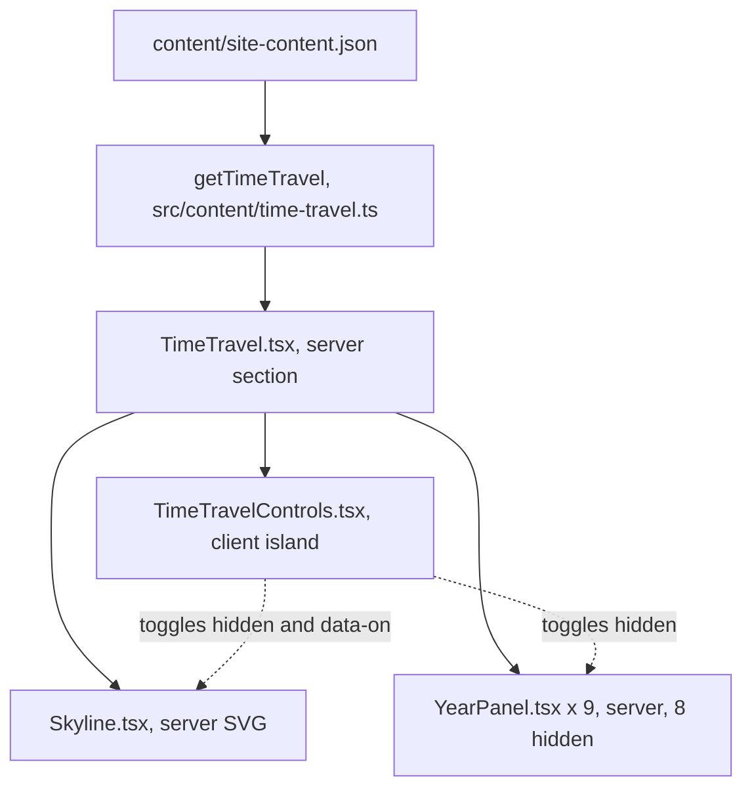

# Time Travel Slider: Design

Status: design approved by the owner and the parent session (sub-project F of the 2026-10-25 brainstorm); no plan yet.

## 1. Goal

A visitor drags one slider (or presses Play) and watches Kurniadi's journey build up, year by year, from the
vocational school in Malang to the Microsoft AI practice at Metrodata. Each stop shows a skyline of the years so
far, one sentence in the owner's own voice and what that year added. The aim is an emotional, memorable moment on
the Classic site, not another filter.

## 2. Decisions

| # | Decision | Chosen | By |
|---|---|---|---|
| D1 | What the slider scrubs | The owner's journey by year (not the site's build history, not the stack alone) | Owner |
| D2 | Where it lives | Classic only: the opening section of `/{locale}/journey`. No 3D work, no 3D bytes | Owner |
| D3 | Human voice | One short owner-approved caption per stop, new bilingual data | Owner |
| D4 | What a stop shows | Accumulate: everything up to the stop stays lit, that stop's new items highlighted | Owner |
| D5 | Steps | 9 stops: a "Before 2019" prologue, then 2019 to 2026 | Owner |
| D6 | Centerpiece | Skyline: one building per stop made of stacked blocks by kind | Owner |
| D7 | Under the skyline | Caption, running tally with "+N this year", up to 3 highlight links | Owner |
| D8 | Highlights | Curated per stop (ids in data), validated by tests | Owner |
| D9 | Start and motion | Opens on now (2026); a Play button sweeps from the prologue to now | Owner |
| D10 | Build approach | Server-rendered SVG skyline and panels plus one small enhancing island | Owner |
| D11 | Data, components, motion, budgets, tests | Sections 3 to 8 below | Owner (section by section) |
| D12 | Highlight kinds and link targets | `entry`, `pod`, `publication`, `cert`; awards are highlighted through their year's `trophy-case-*` entry | Parent (delegated) |
| D13 | No `?year=` deep link | The URL never changes while scrubbing | Parent (delegated) |
| D14 | Ask the HQ | Captions are not added to the Ask pack in this sub-project | Parent (delegated) |
| D15 | Caption wording | The drafts in section 9 are proposals; the owner approves each one during implementation | Parent (delegated) |

No byte cap, draw-call cap, hard rule or earlier owner decision changes (section 7).

## 3. Data

### 3.1 New dataset field

`floors.careerArchive.timeTravel` in `content/site-content.json`, validated in `src/content/schema.ts`:

```ts
const TimeTravelHighlightSchema = z.strictObject({
  kind: z.enum(["entry", "pod", "publication", "cert"]),
  id: z.string().min(1),
});
const TimeTravelStopSchema = z.strictObject({
  id: z.union([z.literal("pre-2019"), z.string().regex(/^20\d\d$/)]),
  caption: LocalizedSchema, // { en, id }, each at most 140 characters
  highlights: z.array(TimeTravelHighlightSchema).max(3),
});
// careerArchive gains: timeTravel: z.strictObject({ stops: z.array(TimeTravelStopSchema).min(1) })
```

- Stops are stored in order: `pre-2019`, `2019`, ..., `2026`.
- Captions are body text, so first person is allowed. They follow the hard rules: no em dash, no client company
  names (C3), no money, no private facts.
- The section title "Time Travel" / "Mesin Waktu" is a UI string (Title Case, no first person).

### 3.2 Derived data (never stored)

One pure selector, `getTimeTravel()` in `src/content/time-travel.ts` (server only), builds everything else from
the dataset at build time.

**Year of an item:**

| Source | Year from |
|---|---|
| Career entries (`careerArchive.entries`) | `start` |
| Projects (`labs.pods`) | `period.start` |
| Side projects (`sideProjects`) | `year` |
| Awards (`awards`) | `date` |
| Publications (`library.publications`) | `year` |
| Talks and posts (`library.talks`, `library.posts`) | `date` |
| Certifications (`certifications`) | `issued` |

Anything before 2019 belongs to the `pre-2019` stop (same cut as `FIRST_CORRIDOR_YEAR`).

**Block kinds** (one SVG rect per item, fixed hues from existing tokens, legend shown under the skyline):

| Kind | Items | Hue |
|---|---|---|
| Roles | entries of type `job` and `freelance` | cyan |
| Study and milestones | entries of type `education` and `milestone` | amber |
| Projects | pods and side projects | violet |
| Awards | `awards` (entries of type `award` are skipped, so nothing counts twice) | pink |
| Writing and research | publications, talks, posts | green |
| Certifications | `certifications` | blue |

**Building height:** proportional to the square root of the stop's item count, so 2026 (about 45 items) is the
tallest building without flattening 2019 to 2025. Blocks inside a building keep equal height.

**Running tally** (cumulative up to the stop, with "+N this year" when N is above 0): roles, projects, awards,
papers (publications where `isResearch(kind)`), certifications.

**Coverage rule:** every year from 2019 to the latest year with an item, plus `pre-2019` when it has items, must
have a stop record. A content test fails otherwise, so the skyline never shows a year without the owner's caption.
A 2027 stop appears when its record is added.

## 4. Page and components

Placement: a new section `#time-travel` on `/{locale}/journey`, between `PageIntro` and `JourneyFilter`. The
intro's "Jump to" chips, the year list, the Workshop, the Experience Gate and the L2 Career Road do not change.



Files in `src/components/time-travel/`:

- **`TimeTravel.tsx`** (server): section heading, one-line lead, the skyline, the legend, the 9 panels and the
  island. Resolves all labels on the server.
- **`Skyline.tsx`** (server): one `<svg>` with a fixed `viewBox` and aspect ratio (no layout shift). Per stop a
  `<g data-stop="2021">` of stacked `<rect>`s with `fill` and `opacity` as SVG attributes (no new CSS for colors).
  Each building sits in an `<a href="#y2021">` (the prologue links to `#y2019`) named, for example, "2021: 14
  items". Without JS a click jumps to that year's rows below. The year ticks under the buildings are SVG text.
- **`YearPanel.tsx`** (server): the year (`pv-num`; the prologue shows "Before 2019" / "Sebelum 2019"), the
  caption, the tally as ruled facts (value, label, "+N this year"), up to 3 highlight links and "See {year} in
  full" to `#y{year}`. The panel for 2026 is visible; the other 8 carry `hidden`.
  - Highlight targets: `entry` to `/journey/<slug>`, `pod` to `/labs/<slug>`, `publication` to the research
    section of `/library`, `cert` to the certifications section that lists it. The plan confirms the exact
    existing anchors; no new anchors are added to other pages.
- **`TimeTravelControls.tsx`** (client, the only JS): renders a native `<input type="range" min=0 max=8>` labelled
  "Year" with `aria-valuetext` set to the stop's label, and a Play/Pause button. It toggles `hidden` on the panels
  and `data-on` on the buildings. The panel heading is `aria-live="polite"`. The controls render only on the client,
  so a no-JS visitor never sees dead controls; their row keeps a reserved height so hydration causes no shift.
- **Strings:** new `journey.timeTravel.*` keys in `messages/en.json` and `messages/id.json` (title, lead, slider
  label, play, pause, tally labels, "+{n} this year", "See {year} in full", prologue label, legend labels, building
  name). Only the island's few strings reach the client.
- **Client bundle rule:** the island imports locale values only from `@/content/locales`, never from
  `@/content/schema` or `@/content/load`.

## 5. Interaction and motion

- **Start:** on now (2026), the whole skyline lit. This is also the server, no-JS and crawler view.
- **Scrub:** the range, arrow keys, Home and End move between the 9 stops. Buildings up to the stop are lit, the
  stop's building gets a brighter outline, later buildings fade to faint glass outlines (opacity only). The panel
  switches to that stop.
- **Building click (with JS):** selects that stop instead of jumping; "See {year} in full" still jumps to the rows.
- **Play the journey:** jumps to the prologue, then advances one stop every 2.5 s and rests on 2026. On each stop
  the new building rises (Web Animations API, `transform: scaleY` from the base, 600 ms) and the caption fades in.
  Pause holds the stop. Any drag, key or building click stops play. Play never starts by itself.
- **Reduced motion** (`html[data-motion="reduced"]`, or the OS setting when the attribute is absent): no rise or
  fade; stops switch instantly; Play still steps every 2.5 s.
- **Still mode** (`html[data-hq-still]`, automation and crawlers): no animation; the state stays on 2026 until the
  visitor acts.
- Only `transform` and `opacity` animate. The page `h1` stays the LCP element and never animates.
- **URL:** scrubbing never changes the URL (no `?year=`). The year list's `?type=` filter leaves the skyline
  alone: it always shows the whole journey.
- **Errors:** the island has no network calls. If it fails to load, the server view (2026 and building links)
  remains fully usable.

## 6. Out of scope

- Any 3D work (the L2 time console, a Glass Drawer view, new floor content). A 3D version needs its own design and
  a budget raise.
- The landing page and `/en/quick` (PR #320 territory and the `/en/quick` HTML budget).
- The site's own build history (already on `/build`) and the L4 writing timeline (sub-project B).
- Adding captions to the Ask knowledge pack.
- Shareable year links.

## 7. Budgets

No cap is raised.

| Budget | Current | This design | Cap |
|---|---|---|---|
| 3D session and first-frame bytes | lite 526,208 / 526,266 B, full 542,342 / 542,400 B | 0 B (nothing in the `Experience.tsx` closure imports `time-travel`) | unchanged |
| Draw calls, triangles, shader programs | unchanged | 0 (no 3D) | unchanged |
| Global CSS chunk (Lighthouse stylesheet) | about 19,601 B gzip | at most +300 B gzip (colors are SVG attributes; animation runs through WAAPI) | 20,480 B |
| `/en/journey` JS | measured in the plan | island at most 4 KB gzip | 240 KB |
| `/en/journey` and `/id/journey` HTML | measured in the plan before any change | at most +4 KB gzip (9 panels, the SVG) | 82 KB |
| `/en/quick` HTML | about 77,195 / 77,230 B | 0 B (`journey.timeTravel` strings stay out of `LAYOUT_NAMESPACES`) | unchanged |
| Lighthouse LCP, CLS, TBT on `/en/journey` | measured | LCP stays the intro `h1`; CLS 0 (fixed SVG ratio, reserved controls row) | 2 s, 0.01, 200 ms |

If a measurement in the plan shows a number above these targets, implementation stops and the parent session gets
the exact figure before any cap change.

## 8. Tests and docs

Tests:

- `tests/unit/time-travel.test.ts`: year bucketing per source, the prologue cut, no double-counted awards,
  cumulative tally and "+N", square-root heights, stop order.
- `tests/content/time-travel.test.ts`: the coverage rule (section 3.2), every highlight id resolves to an item of
  its kind, at most 3 highlights, captions are `{ en, id }` and at most 140 characters, no em dash; the existing
  public-safety lint covers client names; `hasFirstPerson` is false for the section title.
- `tests/hud/TimeTravelControls.test.tsx`: arrow keys, Home and End; Play and Pause with fake timers; reduced
  motion skips the rise; input interrupts Play.
- `e2e/time-travel.spec.ts` (mapped in `scripts/e2e-plan.ts` to the new paths): the section opens on 2026; scrubbing
  to 2021 shows its caption and tally; Play reaches 2026 (waits on state, with the e2e animation speed); with JS
  disabled a building link lands on `#y2021`; axe finds no violations.

Docs in the implementation PR:

- `docs/features.md`: Time Travel under the Journey route.
- `docs/agents/page-view.md`: a "Time Travel" subsection (placement, island pattern, motion, budgets above).
- `docs/agents/content.md`: the new `careerArchive.timeTravel` field.
- `docs/content.md`: how to add a year's stop, caption and highlights.
- `docs/decisions/2026-10-25-time-travel-slider.md`: decisions D1 to D15.

Delivery: one PR. It edits `content/site-content.json`, `src/content/schema.ts` and `messages/*.json`, which PR
#320 also edits, so implementation starts only after #320 merges and the parent releases this sub-project.

## 9. Draft captions and highlights

Proposals for the owner's approval, one by one, during implementation. Facts come from the dataset. Captions carry
no counts, so they cannot drift from the derived tally.

| Stop | Caption (EN) | Caption (ID) | Highlights |
|---|---|---|---|
| pre-2019 | Android apps at a vocational school in Malang, a GitHub account opened in 2016 and the first competition wins. | Aplikasi Android di SMK di Malang, akun GitHub pertama pada 2016, dan juara kompetisi pertama. | entry `prologue-2016` |
| 2019 | A bootcamp, the first semester at Telkom University and the first paid job: part-time e-commerce backend work. | Bootcamp, semester pertama di Telkom University, dan pekerjaan berbayar pertama: backend e-commerce paruh waktu. | entry `telkom-university-2019`, entry `shumi-2019`, pod `anime-figure-ecommerce` |
| 2020 | Leading a campus programming club, assisting practicums and entering competitions all year. | Memimpin klub pemrograman kampus, menjadi asisten praktikum, dan mengikuti kompetisi sepanjang tahun. | entry `campus-and-community-2020`, entry `trophy-case-2020`, entry `research-vaccination-sentiment-2020` |
| 2021 | Three internships, one of them remote for a team in Germany, and the first papers. | Tiga program magang, salah satunya remote untuk tim di Jerman, dan paper pertama. | entry `techbros-2021`, publication `ewallet-sentiment-cnn-lstm`, entry `trophy-case-2021` |
| 2022 | The first full-time engineering job, travel payments at MNC, while finishing the thesis. | Pekerjaan engineer penuh waktu pertama, pembayaran travel di MNC, sambil menyelesaikan skripsi. | entry `mnc-2022`, pod `payments-realtime-backend`, pod `university-sentiment-indobert` |
| 2023 | Graduated, then built multi-tenant SaaS at Jatis, with freelance backend work on the side. | Lulus, lalu membangun SaaS multi-tenant di Jatis, ditambah proyek backend freelance. | entry `graduation-2023`, pod `multi-tenant-saas-platform`, publication `sentiboard-bsc-thesis` |
| 2024 | Joined Jenius to build digital banking integrations, and kept shipping side projects. | Bergabung dengan Jenius untuk membangun integrasi perbankan digital, sambil terus merilis side project. | entry `jenius-2024`, pod `digital-banking-integrations`, pod `stock-allocation-optimizer` |
| 2025 | Freelance and agency work for several teams at once, alongside the banking role. | Proyek freelance dan agensi untuk beberapa tim sekaligus, di samping pekerjaan di bank. | pod `event-ticketing-platform`, pod `ticket-marketplace-backend`, entry `portfolio-v1-2025` |
| 2026 | Joined Metrodata's Microsoft AI practice: writing specs, directing AI coding agents and shipping AI to production. | Bergabung dengan praktik Microsoft AI di Metrodata: menulis spec, mengarahkan AI coding agent, dan merilis AI ke produksi. | entry `metrodata-2026`, pod `voice-ai-contact-center`, cert `ai-103` |
