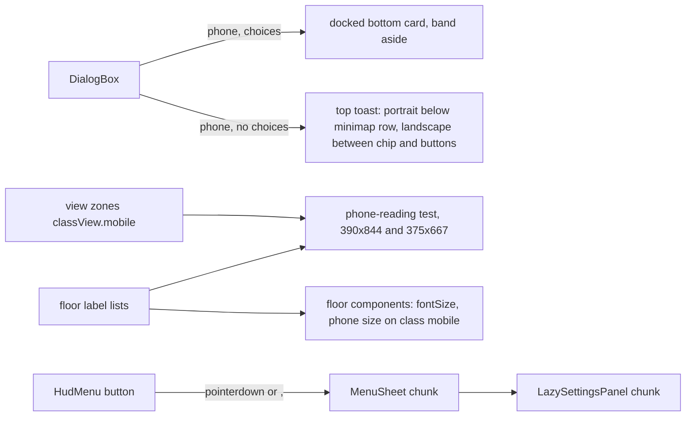

# Phone-First 3D, Part 2: Floor Framing, Legibility and Touch Wording (design)

Status: approved 2026-10-28 (owner decisions 2026-10-28, brainstorm, section 3); plan `2026-10-28-phone-first-3d-part-2.md`;
implementation in review.

Builds on part 1 (#329; spec `2026-10-25-phone-first-3d-design.md`, decision `docs/decisions/2026-10-26-phone-first-3d.md`)
and #317 (touch controls). It does not redo them: the bottom boot card, the L1 landing view, the phone tour, the docked
choice card and its step-aside, no swipe-to-floor, the Boost button, the phone Controls card and the tablet SDF fix
stay as they are. It does not touch B1 (the living machine work is in flight on its own branches; B1 keeps its own
10 px sign rule).

## 1. Problem

After the first 30 seconds, a phone visitor rides to L2 to RF and meets Rover lines, signs and menus made for a
mouse and a large screen. Live captures (kurniadi.pages.dev, lite tier, returning visitor, Chromium with touch,
2026-10-28; HUD boxes in CSS px):

| # | Size | What a phone visitor sees |
|---|---|---|
| 1 | 390 x 844, 375 x 667 | The floor's first-visit line (a toast at 168 px above the bottom) covers the Boost button on every floor: toast y 598 to 676 over Boost y 640 to 688 (390 x 844); 421 to 499 over 463 to 511 (375 x 667) |
| 2 | 375 x 667 | The same toast covers the rover on L4 and RF (rover about y 395 to 440); at 390 x 844 the RF rover sits 8 px above it |
| 3 | 390 x 844, 375 x 667 | The floor line is cut to two rows with an ellipsis ("oldest first, ...", "the CV and ..."); the rest shows only after a tap nobody is told about |
| 4 | 844 x 390 | On a landscape phone the toast sits mid-screen (y 144 to 222 of 390, 820 px wide): over the rover on L2 and over the floor's main sign on L3 (directory boards) and RF (the availability board) |
| 5 | 390 x 844 | Small 3D text from the arrival pose: L3 project names over the boxes about 6 px tall, L3 directory board lines about 7 px, some L2 room labels turned sideways; B1's rule is 10 px or more |
| 6 | 390 x 844, 844 x 390 | The phone menu reads "Rotate left (Q)" and "Rotate right (E)"; the pad pickers say "arrows to move, Enter to ride, Esc to close"; the hologram's Back button and the room drawer's README action show `Esc` and `t` key caps; Settings says "(key M)"; Reset view is named "Reset view (0)" |
| 7 | 844 x 390 | The Rover menu and search footers (`hidden sm:block`) show their keyboard hint lines, because a landscape phone is wider than 640 px |

Out of scope (part 3): phone-native interaction (joystick on demand, gestures) and a landscape camera (landscape
phones keep camera class `tablet`, so in-world text stays small there). Part 2 fixes only the landscape toast
position and the landscape keyboard hints.

## 2. Goal and success criteria

On a phone, Rover's lines never hide the rover or a control, titles and names are readable from where a visitor
stops, and nothing asks a touch visitor to press a key.

- Toast: at 390 x 844, 375 x 667 and 844 x 390, on L2, L3, L4 and RF, the floor's first-visit line box intersects
  none of the rover's projected box, the joystick, Boost, Reset view, the floor chip, Ask, the menu button and the
  minimap. Every floor line shows whole (no clamp) at those sizes.
- Reading: every title and name on L2, L3, L4 and RF (section 4.2) is at least 10 CSS px tall at 390 x 844 and at
  least 9 CSS px at 375 x 667 from its reading pose. The two gates are independent; whichever is stricter binds.
- Touch wording: on a coarse pointer, no visible text or key cap in the HUD, menu, sheets, pickers, hologram or
  room drawer names a keyboard key; on a fine pointer every key hint shown today still shows.
- Bytes: the 3D first frame and both session totals go down or stay equal against main; no existing cap rises
  (section 6).
- Every route still works without WebGL; desktops see no change; tablets see only the key caps rule.

## 3. Decisions (owner, 2026-10-28)

| # | Question | Decision |
|---|---|---|
| 3.1 | Which of the four deferred items are part 2 | Floor framing and legibility, plus the keyboard hints. The landscape toast position is fixed as part of framing. Joystick on demand, gestures and a landscape camera go to part 3 |
| 3.2 | Where a line without choices sits on a phone | Top toast: under the floor chip row and clear of the minimap. Portrait: full width below the minimap row. Landscape: at the top, between the floor chip and the Ask and menu buttons. The full sentence shows, up to 3 rows, no ellipsis |
| 3.3 | How small 3D text becomes readable | A phone reading rule like B1's: every title and name at least 10 CSS px tall at 390 x 844 from the pose where a visitor stops to read it. Fix with phone zone views first, then a portrait-only font size where a view cannot do it. Fine print is exempt (its drawer carries the same text) |
| 3.4 | The small phone | 10 px at 390 x 844 is the gate; 375 x 667 must reach at least 9 px, reported in the PR |
| 3.5 | Keyboard hints on touch | Split label and key: labels become plain ("Rotate left"); the key shows as a small kbd chip only on a fine pointer (CSS, no JS) and is exposed as `aria-keyshortcuts`. Hint lines made of keys get a touch wording on coarse pointers |
| 3.6 | How the bytes are paid | The phone menu's sheet body moves into its own lazy chunk, loaded on the first menu tap like the settings panel, with its own small new cap outside the session totals (the tour chunk precedent). Only the menu button stays on the main path |
| 3.7 | Paying for L2 (during implementation; owner approval relayed by the parent session) | The pad picker sheet moves into its own lazy chunk too, loaded when a picker first opens, with a new cap `BYTES_3D_BUDGET.picker` = measured + 614 B outside both session totals: L2's portrait type sits on the main path and the L3, L4 and RF phone sizes grow the session totals |

## 4. Design

### 4.1 Top toast

Files: `src/hud/dialog/placement.ts`, `src/hud/dialog/DialogBox.tsx`, `src/hud/Hud.tsx` (only if a CSS variable is
needed), docs `hud-and-drawer.md` (Dialog box).

- A new placement constant for a choiceless line on placement `phone`, chosen in `DialogBox` the same way
  `DOCK_PLACE` is chosen for a docked line today. `DIALOG_PLACE.phone` (the 168 px toast) is removed.
  - Portrait (`orientation: portrait`): `top` 144 px plus `env(safe-area-inset-top)` (the minimap row ends at 136 px),
    12 px from both edges.
  - Landscape (`orientation: landscape`): `top` 16 px plus the safe area; left edge clear of the floor chip, right edge
    clear of the Ask and menu buttons. The exact insets come from the Corners layout constants; if the floor chip's
    width varies by floor name, the left inset uses its widest name (the plan measures it at 844 x 390 in EN and ID).
  - Written as two Tailwind arbitrary variants (`portrait:` and `landscape:`) on one class string; no JS and no
    resize listener.
- The text row clamps at 4 rows (`line-clamp-4`) instead of 2; tap to expand and the `TOAST_HOLD_MS` auto-advance
  keep their rules (a line that fits advances by itself, a clamped line waits for a tap). Amended in implementation:
  decision 3.2's 3 rows became 4, because the longest floor line (Indonesian L2, 98 characters) needs 4 rows at
  375 px; the owner's intent (the whole sentence, no ellipsis) holds, checked by the e2e at all three sizes.
- Measured insets (844 x 390): the floor chip's widest name (B1 in Indonesian) ends at 179 px, so the landscape toast
  starts at 188 px; Ask starts about 120 px from the right edge, so it ends 128 px from the right.
- Unchanged: the docked choice card at the bottom and its step-aside, the `raised` and `bottom` placements (tablets
  and desktops), the Ask teaser rule (it never shows while a dialog box exists, so it cannot meet the toast), the
  dialog's pause rules.
- Reduced motion: the toast keeps today's enter and exit (no new motion).

### 4.2 Reading rule (portrait, L2, L3, L4, RF)

Files: each floor's label sources (`career/labels.ts`, `CareerRooms.tsx`, `YearGates.tsx`, `labs/directory.ts`,
`labs/ops.ts` titles only, `OpsRoom.tsx`, `ReactorCore.tsx`, `library/decor/signs.ts`, `NewsroomDecor.tsx`,
`EndPlaza.tsx`, `roof/SignalGarden.tsx`), the floors' view zones (`classView.mobile`), a new
`tests/unit/phone-reading.test.ts`.

- Scope of "titles and names": sign titles, zone and floor signs, project and room names, year labels, the RF
  availability headline. Exempt fine print: ops tile labels and rules, board list lines, captions, dates under a
  name; each has a drawer or room view with the same text.
- Each floor exports a pure list of its readable labels: `{ id, text, at: Vec3, fontSize, facing?, reading }`, where
  `reading` names the pose a visitor reads it from:
  - a view zone id (the zone's `classView.mobile` pose, settled like `settledPose` in `arrivals.test.ts`), or
  - a stop point (the label's door, pad or board stop), read from the default phone follow pose there.
  The list is data next to the label source (no new runtime work); components keep reading their sizes from it.
- `phone-reading.test.ts` projects each label's em box (`at` plus and minus `fontSize / 2`, as the B1 check does) with
  the reading pose at 390 x 844 (at least 10 px) and 375 x 667 (at least 9 px), camera class `mobile`.
- Fix order per failing label:
  1. a phone zone view at its reading spot (a `classView.mobile` zoom or pitch on an existing zone, or a new
     arrival-only or stop zone like part 1's `L1:spawn`), when the same pose also frames the rover and the sight
     (`arrivals.test.ts` must keep passing);
  2. otherwise a portrait-only font size: the label's `fontSize` takes a `phone` value used when the camera class
     is `mobile` (the class is already in the store; no resize listener), with the sign's frame or panel growing to
     fit where the text would overflow.
  Desktop and tablet poses and sizes stay bit-identical (the frozen pose test and a size snapshot per floor).
- Sideways L2 room labels (item 5): from the phone arrival pose they read at an angle the 10 px test cannot see; the
  label list carries `facing`, and the test also requires the label's facing to be within 60 degrees of the camera's
  view direction at its reading pose. The plan fixes the failures by a phone zone view or by turning the label's
  facing toward the road (portrait only if the turn changes the desktop look).
- Draw calls, triangles and programs stay inside the per-floor budgets; a bigger font is the same troika mesh.

### 4.3 Touch wording

Files: `src/hud/Kbd.tsx` (new, tiny), `src/hud/menu/HudMenu.tsx`, `src/hud/ViewControls.tsx`, `src/hud/HologramOverlay.tsx`,
`src/hud/drawer/RoomDrawer.tsx`, `src/hud/RoverTerminal.tsx`, `src/hud/CommandPalette.tsx`, `src/hud/pads/PadPicker.tsx`
(and its callers), the settings sound row, `src/hud/HudLaunchers.tsx`, `messages/en.json`, `messages/id.json`.

- `Kbd`: the existing key cap style (`label rounded border border-glass-border px-1.5 py-0.5 text-ink-3`) plus
  `pointer-coarse:hidden` and `aria-hidden="true"`. Every visible key cap in the HUD uses it (the hologram's Esc, the
  drawer's `t`, the launchers' search key, the new view keys).
- Labels lose their key text and gain a chip and `aria-keyshortcuts`:

| Key | Today (EN / ID) | After (EN / ID) | Chip |
|---|---|---|---|
| `hud.view.rotateLeft` | Rotate left (Q) / Putar ke kiri (Q) | Rotate left / Putar ke kiri | Q |
| `hud.view.rotateRight` | Rotate right (E) / Putar ke kanan (E) | Rotate right / Putar ke kanan | E |
| `hud.view.reset` | Reset view (0) / Atur ulang tampilan (0) | Reset view / Atur ulang tampilan | 0 (in `aria-keyshortcuts` and `title` on a fine pointer; the icon button shows no chip) |
| settings sound hint | Off mutes everything (key M). / Mati membisukan semuanya (tombol M). | Off mutes everything. / Mati membisukan semuanya. | M |

- Hint lines made of keys get a coarse variant, picked by the existing `coarse` flag (`useHudLayout`'s input, no new
  listener); the fine strings stay as they are:

| Key | Coarse EN | Coarse ID |
|---|---|---|
| `pads.floorHintTouch` | Tap a floor to ride there. | Ketuk lantai untuk naik ke sana. |
| `pads.yearHintTouch` | Tap a year to beam there. | Ketuk tahun untuk pindah ke sana. |
| `pads.consoleHintTouch` | Tap a year to beam there, or go back to the elevator. | Ketuk tahun untuk pindah ke sana, atau kembali ke lift. |
| hologram `hintTouch` (sr-only) | Projects: Previous or Next · Back: the Back button | Proyek: Sebelumnya atau Berikutnya · Kembali: tombol Kembali |

- The Rover menu and search footers (keyboard-only lines) change `hidden sm:block` to hide on a coarse pointer too
  (`pointer-coarse:hidden`), which fixes the landscape phone (item 7) without new strings.
- Screen-reader-only text that describes the keyboard (`canvasDescription`, the lightbox hint) stays: it is not
  visible and keyboard users with touch screens still need it.
- The new keys live in the namespaces their components already use (all client namespaces of the 3D chunk or the
  settings chunk); none goes into `LAYOUT_NAMESPACES` (`/en/quick` is at its HTML budget).

### 4.4 Lazy menu sheet

Files: `src/hud/menu/HudMenu.tsx` (keeps the button), a new `src/hud/menu/MenuSheet.tsx` (the sheet body: profile,
actions, settings host), `src/hud/lazyFromChunk.ts` pattern, `e2e/budgets.ts`, `e2e/perf/bytes-3d.spec.ts`,
`window.__hq` (a `menu.load()` hook like `tour.load()`).

- `HudMenu` keeps the button, its `data-onboard="rover-menu"` spotlight, the `,` key toggle, the focus return and the
  sheet frame (`Modal` and `SheetHeader`, shared with other sheets). The sheet body (`MenuProfile`, the action list
  with its icons and the `LazySettingsPanel` host) moves to `MenuSheet`, loaded through `lazyFromChunk` (the
  `LazySettingsPanel` pattern) on the first open.
- The import starts on `pointerdown` of the menu button (and on the `,` key), so the chunk is usually in before the
  click lands; while it loads, the sheet frame opens with the same header and a skeleton of the action grid (no
  layout shift when it fills). A failed load renders the fallback in section 7.
- Modules the sheet shares with the main path (for example `Modal`, `SheetHeader`) stay where they are; only code
  used by the sheet alone moves. The plan checks the chunk graph (`bun run build`, `check-client-chunks.ts`) for
  Turbopack regrouping, and a graph test like `tour-chunk-graph.test.ts` keeps main-path modules to type imports.
- Tablets use the same `HudMenu` and gain the same lazy sheet; desktops do not mount it.

## 5. Data flow

## 6. Budgets and bytes

| Budget | Effect | Rule |
|---|---|---|
| 3D first frame (`failAt`, returning visitor, `?prefetch=off`; full 476,967 B and lite 460,833 B measured on main) | net down: the menu sheet body leaves; the toast classes, `Kbd`, the touch wording choice and the L2 label sizes (L2 is on the main path) join | measured delta at most 0 against main; no cap change |
| 3D session totals, full and lite | net down by the same amount (the sheet loads only on a menu tap, outside the measured walk) | measured delta at most 0; no cap change |
| New `menu` chunk | first menu open only | a new sanity cap `BYTES_3D_BUDGET.menu` = measured + 614 B, measured through `__hq.menu.load()` in `bytes-3d.spec.ts`, outside both session totals like the tour chunk. A new cap, not a raise; owner approved (3.6) |
| Floor chunks L3 20 KB, L4 16 KB, RF 8 KB | the label lists and phone sizes | measured on the PR; must stay under each cap with no raise. If a floor is over, its phone sizes move into zone views instead |
| Settings chunk | the sound hint chip | unmeasured today, on demand only |
| Classic CSS (Lighthouse, 20,480 B) | `pointer-coarse:hidden`, the `portrait:` and `landscape:` toast utilities, `line-clamp-4` | only if these land in the Classic stylesheet; under 150 B gzip together, headroom measured in the plan |
| Gate page HTML (82 KB; `/en` about 50 KB) | 4 new coarse strings per locale, shorter view and sound strings | under 200 B gzip net; none in `/en/quick` |
| Draw calls, triangles, programs | none expected (same meshes, other sizes) | unchanged; the perf lane confirms per floor |

Estimate: additions on the main path about 0.2 to 0.4 KB gzip; the sheet body (profile, 6 actions, 4 icons, the
action wiring) about 0.6 to 1 KB. Expected net about -0.2 to -0.8 KB on the first frame and both session totals.
If the measured net is above 0, the plan cuts from the additions (for example the L2 phone sizes move into a zone
view); it never asks for a raise.

Measured (implementation, against a main build on the same machine): the menu sheet alone left the first frame
84 B under main, but the L3, L4 and RF phone sizes put the session totals 187 B over and L2 needed about 123 B more
(no zone view reaches 10 px from the rail), so decision 3.7 added the pad picker chunk. Final: first frame full
476,048 B and lite 459,914 B (main 476,875 B and 460,741 B, 827 B less), session totals full 542,978 B and lite
526,844 B (main 543,597 B and 527,463 B, 619 B less); menu chunk 1,470 B (cap 2,084 B), picker chunk 1,891 B (cap
2,505 B); floor chunks L3 14,409 B, L4 13,635 B, RF 3,426 B. Lesson: a lazy chunk that imports a module the main
path also uses splits it out of Turbopack's hoisted scope (100 to 800 B of wrappers on the main path), so both sheets
take such pieces as props.

## 7. Error handling and fallbacks

- No WebGL, Save-Data, bots, `?tier=static`: unchanged; the Classic page renders and the HUD is not mounted.
- A failed menu chunk: the sheet's fallback (the `PanelFailed` pattern, on the main path) shows the
  `hud.loadFailed` text, a retry and the Classic site button, so the Classic site is always one tap away; the next
  open retries the import.
- Device rotation with a toast open: the toast moves with the orientation variants (pure CSS); the docked card rules
  are unchanged.
- A touch laptop (fine and coarse pointers): the primary pointer decides (`pointer: coarse` is the primary pointer),
  as the existing `coarse` flag does.

## 8. Testing

- Unit:
  - `phone-reading.test.ts` (section 4.2), plus `arrivals.test.ts` and the frozen pose test unchanged and passing.
  - `placement.test.ts` (or the DialogBox HUD test): a choiceless line on placement `phone` takes the top toast
    classes; a line with choices still docks; `raised` and `bottom` unchanged.
  - `menu-chunk-graph.test.ts`: main-path modules import only types from `MenuSheet`.
  - `dialog-copy.test.ts` and the messages parity test pick up the new keys (EN and ID, no em dash).
  - A key-hint lint: no value in `messages/*.json` rendered as visible text on a coarse pointer contains a
    parenthesised single key (`(Q)`, `(E)`, `(0)`, `key M`, `tombol M`); the fine-only strings are allowlisted by key.
- HUD (Vitest): `Kbd` carries `pointer-coarse:hidden`; the menu's rotate buttons have `aria-keyshortcuts`;
  `PadPicker` renders the touch hint when `coarse`.
- E2E (`e2e/phone-first.spec.ts`, extended; lite, touch):
  - at 390 x 844, 375 x 667 and 844 x 390, ride to L2, L3, L4 and RF as a returning visitor with the floor lines
    unseen: the `dialog-box` rect intersects none of the joystick, Boost, Reset view, floor chip, Ask, menu and
    minimap rects nor the rover's projected box (`__hq` helper), and its text is not clamped
    (`scrollHeight <= clientHeight`);
  - the phone menu opens on the first tap (the chunk loads), shows "Rotate left" with no visible key cap, and closes
    with focus back on the button;
  - a desktop (1440 x 900) still shows "Q" and "E" chips and the pad pickers' key hints.
- Perf lane: `bytes-3d.spec.ts` with the new `menu` cap; first frame, session totals and floor chunks reported
  against main; draw calls per floor unchanged.
- Strict visual gate (`bun scripts/visual-gate.ts --base HEAD --profile strict`) on the desktop and tablet poses: no
  change. Portrait captures (the script used for section 1) before and after go into the PR.
- Lighthouse CI: the CSS and HTML budgets on the Classic pages.
- Docs in the same PR: `docs/agents/hud-and-drawer.md` (Dialog box placement table, the Corners menu sheet chunk,
  key caps), `docs/agents/floors.md` (the phone reading rule next to B1's), `docs/agents/styling-and-i18n.md`
  (key hints and coarse wording), `docs/agents/performance.md` (the menu cap), `docs/features.md`, and a decision
  file `docs/decisions/2026-10-28-phone-first-3d-part-2.md`.

## 9. Risks

- Turbopack chunk grouping: a new `import()` can pull shared modules into the Page View bundle or back into the
  main path. Mitigation: the `lazyFromChunk` pattern already proven by `LazySettingsPanel`, the graph test, and the
  build's client-chunk check.
- First-tap latency on the menu: the import starts on `pointerdown`; the skeleton frame keeps the tap responsive.
  The e2e checks the sheet's actions appear on a lite phone run.
- Portrait font sizes overflowing their frames: the frame grows with the text; the reading test plus portrait
  captures catch clipping. Where a frame cannot grow (a board with a fixed silhouette), the fix is a zone view.
- The landscape left inset depends on the floor chip's widest name: measured in EN and ID; the toast's left inset
  uses the larger value.
- B1 work in flight: part 2 touches no B1 file; the reading rule names L2 to RF only.
