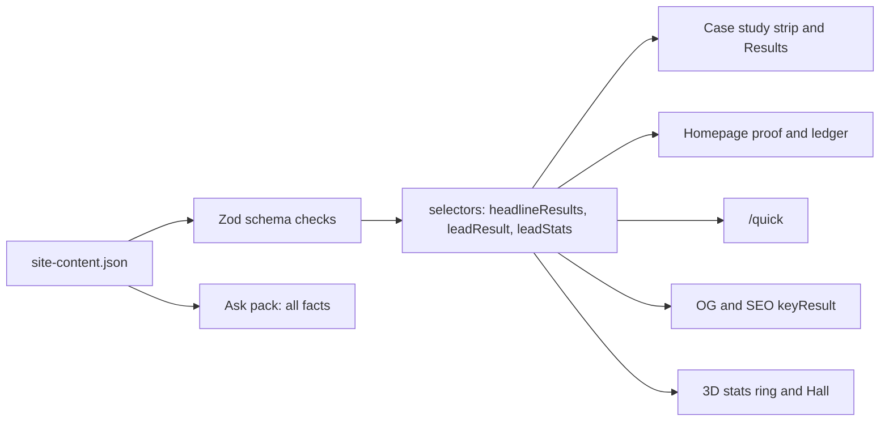

# Impact-first results, list pagination and complete key projects (design)

Status: draft, awaiting owner approval of the written spec (2026-11-13). Direction approved by the owner in conversation
on 2026-11-13, and the five open questions answered the same day (see "Owner answers"); nothing is implemented. The
implementation plan follows in `docs/superpowers/plans/` after approval, and
the owner decision file `docs/decisions/2026-11-13-impact-first-results.md` lands with the first implementation PR.

Inspected on `main` at `4413df23`.

## Owner request (verbatim)

- "The first one im thinking off is buzz word like 1000+ pr sound not wow since i use AI anyway or like 1 week work
  sole developer to production i more prefer show the improvement or things that make who sees it says wow"
- "Also More projects i think needs pagination max 10"
- "For Key projects i would like you to change Vendor Management Portal into AI Solutions Portfolio & Assistant"
- "Also in /voice-ai-contact-center there is 8 points chapters (On this page) i think all Key Projects should be added
  that too"
- "Also on Writing make blog paginate top 6"

## Confirmed decisions

1. Volume metrics (PR and commit counts, "X in N days or weeks", share of commits authored, spec and test counts) are
   demoted, not removed. Before and after deltas lead; volume stays as small supporting context.
2. Approach A: an optional `kind: "impact" | "scale"` on results and on homepage stats (absent means impact), plus an
   optional `delta: { before, after }` on impact results. `value` stays the plain-text fallback for Ask, OG and SEO.
3. Any `headline` result is kind impact. The build fails when a pod has no impact result, naming the pod.
4. Homepage stats row: impact and credential stats only; PR and contribution counts move to one muted footnote line.
5. Pagination through one shared client component: /labs "More projects" 10 per page (`?page=`), /library Blog 6 per
   page (`?posts=`). Key projects and the other Writing sections stay unpaginated.
6. Key projects: `vendor-management-portal` goes hero to featured; `ai-solutions-assistant` goes featured to hero and
   keeps its current title "AI Solutions Portfolio and Assistant" (Q1) and its place last among the key projects (Q2).
7. Every key project has the same 8 chapters as `/labs/voice-ai-contact-center`, enforced by a schema check.
8. Nothing unverified ships. Numbers mined from employer or client repositories reach the site as numbers only (C3 and
   the public-repo rules apply).

## Non-goals

- Ask answers, the CV, the build story and the timeline highlights copy (for example the "1,190+ merged pull requests"
  bullet on the Metrodata timeline entry) are not rewritten. Ask's knowledge is regenerated from the changed dataset
  and keeps every fact.
- The 3D Glass Drawer keeps its metric tabs; it only reads results impact first through the shared selector.
- Removing Time Travel from /journey (a separate session).
- No new routes, no budget changes.

## Current state (findings on main)

| Area | Today | Source |
|---|---|---|
| Result shape | `value`, `label`, `context?`, `confidence`, `headline?`; 1 to 4 per pod; at most 3 headline | `src/content/schema.ts` `ResultSchema`, `PodSchema` |
| Strip | `headlineResults`: flagged, else the first 3, any kind | `src/content/selectors.ts` |
| Case study | `MetricStrip` under the tagline; `MetricLedger` in the Results chapter | `src/app/[locale]/labs/[slug]/page.tsx`, `src/components/page/Case.tsx` |
| Rows and cards | `pod.results[0]` as the `pv-result` | `src/components/page/Work.tsx`, `Featured.tsx` |
| OG and SEO | `keyResult`: first numeric result without first person | `src/lib/seo.ts`, `src/lib/og-cards.ts` |
| Hall results station | regex `→` or ` to ` on `value`, verified only | `src/content/highlights.ts` `beforeAfterResults` |
| Homepage | hero `ProofStrip` (`profile.heroProof`: clients, PRs, certifications) and the `StatTicker` ledger (the other 3 stats) | `src/app/[locale]/page.tsx` |
| Stats | exactly 6 (the 3D stats ring reads them); `prs-merged-2026` 1,190+, `github-contributions-365` 7,350 (live, `DYNAMIC_STATS`), `voice-interruption-speedup` "10x" | `content/site-content.json`, `src/content/load.ts` |
| Filters | `WorkIndex` (wing, stack) and `TopicFilter` (topic) set `row.hidden` on server-rendered rows; URL is the state (`replaceState`) | `src/components/page/WorkIndex.tsx`, `TopicFilter.tsx`, `urlState.ts` |
| Counts | 40 pods, 5 key projects (so 35 "More projects" rows: 4 pages of 10), 14 posts (3 pages of 6) | dataset |
| Key projects | `isKeyProject`: tier hero and a gallery. Today: voice, AI code security, fraud review, vendor portal, AI app template | `src/content/pageview.ts` |

Chapter audit of the key projects after the swap (the case study renders Situation, Role and key decisions, Results,
Lesson, Architecture, Engineering details, Gallery, then Code and research when present, then Tech stack):

| Pod | Chapters | Missing |
|---|---|---|
| voice-ai-contact-center | 8 | none |
| ai-code-security-platform | 8 | none |
| fraud-review-platform | 8 | none |
| ai-solutions-assistant | 7 | Engineering details |
| ai-app-accelerator | 6 (no story: Results, Problem, Contribution, Architecture, Gallery, Tech stack) | Situation and Role and key decisions as a story, Lesson, Engineering details |

## Part 1: impact-first results

### Schema (`src/content/schema.ts`)

```ts
export const ResultKindSchema = z.enum(["impact", "scale"]);
export const DeltaSchema = z.strictObject({ before: nonEmpty, after: nonEmpty });

ResultSchema = z.strictObject({
  value: nonEmpty,            // unchanged: plain-text fallback, e.g. "~2 s to ~0.2 s"
  label: LocalizedTextSchema,
  context: LocalizedTextSchema.optional(),
  confidence: ConfidenceSchema,
  headline: z.boolean().optional(),
  kind: ResultKindSchema.optional(),   // absent = "impact"
  delta: DeltaSchema.optional(),       // impact only
}).superRefine(...)
```

Result-level checks (messages say what to fix):

- `delta` with `kind: "scale"`: "A delta is only allowed on an impact result".
- `delta` present: `value` must contain `delta.before` and `delta.after` in that order ("value must read before to
  after"), so Ask, OG and SEO text never disagree with the drawn delta.
- `headline: true` with `kind: "scale"`: "A headline result must be an impact result".

Pod-level check (in the existing `PodSchema.superRefine`): at least one result whose kind is absent or `impact`, message
`Pod "<slug>" needs at least one impact result (kind "impact" or no kind)`. While every result has no kind, every pod
passes, so the check is backward compatible and starts to bite only as the content pass marks results `scale`.

`delta.before` and `delta.after` are plain strings like `value` (not `{ en, id }`), matching how values are written
today ("11.7 MB", "~0.2 s"). Units stay as in `value`.

Stats (`StatSchema`): the same optional `kind` and `delta`, with the same result-level checks. `SiteContentSchema`
adds:

- exactly 6 lead stats (kind absent or impact): the 3D stats ring and the ledger read them, so the existing "exactly
  six" rule moves to the lead stats;
- at most 2 scale stats, each with a `short` label (the footnote reads it);
- `profile.heroProof` ids must be lead stats ("A hero proof stat cannot be a scale stat");
- the `stats` array length becomes 6 to 8.

Definitions used by the content pass and by reviewers:

- **impact**: what the work changed or achieved: a before and after, a quality, latency, cost, accuracy or reliability
  measure, a placing, adoption by other people or projects, or a sourced capability outcome ("Resumable",
  "Maker-checker").
- **scale**: how much was produced or how fast it was built: PRs, commits, share of commits authored, tests, specs,
  files, repositories touched, artifact counts, dataset sizes, stars of the owner's own output, "N days or weeks to
  production".

### Shared selectors (`src/content/selectors.ts`, client-safe)

| Selector | Returns | Used by |
|---|---|---|
| `isImpact(r)` | `r.kind !== "scale"` | everything below |
| `impactResults(results)` / `scaleResults(results)` | split, dataset order kept | case study, drawer order |
| `headlineResults(results)` | flagged ones, else the first 3 impact results; never scale | strip, drawer `headline` flag |
| `leadResult(pod)` | first headline result, preferring one with a `delta` | `WorkRow`, `FeaturedProject` (replacing `pod.results[0]`), `keyResult` |
| `leadStats(stats)` / `scaleStats(stats)` | split | homepage, /quick, 3D stats ring, L1 room views |

`keyResult` (SEO description, OG project card) keeps its first-person filter and draws its pool from `leadResult`
order: impact results first, then the rest only if a pod somehow has none (cannot happen after the schema check).
`beforeAfterResults` (Highlights Hall results station) becomes: verified, impact, with a `delta`. The regex goes.

### Rendering

One server, hook-free component `DeltaValue` (`src/components/DeltaValue.tsx`) draws a value:

- with a `delta`: `before` muted (`text-ink-2`, `line-through`), an arrow `aria-hidden`, `after` at full ink, plus
  sr-only text from `common.delta` ("{before} to {after}") so screen readers hear words, not a strike;
- `compact` variant for tight surfaces: `after` large, "from {before}" small and muted;
- without a `delta`: `value` as today.

Muted text keeps AA contrast (`ink-2` on `surface`; `ink-3` is not used for the before value). The line-through is a
decoration only, never the sole carrier of meaning.

| Surface | Change |
|---|---|
| Case study strip (`MetricStrip`) | items from `headlineResults` (impact only), drawn with `DeltaValue` |
| Results chapter (`MetricLedger`) | impact rows first with `DeltaValue` and their `context`; then one muted line `pv-meta`, `labs.scaleLine` ("Scale:") followed by `value` plus `label` of each scale result joined by commas, for example "Scale: 6 weeks First commit to deployed portal, as the sole engineer, 21 domains Backend domains, ..." (the label carries the essential boundary, existing rule); scale `context` stays in the dataset and Ask |
| Results chapter visibility | unchanged rule (`detail`): more results than the strip or any context |
| `WorkRow`, `FeaturedProject` | `leadResult(pod)` with `DeltaValue compact` |
| Homepage `ProofStrip` | the 3 `heroProof` lead stats, `DeltaValue compact` |
| Homepage `StatTicker` ledger | the other lead stats with `DeltaValue`; below the list one muted footnote `<p class="pv-meta">`: `home.scaleNote` ("Volume, agent-assisted and human-reviewed:") then each scale stat as "{value} {short}", joined by commas |
| /quick `StatLedger` | lead stats, then the same footnote |
| OG project card, SEO description | `keyResult` text (`value`, so "~2 s to ~0.2 s") |
| 3D stats ring (L1), L1 room views | `leadStats` (6 tiles, unchanged count); delta stats use the compact form on the tile |
| Highlights Hall results station | `beforeAfterResults` as above |
| 3D Glass Drawer (L3) | metrics ordered impact first; no visual change |
| Ask pack | unchanged code; regenerated knowledge keeps every result and stat |

### Proposed homepage stats

Every number was re-checked against `main` at `4413df23`:

| Order | id | Kind | Value | Delta | Basis |
|---|---|---|---|---|---|
| 1 | `enterprise-clients` | impact | 12+ | none | existing stat, self-reported, owner decision 2026-10-24 |
| 2 | `voice-interruption-speedup` | impact | ~2 s to ~0.2 s | ~2 s, ~0.2 s | pod result, verified (was "10x"; id kept) |
| 3 | `fraud-false-positives` (new) | impact | 90.9% to 36.4% | 90.9%, 36.4% | `fraud-review-platform` result, verified, offline development set (label keeps that boundary) |
| 4 | `dashboard-payload` (new) | impact | 11.7 MB → 156 KB | 11.7 MB, 156 KB | `fabric-forecasting-dashboard` result, verified |
| 5 | `microsoft-certifications` | impact | 6 | none | 6 earned (AB-100 is in progress, not counted) |
| 6 | `competition-placings` | impact | 20 | none | 24 award entries minus 3 finalists and 1 Top 100; 7 first places |
| 7 | `prs-merged-2026` | scale | 1,190+ | none | footnote |
| 8 | `github-contributions-365` | scale | 7,350 (live) | none | footnote, still overlaid by `DYNAMIC_STATS` |

`heroProof` becomes `enterprise-clients`, `voice-interruption-speedup` (~2 s to ~0.2 s, owner answer Q5),
`microsoft-certifications` (short label for the
voice stat: "voice interruption latency", 26 characters). A unit test checks that each delta stat matches a verified
pod result with the same `delta`, so the homepage and the case study cannot drift.

### Data flow



### Content pass (all 40 pods)

1. Classify every result with the definitions above and set `headline` on the strongest impact results (at most 3).
   Appendix A is the first-pass classification from the dataset alone.
2. Add a `delta` to every impact result that is already a before and after.
3. Mine all 13 scale-only pods of Appendix A (owner answer Q4), and the key and featured pods marked for mining there,
   for real before and after measurements
   from the project's own sources: PR descriptions, eval reports, CI and perf artifacts, benchmark notes, git history.
   Many are employer or client repositories: only the number, its unit and a public-safe measurement boundary reach
   the dataset. Never client names, hosts, resource names, private repository names, code, PR numbers or links.
4. A pod with no traceable measured delta uses a sourced qualitative outcome as its impact result (like "Resumable"
   today; owner answer Q3), flagged `qualitative` in the review table so the owner sees it was not a measurement. It
   stays in its tier. Never an estimate, a design intent or a number without a source.
5. Every mined candidate goes into the review table (Appendix B) for the owner. Only owner-confirmed rows ship.
   Private source pointers stay in the owner's private notes, never in this public repo, PR text or commits.
6. Pods keep at most 4 results; demoting to scale never deletes a result unless the owner asks.

## Part 2: pagination

### Component

One client component `Paginated` (`src/components/page/Paginated.tsx`) wraps a server-rendered list it does not own:

```tsx
<Paginated param="page" pageSize={10} total={rest.length} label={tp("projects")} headingId="all-projects-title">
  <ul>…rows with pageItemAttrs(i, 10)…</ul>
</Paginated>
```

- Items carry `data-page-item`; the server marks items past the first page `data-paged-out` through a small helper
  `pageItemAttrs(index, pageSize)` (`src/content/pageview.ts`), spread by `WorkRow` (new optional prop) and `PostList`.
- CSS (`pageview.css`): `@media (scripting: enabled) { [data-paged-out] { display: none } }` hides them before first
  paint (no CLS on the default page), and `[data-paged] [data-paged-out] { display: none }` covers browsers without the
  `scripting` media feature once the component mounts and sets `data-paged` on its root. Without JS every row shows.
- The pager is rendered on the server for page 1 of the unfiltered list (from `total`) so its space is reserved, and
  hidden by `@media (scripting: none) { [data-pager] { display: none } }`.
- If the CSS toolchain (Tailwind 4 and its minifier) drops the `scripting` media feature, keep only the `[data-paged]`
  rule and the always-shown pager, and confirm with Lighthouse that the post-hydration shift stays below the fold (CLS
  0.01).
- On the client it reads the page from `useSearch()`, counts the items that the filter left visible
  (`[data-page-item]:not([hidden])`), and marks everything outside the current page `data-paged-out`.
- Filters set `hidden`; pagination sets only `data-paged-out`. The two never write the same attribute, and
  `WorkIndex` and `TopicFilter` keep their section logic (`:not([hidden])`), so a section with only paged-out rows of
  the current filter still shows. Child effects run before the parent filter effect, so `Paginated` watches its items
  with a `MutationObserver` on `hidden` and recounts after any filter change.

Pure helpers in `src/content/pagination.ts` (Vitest):

- `parsePage(search, param)`: a positive integer, else 1;
- `clampPage(page, count, size)`: 1 to `max(1, ceil(count / size))`;
- `pageRange(page, count, size)`: `{ from, to }` (1-based, `to` capped);
- `pageWindow(page, pages)`: every number up to 7 pages, else first, last, current plus or minus 1 with gaps.

### Behavior

| Case | Result |
|---|---|
| Default URL | page 1, no param |
| `?page=3` deep link | page 3 after hydration (a shift only on deep links, which Lighthouse does not use) |
| `?page=99`, `?page=abc`, `?page=0` | clamped or reset; the URL is rewritten with `replaceState` (param removed when page 1) |
| Filter change (wing, stack, topic, and the Clear button) | every filter write clears the pager param in the same `setSearchParams` call (`page: null` in `WorkIndex`, `posts: null` in `TopicFilter`), so page 1 |
| Filtered to one page or zero rows | pager hidden; the existing empty state stays |
| Page change | `replaceState` like the filters (no history entry), focus moves to the list heading (`tabIndex=-1`), scroll to it, smooth only without reduced motion |
| Canonical | the clean URL (`seoMetadata` unchanged) |

### UI

- `<nav aria-label>` ("More projects pages", "Blog pages") with Prev, page numbers and Next as links (`href="?page=2"`
  keeps open-in-new-tab working; click is intercepted). Current page `aria-current="page"`; Prev and Next on the edges
  are `aria-disabled` and inert. Every target at least 44 px (`min-h-11 min-w-11`, the `chip` style).
- Counter under the list, `pv-meta`, not a live region: "Showing 11 to 20 of 35" (`common.pager.range`). Focus moving
  to the heading is the announcement.
- Strings in `common.pager` (`common` is already in `CLIENT_NAMESPACES`; both pages wrap in `ClientMessages`), en and
  id with identical keys.

### Lists

- /labs `#all-projects`: `?page=`, 10 per page, pages the rows still visible after the wing and stack filters. Key
  projects are outside the wrapper and never paginated.
- /library `#posts`: `?posts=`, 6 per page, newest first (`getPosts`). The lead card is item 1, so page 1 is the lead
  plus 5 rows and later pages 6 rows. With a topic filter the first matching post leads the page as a row (the lead
  card is not re-promoted). Research, Models, Talks and Study guides are not wrapped.

## Part 3: key projects

### Tier swap

- `vendor-management-portal`: `tier` hero to featured. `ai-solutions-assistant`: featured to hero. Titles unchanged.
- Effects to update in the same PR:
  - /labs Key projects become voice, AI code security, fraud review, AI app template, AI solutions assistant (all AI
    wing, `order` within the wing, so the assistant stays last as the owner chose in Q2); the vendor portal joins
    "More projects".
  - Landing "More key projects" (`moreKeyProjects`) becomes fraud review and AI app template (the assistant is already
    Selected work 3); `tests/unit/pageview.test.ts` expectations.
  - 3D L3: hero pods are larger boxes (`LABS.hero`), so the docking, wing directory tier marks and `labs-layout`
    expectations change; re-run the L3 perf poses (draw calls under 150, shader baseline), the strict visual gate for
    L3 poses, and `bun run floor:thumbs` if the L3 thumbnail changes.
  - Missions `SURPRISE_WEIGHT` by tier, Ask suggestions and perspectives that name either pod (`content/ask/suggestions.json`,
    `content/perspectives.json`, `tests/unit/perspectives.test.ts`, `tests/ask/*`), the recruiter-pass test.
  - The `hero` tier needs an architecture of 3 nodes or more: the assistant has one.

### Complete chapters

Schema rule in `PodSchema.superRefine`: a key project (tier hero with at least one asset; the same predicate as
`isKeyProject`, inlined to avoid an import cycle) needs `story` with `lesson`, at least one `engineering` topic, an
`architecture` and assets. Message: `Key project "<slug>" is missing chapters: Lesson, Engineering details`.

The case study's chapter list moves from the page into a pure selector `caseChapters(pod)` (`src/content/case.ts`)
returning ordered ids. The page renders from it, the TOC reads it, and a Vitest test asserts every key project yields
exactly `problem, approach, results, lesson, architecture, engineering, gallery, stack` (plus `code` before `stack` when
a pod has repos or publications; no key project has them today).

Content to write, sourced from each project's own repository and docs (existing story and engineering rules apply: no
new numbers in the story, every engineering claim traceable, pattern-level security, no client names):

| Pod | Add |
|---|---|
| `ai-solutions-assistant` | 1 to 4 engineering topics, for example the deterministic router and fallback tier, citation gating with sentence checks, and the spend-cap token accounting fix |
| `ai-app-accelerator` | `story.situation`, 2 to 4 decisions, `lesson`, 1 to 4 engineering topics; join `STORY_SLUGS` |

`lesson` is the owner's own words only: drafted from what the owner already wrote, shipped only after the owner
approves it (existing rule). That approval gates the PR that turns the key-project check on for `ai-app-accelerator`.

## Error handling

- Content mistakes fail `bun run validate:content` and the build with a message that names the pod or stat and the
  fix. No runtime fallback is needed for data that cannot pass the schema.
- Pager with an unknown or out-of-range param clamps and rewrites the URL; it never shows an empty page.
- If the client count is 0 (everything filtered out), the pager renders nothing and the filter's empty state shows.
- If hydration fails, rows past page 1 stay hidden by CSS but the pager links still change the query; the existing
  filters have the same dependency on hydration. Without JS everything shows.
- `DeltaValue` with a delta whose strings are missing cannot happen (schema), so it has no fallback branch.

## Testing

Vitest:

- Schema: delta on scale fails; headline scale fails; value not containing before and after fails; a pod with only
  scale results fails with its slug in the message; a key project missing lesson or engineering fails naming the
  chapters; stats: 6 lead, at most 2 scale, `heroProof` cannot be scale, scale stats need `short`.
- Selectors: `headlineResults` never returns scale and falls back to impact; `leadResult` prefers a delta;
  `leadStats` and `scaleStats`; `beforeAfterResults` reads `delta`; `keyResult` never picks scale.
- Homepage delta stats equal a verified pod result's delta.
- Pager math: `parsePage`, `clampPage`, `pageRange`, `pageWindow` edges (0, 1, exact multiple, last partial page,
  over 7 pages).
- `caseChapters` for every key project; `recruiter-pass` updated for `STORY_SLUGS`.
- `Paginated` in jsdom: hides past page 1, recounts after a `hidden` change, filter param change resets page, focus moves
  to the heading on click only.
- i18n key parity (existing test) for `common.pager`, `common.delta`, `home.scaleNote`, `labs.scaleLine`.

Playwright:

- /labs: 10 rows then the pager; page 2 deep link; wing filter then paging; filter change returns to page 1;
  `?page=99` clamps; Key projects never hidden.
- /library: 6 posts on page 1 with the lead card; `?posts=2`; topic filter then paging.
- No JS (`javaScriptEnabled: false`): every row and post visible, no pager.
- Case study: strip shows only impact, delta has the sr-only "to" text; scale line present; key projects show 8 TOC
  items.
- Homepage: footnote present, PR count not in the proof strip.
- axe on /labs, /library, a case study and the homepage stays clean; Lighthouse CI budgets (CLS 0.01, HTML 82 KB, JS
  240 KB) stay green for the touched URLs; the L3 and L1 perf lanes for the tier swap and the ring.

## Docs to update in the implementation PRs

- `docs/agents/content.md`: `Result.kind`, `delta`, the impact and scale definitions, stats rules (6 lead, 2 scale),
  the key-project chapter rule.
- `docs/agents/page-view.md`: strip and Results chapter, `leadResult` replacing `pod.results[0]`, the pager.
- `docs/agents/floor-l1-lobby.md`: Hall results station selector, stats ring reads lead stats.
- `docs/features.md` and `docs/content.md`: the user-facing changes and the content-pass workflow.
- New decision file `docs/decisions/2026-11-13-impact-first-results.md`.

## Delivery plan

Each PR follows the repo workflow (verify:quick, e2e:changed, the perf lane where 3D is touched, up to date with main
before handoff).

1. **PR 1: schema, selectors and renderers.** `kind`, `delta`, the checks, selectors, `DeltaValue`, the scale line,
   homepage stats with footnote, /quick, OG and SEO, Hall station, stats ring. Content limited to mechanical changes:
   deltas on results that are already before and after, the two scale stats, the new stats. Docs and decision file.
2. **PR 2: pagination.** `Paginated`, helpers, CSS, `WorkRow` and `PostList` attributes, filter param resets, tests.
3. **PR 3: tier swap and complete chapters.** Swap, `caseChapters`, the key-project schema check, the assistant's
   engineering topics, the AI app template story and engineering (lesson after owner approval), 3D and Ask follow-ups.
4. **PR 4: content pass.** Classification of all 40 pods, headlines, and only the owner-confirmed mined deltas from
   Appendix B. May split into batches by wing if the review is long.

## Owner answers (2026-11-13)

- **Q1 (title).** Keep the current title "AI Solutions Portfolio and Assistant" (main already uses it under the
  capability-naming rule of 2026-11-09). No rename.
- **Q2 (position).** Keep the assistant last among the key projects (its `order` 7 in the AI wing stays).
- **Q3 (no measurable delta).** Allow a sourced qualitative outcome as the impact result, flagged in the review table
  (content pass rule 4). The pod keeps its tier.
- **Q4 (scope).** Mine all 13 scale-only pods of Appendix A, including `university-alumni-platforms`,
  `azure-ai-operations`, `ticketing-assistant-replatform` and `insurer-contact-center-architecture`.
  `vendor-management-portal` keeps its cookie-fix delta and is mined for more.
- **Q5 (hero proof).** The hero proof strip uses the voice interruption stat, ~2 s to ~0.2 s, in place of the PR count.

No open questions remain. The next step is the owner's approval of this written spec, then the implementation plan.

## Appendix A: first-pass classification (dataset only)

I = impact, S = scale, D = already a before and after (gets a `delta`), H = proposed headline. "Mine" means mining is
needed before PR 4 can mark the scale results.

| Pod | Tier | Impact | Scale | Mine |
|---|---|---|---|---|
| digital-banking-integrations | hero | ~30% throughput H, 99% uptime H, -30% production issues H | 5 partners | no |
| voice-ai-contact-center | hero | ~2 s to ~0.2 s D H, 2 of 2 drills H, 6 vs 18 H, Migrated | none | no |
| ticket-marketplace-backend | hero | 2 → 1 databases D H, 3 roles H | 61% commits | optional |
| ai-code-security-platform | hero | 628 PRs reviewed with scan results (adoption) H, ~9 min outage H | 7 engines, 31 fix PRs | yes, key project wants a delta |
| fraud-review-platform | hero | 90.9% to 36.4% D H, 76.2% to 0% D H, 11.1% to 3.7% D H, 0 of 3,780 | none | no |
| vendor-management-portal | hero to featured | 4.5 KB → 2.1 KB D H | 6 weeks, 21 domains | yes |
| multi-tenant-saas-platform | featured | 500+ users, ~30%, -60% | none | no |
| ai-cv-screening-platform | featured | 21.1 s to 12.1 s D H, 0.13% H, ~45% H | 270+ test files | no |
| payments-realtime-backend | featured | all 4 | none | no |
| bank-statement-analyzer | featured | ~20% faster (233.9 s to 186.8 s) D H, 8 evaluators | 748 tests | no |
| anime-figure-ecommerce | featured | Live | 3+ years | optional |
| ai-app-accelerator | hero | 10+ client projects adopted H, 3 engineers continued H | none | yes, key project wants a delta |
| vulnerability-scanning-automation | featured | none | 28 PRs | yes |
| fabric-forecasting-dashboard | featured | ~21 s to ~1.1 s D H, 11.7 MB → 156 KB D H, 61.0 s vs 9.5 s H | ~5 weeks | no |
| limited-quota-event-ticketing | listed | 1 transaction (design property) | 45% commits | yes |
| ai-solutions-assistant | featured to hero | -23% prompt tokens (3 to 2 calls) H, ~4.2x undercount fixed H | none | yes, key project wants a measured delta |
| event-tech-search-backend | listed | all 4 | none | no |
| agent-orchestrated-delivery | featured | none | 9+ repos, 1,190+ PRs | yes |
| digital-products-ecommerce | listed | none | 16 PRs | yes |
| marketplace-productization | listed | 4 products validated by real installs | 36 defects, 1 day pivot | optional |
| university-alumni-platforms | listed | none | 2 platforms | yes |
| azure-ai-operations | listed | none | 23 deployments, 24 rotations, 22 rules, 9 repos | yes |
| healthcare-outreach-dashboard | listed | 60 s → <2 s D H, 61 of 61 H | ~45 hours, ~2,900 tests | no |
| automotive-fraud-dashboard | listed | A+ headers grade H | 2 days, ~38 findings | optional (grade before) |
| solutions-marketing-site | featured | none | 17 specs | yes |
| event-ticketing-platform | featured | none | 3 apps, 95%, 34% | yes |
| ticketing-assistant-replatform | listed | none | 14 tools | yes |
| mining-coa-assistant | listed | Resumable | none | no |
| sewise-fashion-labs | featured | none | 1,390 tests, 118 commits, 9 specs | yes |
| credit-scoring-poc | listed | In-browser | none | no |
| bank-genai-governance | listed | Maker-checker | none | no |
| agent-deck-platform | featured | none | 21 PRs, 20 releases, 32 blueprints | yes |
| mii-cowork | featured | none | 194 commits, 133 files, 57% | yes |
| insurer-contact-center-architecture | listed | none | 13 diagrams | yes (outcome not public; a qualitative outcome per Q3 is likely) |
| clearbox | featured | none | 1,589 tests, 179 commits, 40 emails | yes (the eval reports precision and recall) |
| university-sentiment-indobert | featured | 89% H, 88% H | 7,500 tweets | no |
| ifest-2021-sentiment-analysis | featured | 1st place H, 84.8% H, 82.8% | 9,810 tweets | no |
| covid-herd-immunity-forecast | featured | 0.992 H, 0.9995 H, about 10 months | 208 days | no |
| stock-allocation-optimizer | featured | 2 solvers | 503 tickers, 8 of 9 commits | optional |
| kampus-merdeka-reports-crawler | featured | 21 stars (others' adoption) H | 2 report types | no |

Not combined into a delta on purpose: `ai-cv-screening-platform` ~45% and 0.13% (different runs, models and inputs) and
`ifest-2021-sentiment-analysis` 82.8% and 84.8% (different models and validation sets).

## Appendix B: review table (format)

Filled during PR 4 and reviewed by the owner before anything ships. Only public-safe columns live in the repo; the
private pointer to each source stays in the owner's notes.

| Pod | Proposed result (value, label) | Delta | Type | Source kind | Confidence | Owner |
|---|---|---|---|---|---|---|
| (illustrative row) | "40 s to 6 s", "Nightly export runtime" | 40 s, 6 s | measured | CI run timings | verified | pending |
| (illustrative row) | "Resumable", "Processing resumes after a crash" | none | qualitative | merged code | verified | pending |

Type is `measured` (a number with a measurement boundary) or `qualitative` (a sourced outcome without a number, used
only when no measured delta is traceable, owner answer Q3).

Source kinds: PR benchmark, eval report, CI or perf artifact, git history, production telemetry, owner statement
(self-reported). Confidence uses the existing `ConfidenceSchema` values.
