# Appendix 02: Interaction Model and State Machine

Part of [Agent HQ design spec](../2026-10-09-agent-hq-design.md).

## 1. Experience states

```mermaid
stateDiagram-v2
  [*] --> boot
  [*] --> explore: intro already played this session
  boot --> intro: Boot rover (once the log has typed out)
  intro --> explore: intro finished (never skipped); a deep link then rides on to its floor or room
  explore --> terminal: click rover / Enter near rover / first visit
  terminal --> autopilot: mission chosen
  terminal --> explore: Esc / "drive myself"
  explore --> palette: Cmd-K or "/"
  palette --> autopilot: mission or room chosen
  palette --> explore: Esc
  explore --> elevator: elevator panel / call pad / PgUp PgDn / swipe (more than 25 u from the call pad: beam into the car first)
  explore --> explore: Express Return pad (beam to the elevator call pad)
  elevator --> explore: arrived
  explore --> autopilot: click a room label (far away)
  autopilot --> explore: any manual input (cancel)
  autopilot --> room: arrived at room
  explore --> room: rover enters a door trigger
  room --> hologram: "View architecture" (hero pods)
  hologram --> room: Esc / back
  room --> explore: close drawer / drive away
  room --> room: prev / next
  explore --> quick: Quick view
  quick --> explore: close
  boot --> static: GPU tier = static or WebGL error
  explore --> static: context lost
```



`palette` and `quick` are overlays: they pause input to the world but keep rendering. `static` is a terminal state for the session and shows the HTML-only experience.

## 2. Transition rules

"Reduced motion" below means the effective flag: `prefers-reduced-motion` under the default Motion setting (System), or the visitor's Full or Reduced override from the HUD Motion control and Cmd-K (AGENTS.md, "Motion setting").

| From → To | Visual | Duration | Reduced motion |
|---|---|---|---|
| boot → intro | Boot lines type out (max 6 lines), then a CRT-off flash; first 3D load of each browser session, any route. The boot card shows the owner's name, headline, motto and current role (server-rendered, visible at first paint) and a small "Classic site" link (formerly "Page view") that leaves the 3D view; Boot rover is still required and the intro still plays in full (owner decision, round 5) | 1.2 s, never skipped | Same pace (revealing lines is not motion) |
| intro → explore | Exterior orbit and fly-in (see appendix 01); first 3D load of each browser session, any route | 2.5 s, never skipped | A still exterior shot for the same 2.5 s, then a cut |
| explore → elevator → explore | Rover drives to the door, doors close, the car waits with closed doors until the destination floor is built, compiled and typeset (at most 1.5 s, first visits only), camera dollies vertically, doors open. A long frame pauses the ride (each frame adds at most 1/30 s of ride time at 60 fps, 1/20 s on steadily slow devices) instead of skipping it | Drive time + 1.3 s of door stages + 0.8 s dolly (+ up to 1.5 s wait on a first visit) | 150 ms fade cut (the same wait happens at the door) |
| explore → elevator, far (fast return, owner decision 2026-10-14) | More than 25 u (straight line) from the floor's elevator call pad, the rover beams onto the pad facing the car instead of driving (0.3 s rise over the rover, jump with a camera cut, 0.3 s fade over the pad, green column), and the ride boards on the jump frame; the rest of the ride is unchanged. Applies to every trigger, since all go through `requestElevator`: the elevator panel, PgUp/PgDn, swipes, the call pad picker, Cmd-K and mission `elevator` steps | 0.6 s instead of the drive | 150 ms fade cut, then the ride's cut |
| explore → explore (Express Return pad) | Stopping on a floor's Return pad (`return:<floor>`, L2 annex forecourt and L3 east plaza today) or point-and-go to it beams the rover onto the elevator call pad, facing the car; the call pad stays quiet (no floor picker) until the rover leaves it | 0.6 s | 150 ms fade cut |
| autopilot step | Rover follows the navgrid path at autopilot speed | Distance-based | Same, but no camera sway |
| → room | Rover plants its flag, the room hologram brightens, the drawer slides in | 300 ms | Instant drawer |
| room → hologram | Camera flies into the pod, the world dims to 25%, the diagram assembles node by node | 900 ms | Diagram appears instantly |
| any → static | Notice toast "Switched to lite view" | | |

Fast return and missions: a beam inside a ride is part of the ride, so mission `elevator` steps (guided trips, tours, deep link continuations) keep running and only arrive sooner. A manual floor change cancels a running mission and pauses a walk, as before. The Return pad uses the pad latch, which never fires while a mission or walk drives, so tours never beam by accident. Esc does nothing during any beam; manual driving input is ignored until it lands.

## 3. Missions

A mission is a list of steps run by `missions/runner.ts`:

```ts
type MissionStep =
  | { kind: "elevator"; floor: FloorId }
  | { kind: "drive"; to: RoomId | Vec2 }
  | { kind: "open"; room: RoomId; tab?: DrawerTab }
  | { kind: "say"; text: LocalizedText; ms?: number }; // rover screen text
```

- Each step resolves when complete. The runner exposes `start(missionId)`, `cancel()` and a `status` (`idle | running | done | cancelled`).
- Manual input during `running` calls `cancel()`. The rover face shows `o_o` for 600 ms, then control returns.
- The `surprise` mission picks a random unvisited room, weighted toward hero pods.

### Mission catalog (v1)

| id | Label (EN) | Steps |
|---|---|---|
| `best-ai` | Show me your best AI work | elevator L3 → drive to the door of the top AI Engineering hero pod → open overview |
| `best-swe` | Show me your software engineering | elevator L3 → drive to the door of the top Product Engineering hero pod → open overview |
| `journey` | Walk me through your journey | elevator L2 → drive to 2019 → `say` "drive or swipe forward through time" |
| `projects` | Tour my projects | `walk` step: starts the L3 "Tour my projects" guided walk (rides to L3, then drives the wing roads pod by pod and ends at the wing directory boards). Static tier, or with walks off: L3 (`/labs`) and the palette filtered to pods |
| `hire` | Hire / contact | elevator RF → drive to the comms terminals → open contact |
| `cv` | Download CV | elevator RF → drive to the CV kiosk → open the CV drawer |
| `blog` | Read my writing | `walk` step: starts the L4 "Read my writing" guided walk (rides to L4, then drives station by station, posts newest first). Static tier, or with walks off: L4 (`/library`) and the palette filtered to posts |
| `surprise` | Surprise me | random, as above |

Software engineering and AI engineering get equal billing: `best-swe` and `best-ai` are always the first two options (their order alternates per visit).

### Quests (v1.1, out of v1 scope)

The dossier also proposes 14 story-driven "quests" (for example "Interrupt the voice agent", "Fix the 45%", "Solve the 21-second mystery", "Origin story", "Trophy hunt"). They reuse the same step runner plus a quest log in the HUD. They are designed but deferred to v1.1, so v1 ships with the utility missions above.

## 4. Rover Terminal

- **Open:** click or tap the rover, press Enter when the rover is focused, or automatically on the first visit after the intro.
- **Layout:** a terminal window anchored to the rover's screen (desktop) or a bottom sheet (mobile). The prompt is `rover@hq:~$ ./missions`.
- **Greeting:** chosen by time of day in the visitor's locale ("good morning", "good evening") plus "where should we go? ^_^".
- **Options:** numbered 1 to 8 from the mission catalog, plus "drive myself". Input by number keys, arrow keys plus Enter, or tap. `Esc` closes it.
- **Typing effect:** 12 ms per character. The full text shows immediately on the second open or under reduced motion.

## 5. Command palette

- **Open:** `⌘K` / `Ctrl+K`, `/`, or the search button in the HUD.
- **Index:** missions, rooms (all floors), years, actions (`Download CV`, `Copy email`, `Toggle language`, `Toggle sound`, `Quick view`), and one "Show projects using X" row per Tech Reactor tech (section 9; shown for a query only, its title weighs like keywords so a bare tech name still opens a project first).
- **Search:** fuzzy matching over title, tags, stack and year, in both languages. Results are grouped by type with a floor badge. Entry texts are normalized once per index; a keystroke normalizes only the query (budget: p95 under 16 ms per keystroke at 4x CPU, `tests/bench/search.bench.ts`).
- **Empty query:** shows the missions, then "Recent" (last 3 visited rooms).
- **Keyboard:** up/down to move, Enter to run, Esc to close, Tab to jump between groups.

## 6. Room drawer

| Property | Spec |
|---|---|
| Tabs | Overview, Architecture, Results, Stack. Year rooms and Library items use a single-pane variant. |
| Header | A slim bar that stays put: floor and room code (mono), prev/next arrows, the "..." menu (README with its `t` shortcut, the cross-floor link, Open page) and close. Below it the title, badges, role and period and the cross-floor link scroll with the body; once the title scrolls away it joins the bar (with the badges when they fit). Tabs stick under the bar. The scrolling body gets at least 65% of the drawer height on desktop. |
| Metric tiles | 1 to 3 tiles, each with the value, the label and the context (e.g. "controlled A/B, n=4") |
| Actions | One footer row: "Full case study" (route link) plus "View architecture" (hero pods only); prev/next and close live in the bar |
| Focus | Focus moves into the drawer on open and returns to the canvas on close. Esc closes it. |
| URL | Opening updates the URL with `history.pushState`. Closing restores the floor URL. Rooms without a page of their own keep the floor URL (the L1 Highlights Hall stations, L4 shelves and Medium posts, and the L2 Workshop rooms). |
| Workshop rooms (L2, F3) | The Workshop overview (`L2:workshop`, the gateway), one single-pane drawer per side project (`L2:side-<id>`: summary, year, stack, live demo and repository links, footer "Open project" or "View on GitHub") and per public repo (`L2:repo-<slug>`: description, language, stars, footer "View on GitHub", new tab with `rel="noopener noreferrer"`), each chained prev/next in content order. They open from point-and-go on a bench or a skyline bar (the rover drives to its stop first), are not in the Cmd-K catalog (the Workshop overview's keywords list every project and repo) and keep `/journey`. |
| Time console (L2, F3) | A point-and-go station (`L2:station:time-console`, action `console-picker`) that drives to the console stop and opens the pad picker in its `console` form: "Back to elevator" first, then every year plaza (none current). A year beams to its teleporter pad (`teleport:<year>`), Back to elevator to the elevator call pad facing the car (`elevator:L2`); both reuse the teleport beam (the 150 ms fade cut under reduced motion) and leave the target pad latched, so no picker opens on landing. |

## 7. Hologram view

- Available only for pods with `tier === "hero"` and at least 3 architecture nodes.
- Nodes are laid out by `layer` (columns) and `row`, with no automatic graph layout.
- Packets travel along edges at 2 u/s. Edges marked `async` are dashed.
- Results float as cards to the right of the diagram, or below it on portrait screens.
- Navigation: ←/→ or a horizontal swipe moves to the previous/next hero pod. Esc returns to the drawer.

## 8. README easter egg

- Press `t` inside any room (or tap "README" in the drawer's overflow menu) to toggle the terminal view of the same content.
- The ASCII architecture is generated from the same `architecture` data, using box-drawing characters.

## 9. L3 Tech Reactor (design 2026-10-14, owner approved)

The reactor core in the L3 east plaza is a project filter. Its six tech rings are the CV skill groups (DevOps at the bottom, then Data, Backend, Frontend, Azure, AI and LLM at the top), each with a floating label.

| Action | Result |
| --- | --- |
| Click a ring (point-and-go target `L3:station:reactor-<ring>`, a stacked pick band of the core) | The rover drives to the reactor stop (the ring road's east point) and the "Tech Reactor" drawer (room `L3:reactor`, kind `reactor`) opens on that ring |
| Pick a tech in the drawer (techs listed by project count) | Its docked pods glow with a beacon, the road from the reactor to them glows, other holograms dim, its ring burns bright, "N projects use X" floats above the core, the drawer lists the projects (each rides to its pod; listed pods say "On the wing directory"), the URL gets `#labs-tech=<slug>` |
| Pick it again, or Clear | Everything returns to normal; the hash goes away |
| Surprise me | The rings spin fast for 1.2 s (still under reduced motion) and the rover drives to a random pod of the pick (any docked pod without a pick), never the pod it is at |
| `/{locale}/labs#labs-tech=<slug>` | The gate starts on `L3:reactor` with that tech picked (after the intro on a first visit) |
| Cmd-K "Show projects using X" | In 3D: picks the tech and rides to the reactor. On the Classic site: `/labs?stack=X#all-projects` |

The pick is store state (`reactor`, not persisted); the hash mirrors it while the rover is on L3 and never touches other hashes.

