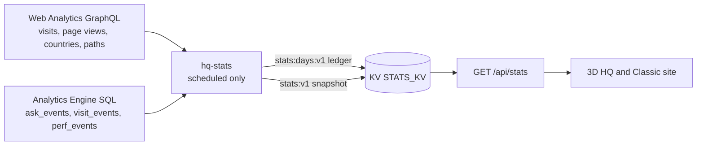

# hq-stats: public visit stats Cron Worker

Daily job (`0 1 * * *`, UTC) behind the public visit stats (Layer 1). It reads two sources with one
read-only Account Analytics token, keeps one rollup per finalized UTC day, and writes the public
snapshot that `GET /api/stats` (Pages Function, `functions/api/stats.ts`) serves.

- Contract: `StatsSnapshotV1` in `src/lib/stats/protocol.ts` (validated before every write and again
  in the Function).
- Sources: `src/sources.ts`. Web Analytics `rumPageloadEventsAdaptiveGroups` filtered by siteTag,
  `bot: 0` and the production hosts (`WA_HOSTS`; local `127.0.0.1` traffic shares the siteTag), grouped
  by `date`. Analytics Engine `ask_events` (blob8 topic, blob9 chip, Turnstile rejects excluded),
  `visit_events` (blob2 mode) and `perf_events` (the RUM beacon: blob4 median FPS bucket, blob6
  explore time bucket, `blob1 = '1'`), counted with `SUM(_sample_interval)`. Bucket strings outside the
  RUM contract (`src/lib/rum/protocol.ts`) are ignored.
- Math: `src/rollup.ts` (pure, `tests/stats/rollup.test.ts`). Floors come from Web Analytics paths via
  `floorOfPath` (the site's own route parser). Countries are ISO alpha-2 only (no `XX`, no `T1`),
  without counts. A day whose beacon points exceed `max(30, 3 x page views)` keeps a zero 3D vs Classic
  split (`frozen`). The optional snapshot `perf` block (sampled 3D sessions, sessions with a median FPS
  bucket, sessions at "55+", median explore bucket) sums each day's `perf` over the period; the median
  is weighted (the first bucket where the running count reaches half the total).
- Run: `src/run.ts`. The first run backfills 183 days (Web Analytics keeps 184, Analytics Engine 3
  months) and starts the ledger at the first day with data, which becomes `since`. Every later run
  appends only the days after the ledger's last day, so a finalized day is never recomputed; a failed
  run writes nothing and the next one catches up. Stored days without `perf` (rolled up before it
  existed) that are inside the Analytics Engine retention (90 days) get `perf` filled once from one
  extra `perf_events` query; nothing else of those days changes, and older days stay without it (no
  data). At most 3 GraphQL requests, 4 SQL queries (asks, visits, perf, and one perf backfill), 2 KV
  reads and 2 KV writes per run.

## Configuration

| Name | Kind | Value |
|---|---|---|
| `STATS_KV` | KV binding | namespace `STATS_KV` (same id as the Pages binding) |
| `WA_SITE_TAG` | var | Web Analytics siteTag of kurniadi.pages.dev |
| `WA_HOSTS` | var | `kurniadi.pages.dev,kurniadi.dev` |
| `WA_TOKEN` | secret | read-only Account Analytics token (GitHub environment secret `CF_STATS_TOKEN`, analytics only, 90 days; `CF_EVAL_TOKEN` until it exists) |
| `WA_ACCOUNT_ID` | secret | Cloudflare account id (GitHub secret `CLOUDFLARE_ACCOUNT_ID`) |

`deploy.yml` (job "hq-stats Worker") first proves the token can read Web Analytics and query Analytics
Engine (`bun scripts/stats-token-check.ts analytics`, fails loudly otherwise), then deploys this folder with
`cloudflare/wrangler-action` and sets both secrets. The deploy token (`CLOUDFLARE_API_TOKEN`) needs
Workers Scripts Edit on the account.

## Operations

- Dry run against production data (in-memory KV, prints the snapshot, writes nothing):
  `WA_TOKEN="$(bunx wrangler auth token)" WA_ACCOUNT_ID=<account id> bun scripts/stats-dry-run.ts`.
  The token stays in the environment; the script never prints it.
- Manual deploy (fallback when the CI deploy token lacks Workers permissions): from this folder,
  `bunx wrangler deploy`, then `bunx wrangler secret put WA_TOKEN` and
  `bunx wrangler secret put WA_ACCOUNT_ID` (each reads the value from a hidden prompt).
- Redeploy after a code change (for example the `perf` block): from this folder, `bunx wrangler deploy`.
  The `perf` block needs no new secret or binding: `perf_events` is read over the same Analytics Engine
  SQL API with the existing `WA_TOKEN`, and `scripts/stats-token-check.ts` already checks that it can
  query Analytics Engine. The first run after the deploy fills `perf` for the stored days of the last
  90 days.
- Kill switch: `STATS_ENABLED` in the root `wrangler.toml` (anything but `"true"` makes `/api/stats`
  answer 204 and `/api/visit` drop points). The Worker can keep running; it only writes KV.
- Reset (never needed in normal operation): deleting `stats:days:v1` makes the next run backfill again
  from the sources, which by then only keep the last 6 months (Web Analytics) and 3 months (Analytics
  Engine), so older history would be lost.
- Logs: Workers Logs (observability on) show one line per run with dates and counts only.
