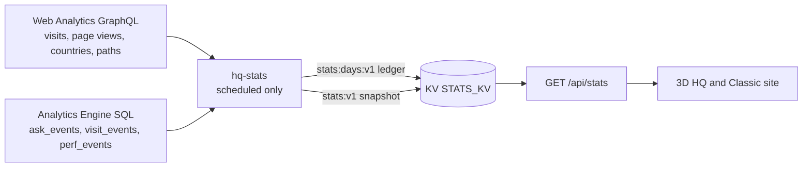

# hq-stats: public visit stats Cron Worker

Job every 4 hours (`0 */4 * * *`, UTC: 00, 04, 08, 12, 16 and 20 o'clock) behind the public visit stats
(Layer 1). It reads two sources with one read-only Account Analytics token, keeps one rollup per
finalized UTC day, and writes the public snapshot (days so far, today included) that `GET /api/stats`
(Pages Function, `functions/api/stats.ts`) serves.

- Contract: `StatsSnapshotV1` in `src/lib/stats/protocol.ts` (validated before every write and again
  in the Function).
- Sources: `src/sources.ts`. Web Analytics `rumPageloadEventsAdaptiveGroups` filtered by siteTag,
  `bot: 0` and the production hosts (`WA_HOSTS`; local `127.0.0.1` traffic shares the siteTag), grouped
  by `date`, each group with `avg { sampleInterval }`. Analytics Engine `ask_events` (blob8 topic, blob9 chip, Turnstile rejects excluded),
  `visit_events` (blob2 mode) and `perf_events` (the RUM beacon: blob4 median FPS bucket, blob6
  explore time bucket, `blob1 = '1'`), counted with `SUM(_sample_interval)`. Bucket strings outside the
  RUM contract (`src/lib/rum/protocol.ts`) are ignored.
- Math: `src/rollup.ts` (pure, `tests/stats/rollup.test.ts`). Floors come from Web Analytics paths via
  `floorOfPath` (the site's own route parser). Countries are ISO alpha-2 only (no `XX`, no `T1`),
  without counts. A day whose beacon points exceed `max(30, 3 x page views)` keeps a zero 3D vs Classic
  split (`frozen`); a day whose RUM sessions exceed the same `max(30, 3 x page views)` keeps a zero
  `perf` (`PERF_FREEZE`, `frozen`), so forged beacons cannot set the public numbers (security S7). The optional snapshot `perf` block (sampled 3D sessions, sessions with a median FPS
  bucket, sessions at "55+", median explore bucket) sums each day's `perf` over the period; the median
  is weighted (the first bucket where the running count reaches half the total).
- Run: `src/run.ts`. The first run backfills 183 days (Web Analytics keeps 184, Analytics Engine 3
  months) and starts the ledger at the first day with data, which becomes `since`. An empty ledger
  fetches the whole backfill window again on every run until the first day finalizes (bootstrap only).
- Finalized and provisional days: a UTC day is finalized (`finalizedThrough(now)`) once it ended at least
  `SETTLE_MS` (1 hour) ago, so late events land first. Finalized days are appended to the ledger once and
  never recomputed, so a finalized day is stored only from an exact Web Analytics answer (`waExact` in
  `src/rollup.ts`): every row unsampled (average `sampleInterval` 1) and the totals, countries and paths
  groups adding up to the same page views. Otherwise the day (and every later day, the ledger stays
  contiguous) stays provisional and is fetched again on the next runs; after `EXACT_GRACE_DAYS` (3) it
  is stored anyway and the run log says so. Why: on 2026-10-16 the 04:00 run got a coarse answer (700
  page views, 0 visits, 1000 per floor) for a day that had 333 page views and 36 visits, and kept it. Every run also rolls up the days after that from the same queries: yesterday during
  the 00:00 run (it is not settled yet) and today so far. These provisional days enter the public
  snapshot but are never stored; the next run recomputes them. `d30` is the 30 days ending today (today
  partial) and `updatedAt` is the run time. A failed run writes nothing, so the last good snapshot stays,
  and the next one catches up every missed day.
- Perf backfill: stored days without `perf` (rolled up before it existed) that are inside the Analytics
  Engine retention (90 days) get `perf` filled once from one extra `perf_events` query; nothing else of
  those days changes, and older days stay without it (no data).
- Run budget (routine run): 1 Web Analytics GraphQL request, 3 Analytics Engine SQL queries (asks,
  visits, perf; plus one perf backfill query at most), 2 KV reads (ledger and extra rows), and the snapshot write every run. The
  ledger is written only when a day finalizes or perf is filled, so at most 2 KV writes per run and 12
  a day.

Limits checked 2026-10-16:

| Limit | Value | This Worker |
|---|---|---|
| GraphQL Analytics API | 300 queries per 5 minutes per user | 1 per run, 6 a day |
| Cron Triggers | several schedules per Worker | 1 schedule |
| Workers KV (free plan) | 1,000 writes a day | at most 12 a day (the quota is per account, so it is shared with the Ask Function, see `docs/ask-runbook.md`) |
| Analytics Engine SQL API | 10,000 read queries a day on the Workers Free plan (not billed today) | 3 queries per routine run (4 with a perf backfill), 18 to 24 a day |

## Configuration

| Name | Kind | Value |
|---|---|---|
| `STATS_KV` | KV binding | namespace `STATS_KV` (same id as the Pages binding) |
| `WA_SITE_TAG` | var | Web Analytics siteTag of kurniadi.pages.dev |
| `WA_HOSTS` | var | `kurniadi.pages.dev,kurniadi.dev` |
| `WA_TOKEN` | secret | read-only Account Analytics token (GitHub environment secret `CF_STATS_TOKEN`, analytics only, 90 days; `CF_EVAL_TOKEN` until it exists) |
| `WA_ACCOUNT_ID` | secret | Cloudflare account id (GitHub secret `CLOUDFLARE_ACCOUNT_ID`) |

`deploy.yml` (job "hq-stats Worker") first proves the token can read Web Analytics and query Analytics
Engine (`bun scripts/stats-token-check.ts analytics`, fails loudly otherwise), then deploys this folder with
`cloudflare/wrangler-action` and sets both secrets. The deploy token (`CLOUDFLARE_API_TOKEN`) needs
Workers Scripts Edit on the account.

## Operations

- Dry run against production data (in-memory KV, prints the snapshot, writes nothing):
  `WA_TOKEN="$(bunx wrangler auth token)" WA_ACCOUNT_ID=<account id> bun scripts/stats-dry-run.ts`.
  The token stays in the environment; the script never prints it.
- Manual deploy (what runs today: `STATS_WORKER_DEPLOY=false` because the CI deploy token lacks Workers
  permissions; use the owner's wrangler login): from this folder, `bunx wrangler deploy` (this also
  registers the cron schedule from `wrangler.toml`), then check `bunx wrangler deployments list`; after the next 4-hour slot,
  `curl -s https://kurniadi.pages.dev/api/stats | jq .updatedAt` shows that slot's time. Set the
  secrets only on a first deploy or after a rotation: `bunx wrangler secret put WA_TOKEN` and
  `bunx wrangler secret put WA_ACCOUNT_ID` (each reads the value from a hidden prompt).
- Rollout order for the 4-hour cadence: the uptime check allows a snapshot at most 12 h old, but the
  previous daily Worker keeps running until it is redeployed, so merging first would fail the hourly check
  from about 12:17 UTC on merge day. Deploy this Worker first (`bunx wrangler deploy`; safe because the
  current site accepts the new snapshot, whose shape is unchanged), confirm a fresh `updatedAt` on
  `/api/stats` (after the next 4-hour slot), then merge and deploy the site.
- Redeploy after a code change (for example the `perf` block): from this folder, `bunx wrangler deploy`.
  The `perf` block needs no new secret or binding: `perf_events` is read over the same Analytics Engine
  SQL API with the existing `WA_TOKEN`, and `scripts/stats-token-check.ts` already checks that it can
  query Analytics Engine. The first run after the deploy fills `perf` for the stored days of the last
  90 days.
- Kill switch: `STATS_ENABLED` in the root `wrangler.toml` (anything but `"true"` makes `/api/stats`
  answer 204 and `/api/visit` drop points). The Worker can keep running; it only writes KV.
- Reset (never needed in normal operation): deleting `stats:days:v1` makes the next run backfill again
  from the sources, which by then only keep the last 6 months (Web Analytics) and 3 months (Analytics
  Engine), so older history would be lost.
- Logs: Workers Logs (observability on) show one line per run with dates and counts only (and the days
  held back or stored after the grace period).
- One beacon only: Pages Web Analytics (project Metrics tab) and zone automatic setups must stay off.
  Cloudflare injects its own beacon tag into every HTML page, only one beacon per page reports, and the
  injected one wins: from 2026-10-15 19:35 UTC to 2026-10-16 about 12:00 UTC every page load went to a
  second site (`ee28fc...`), so `WA_SITE_TAG` saw none, and that beacon ignored "Don't count my visits".
  `scripts/deploy-smoke.ts` and the hourly uptime check fail on an injected beacon
  (`scripts/injected-analytics.ts`). To turn it off: Workers & Pages > kurniadi > Metrics > Web
  Analytics > Disable, or `PATCH /accounts/<id>/pages/projects/kurniadi` with
  `{"build_config":{"web_analytics_tag":null,"web_analytics_token":null}}`; either way the injection
  stops with the next deployment.
- Repair a bad finalized day: save the ledger (`bunx wrangler kv key get stats:days:v1 --namespace-id
  <id> --remote`), put it back without that day and every later day, and the next run rolls them up
  again from the sources (Web Analytics 184 days, Analytics Engine 90). Preview first with a copy of the
  repaired ledger in an in-memory KV (like `scripts/stats-dry-run.ts`).
- Extra rows (`stats:wa-extra:v1`, `WaExtra` in `src/types.ts`): Web Analytics rows of a retired site,
  added to the fetched rows of the days they cover while those days are rolled up (never again once
  stored). Used once: the rows of the Pages-injected site for 2026-10-15 and 2026-10-16 (its page loads
  are not in `WA_SITE_TAG`; both sites saw disjoint page loads, so nothing is counted twice; they include
  visitors who had opted out, because that beacon ignored the switch). A malformed value stops the run
  before anything is written.
