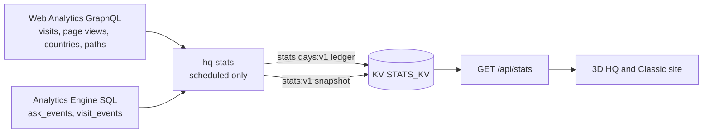

# hq-stats: public visit stats Cron Worker

Daily job (`0 1 * * *`, UTC) behind the public visit stats (Layer 1). It reads two sources with one
read-only Account Analytics token, keeps one rollup per finalized UTC day, and writes the public
snapshot that `GET /api/stats` (Pages Function, `functions/api/stats.ts`) serves.

- Contract: `StatsSnapshotV1` in `src/lib/stats/protocol.ts` (validated before every write and again
  in the Function).
- Sources: `src/sources.ts`. Web Analytics `rumPageloadEventsAdaptiveGroups` filtered by siteTag,
  `bot: 0` and the production hosts (`WA_HOSTS`; local `127.0.0.1` traffic shares the siteTag), grouped
  by `date`. Analytics Engine `ask_events` (blob8 topic, blob9 chip, Turnstile rejects excluded) and
  `visit_events` (blob2 mode), counted with `SUM(_sample_interval)`.
- Math: `src/rollup.ts` (pure, `tests/stats/rollup.test.ts`). Floors come from Web Analytics paths via
  `floorOfPath` (the site's own route parser). Countries are ISO alpha-2 only (no `XX`, no `T1`),
  without counts. A day whose beacon points exceed `max(30, 3 x page views)` keeps a zero 3D vs Classic
  split (`frozen`).
- Run: `src/run.ts`. The first run backfills 183 days (Web Analytics keeps 184, Analytics Engine 3
  months) and starts the ledger at the first day with data, which becomes `since`. Every later run
  appends only the days after the ledger's last day, so a finalized day is never recomputed; a failed
  run writes nothing and the next one catches up. At most 3 GraphQL requests, 2 SQL queries, 2 KV
  reads and 2 KV writes per run.

## Configuration

| Name | Kind | Value |
|---|---|---|
| `STATS_KV` | KV binding | namespace `STATS_KV` (same id as the Pages binding) |
| `WA_SITE_TAG` | var | Web Analytics siteTag of kurniadi.pages.dev |
| `WA_HOSTS` | var | `kurniadi.pages.dev,kurniadi.dev` |
| `WA_TOKEN` | secret | read-only Account Analytics token (GitHub secret `CF_EVAL_TOKEN`) |
| `WA_ACCOUNT_ID` | secret | Cloudflare account id (GitHub secret `CLOUDFLARE_ACCOUNT_ID`) |

`deploy.yml` (job "hq-stats Worker") first proves the token can read Web Analytics
(`bun scripts/stats-token-check.ts analytics`, fails loudly otherwise), then deploys this folder with
`cloudflare/wrangler-action` and sets both secrets. The deploy token (`CLOUDFLARE_API_TOKEN`) needs
Workers Scripts Edit on the account.

## Operations

- Dry run against production data (in-memory KV, prints the snapshot, writes nothing):
  `WA_TOKEN="$(bunx wrangler@4 auth token)" WA_ACCOUNT_ID=<account id> bun scripts/stats-dry-run.ts`.
  The token stays in the environment; the script never prints it.
- Manual deploy (fallback when the CI deploy token lacks Workers permissions): from this folder,
  `bunx wrangler@4 deploy`, then `bunx wrangler@4 secret put WA_TOKEN` and
  `bunx wrangler@4 secret put WA_ACCOUNT_ID` (each reads the value from a hidden prompt).
- Kill switch: `STATS_ENABLED` in the root `wrangler.toml` (anything but `"true"` makes `/api/stats`
  answer 204 and `/api/visit` drop points). The Worker can keep running; it only writes KV.
- Reset (never needed in normal operation): deleting `stats:days:v1` makes the next run backfill again
  from the sources, which by then only keep the last 6 months (Web Analytics) and 3 months (Analytics
  Engine), so older history would be lost.
- Logs: Workers Logs (observability on) show one line per run with dates and counts only.
